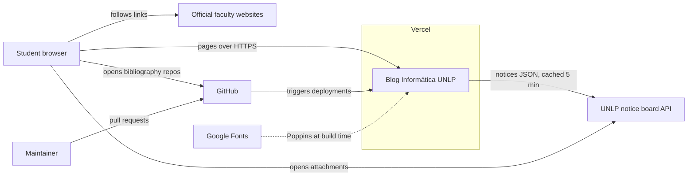
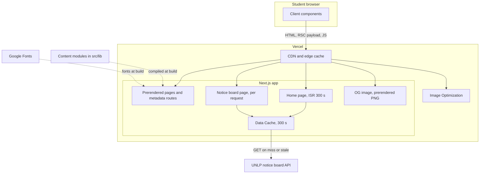

# Architecture

How Blog Informática UNLP is built, rendered and delivered. For the product
view (audience, environments, timeline), read the [overview](../overview.md)
first.

## At a glance

- One Next.js 16 App Router application on Vercel. There is no database, no
  custom API and no middleware.
- Content is TypeScript code in [`src/lib`](../../src/lib/), compiled into
  the build.
- The only runtime data source is the official UNLP notice board API, read
  on the server and cached for 5 minutes.
- Almost every route is prerendered at build time. The home page regenerates
  every 5 minutes and the notice board renders on each request.

## Principles

| Principle | How the code applies it | Where it falls short today |
| --- | --- | --- |
| Server Components by default | Pages, layouts, the header and the notice board pagination are Server Components. They read content modules and fetch notices on the server. | The shell wraps every page in client-only providers, so the server HTML carries no page content. See [Rendering and caching](rendering-and-caching.md#how-html-reaches-the-browser). |
| Client components only for interactivity | 26 client components are in use, each for state, browser APIs, gestures or animation. See [Client components](routing-and-layouts.md#client-components). | The animation wrappers make most sections client components, and 16 client components are unused. |
| Content as code | Plans, subject slugs, notes, the calendar and site settings are typed modules. Changes ship through pull requests and a new deployment. | Some content is page-local, and the navigation list is repeated in several files. See [Content and data](content-and-data.md#where-content-lives). |
| Validation with zod at boundaries | [`src/env.ts`](../../src/env.ts) validates server environment variables at build time. | The notice board response is cast to a TypeScript type, not parsed. Only the HTML bodies are sanitized. See [Data validation](content-and-data.md#data-validation). |
| ISR for external data | The notice fetch uses `next.revalidate = 300` and the home page regenerates on the same window. | `/cartelera` reads `searchParams`, so the page renders per request and only its fetch is cached. |

## System context

The diagram shows who uses the site and which external systems it touches at
runtime and at build time.

| System | Host | Interaction | When |
| --- | --- | --- | --- |
| UNLP notice board API | `gestiondocente.info.unlp.edu.ar` | The server requests `GET /cartelera/data/0/500` and receives JSON. Browsers open attachment links on the same host. | Runtime, at most about once per 5 minutes while the site has traffic |
| Official faculty websites | `www.info.unlp.edu.ar` and the faculty platforms | Outbound links only: study plans, yearly lists of optional subjects, the official calendar, course platforms and student services | Browser navigation |
| GitHub | `github.com` | Outbound links to the two bibliography repositories and to the project repository. It also hosts the source and triggers Vercel deployments. | Browser navigation, every push |
| Google Fonts | `fonts.googleapis.com` | `next/font/google` downloads Poppins during the build and serves it from the site. Browsers never call Google. | Build time |

## Containers

The diagram shows the deployable parts inside Vercel and how a request flows
to the external API.

| Container | Technology | Responsibility |
| --- | --- | --- |
| CDN and edge cache | Vercel | Serves prerendered HTML, RSC payloads and static assets, and holds the ISR copy of `/` |
| Prerendered pages and metadata routes | Next.js static generation | `/carreras`, `/carreras/[carrera]` (4 paths), `/materia/[slug]` (25 paths), `/calendario`, `/bibliografia`, `/links`, `/sobre-mi`, the sitemap, robots, manifest and icons |
| Home page | ISR | Regenerates in the background at most every 300 seconds, when requested |
| Notice board page | Vercel Function, Node.js runtime | Renders `/cartelera` on every request with the filters from the query string |
| OG image | `next/og` `ImageResponse`, Node.js runtime | One 1200x630 PNG generated at build time |
| Data Cache | Next.js fetch cache | Stores the notice board response for 300 seconds |
| Image Optimization | `next/image` | Resizes images from [`public/`](../../public/) (logo, about photos) and serves them as WebP |
| Client components | React 19 in the browser | Shell, filters, modals, calendar, graph and animations |
| Content modules | TypeScript | Plans, slugs, notes, calendar and site settings |

The app has no `route.ts` handlers and no middleware. The metadata files
([`sitemap.ts`](../../src/app/sitemap.ts),
[`robots.ts`](../../src/app/robots.ts),
[`manifest.ts`](../../src/app/manifest.ts),
[`opengraph-image.tsx`](../../src/app/opengraph-image.tsx) and the icon
images) compile to built-in route handlers, and all of them are prerendered.

## Documents

| Document | Covers |
| --- | --- |
| [Routing and layouts](routing-and-layouts.md) | Route tree, the `(public)` route group, the navigation shell and every client component |
| [Content and data](content-and-data.md) | Data modules and types, the subject slug system, editing content, environment variables and validation |
| [Rendering and caching](rendering-and-caching.md) | Rendering mode per route, the notice board pipeline, the Open Graph image and failure modes |
| [Deployment](deployment.md) | Environments, the delivery pipeline, Vercel settings, rollback and plan constraints |
