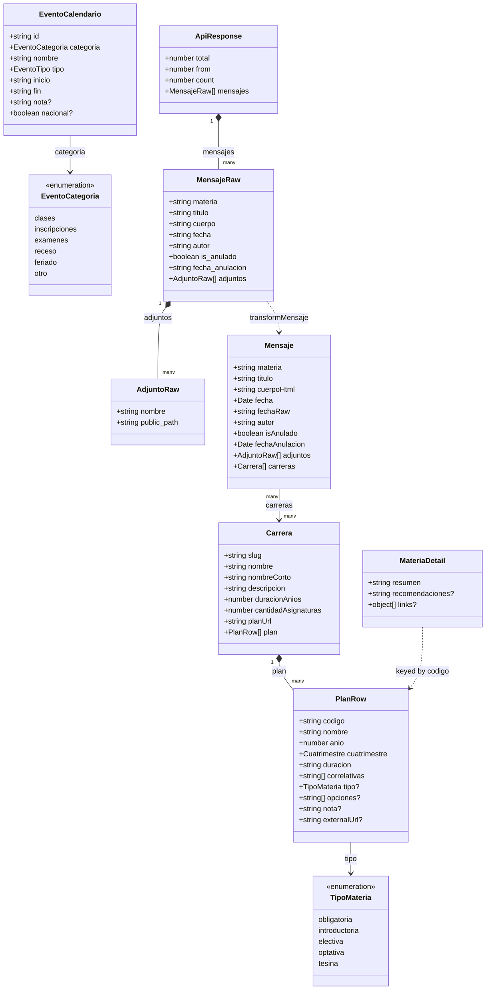
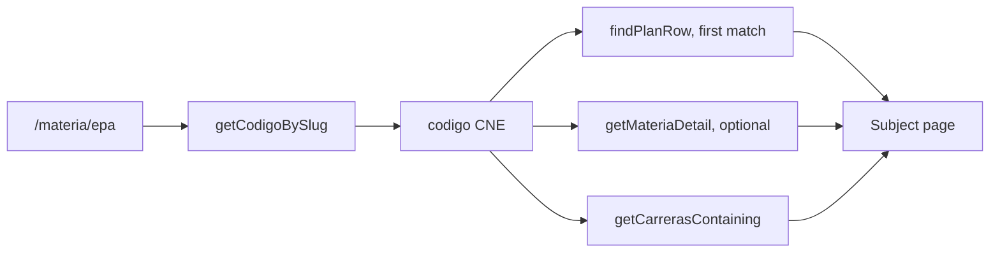

# Content and data

All content of Blog Informática UNLP is TypeScript code. There is no
database, CMS or admin panel: the build compiles the content modules into the
site, and the only runtime data is the official UNLP notice board.

## Where content lives

### Data modules

| Module | Contents | Used by |
| --- | --- | --- |
| [`carreras.ts`](../../src/lib/carreras.ts) | Study plan types, shared plan blocks, the four careers, `materiaSlugs` (25 entries), `materiaDetails` (3 entries) and lookup helpers | Career and subject pages, home, sitemap, breadcrumbs, prerequisites graph, notice board career mapping |
| [`calendario.ts`](../../src/lib/calendario.ts) | 73 events of the 2026 academic year, date helpers, category order, labels and Tailwind styles, Spanish date formatting | [`CalendarioView`](../../src/components/calendario/CalendarioView.tsx) |
| [`cartelera.ts`](../../src/lib/cartelera.ts) | Notice board API types, `fetchCartelera()`, HTML sanitizing, date parsing and formatting, `mensajeId()`, subject to career mapping, filters | Home, `/cartelera` and the notice components |
| [`site.ts`](../../src/lib/site.ts) | `SITE` settings (name, description, URL, locale, author, publisher, keywords), `absoluteUrl()` and `pageMetadata()` | Root layout, page metadata, sitemap, robots, Open Graph image |
| [`utils.ts`](../../src/lib/utils.ts) | `cn()` to merge class names. `base64FromFile()`, `formatErrorMessage()` and `HttpError` are unused. | Most components |
| [`env.ts`](../../src/env.ts) | Environment schema and the unused helpers `isProduction()` and `isDevelopment()` | Only [`next.config.ts`](../../next.config.ts), for build-time validation |

### Page-local content

| Content | Where |
| --- | --- |
| Bibliography repositories (APU and LS) | `repos` in [`bibliografia/page.tsx`](../../src/app/(public)/bibliografia/page.tsx) |
| Link directory, 7 groups and 20 links | `groups` in [`links/page.tsx`](../../src/app/(public)/links/page.tsx) |
| About bio, photo wall and social profiles | [`sobre-mi/page.tsx`](../../src/app/(public)/sobre-mi/page.tsx), photos in [`public/sobre-mi`](../../public/sobre-mi/) |
| Home section grid | `navItems` in [`(public)/page.tsx`](../../src/app/(public)/page.tsx) |
| Sidebar and drawer navigation | [`DesktopSidebar.tsx`](../../src/components/DesktopSidebar.tsx) and [`MobileSidebarTrigger.tsx`](../../src/components/MobileSidebarTrigger.tsx), one copy each |
| Breadcrumb labels | `segmentLabels` in [`Breadcrumb.tsx`](../../src/components/Breadcrumb.tsx) |
| Sitemap sections | `STATIC_PATHS` in [`sitemap.ts`](../../src/app/sitemap.ts) |
| Open Graph image text | [`opengraph-image.tsx`](../../src/app/opengraph-image.tsx) |
| Web app manifest | [`manifest.ts`](../../src/app/manifest.ts) |

## Main types

The diagram shows the content types and the notice board types, and how they
relate.



`Cuatrimestre` is `1`, `2` or `"intro"`. `EventoTipo` is `"fecha"` (a single
day) or `"rango"` (a range). `MateriaDetail.links` items are
`{ label, href }`. `fecha_anulacion` and `fechaAnulacion` are nullable.

## Study plans

[`carreras.ts`](../../src/lib/carreras.ts) models the 2021 plans. The first
two years are identical in the four careers, so the module defines them once
(`INTRODUCTORIAS`, `ANIO_1_CUAT_1`, `ANIO_1_CUAT_2`, `ANIO_2_CUAT_1`,
`ANIO_2_CUAT_2`, together `PLAN_BASE` with 17 rows) and appends per-career
blocks such as `APU_ANIO_3` or `LS_ANIO_4`.

| Career | `slug` | Plan rows | `cantidadAsignaturas` | Prerequisite links |
| --- | --- | --- | --- | --- |
| APU | `apu` | 27 | 24 | 46 |
| ATIC | `atic` | 24 | 24 | 30 |
| LS | `ls` | 37 | 37 | 52 |
| LI | `li` | 37 | 37 | 52 |

The four plans hold 125 rows and 52 distinct subject codes. APU lists its
alternative electives as separate rows, so it has more rows than subjects.
`cantidadAsignaturas` is typed by hand, not computed.

| Field | Meaning |
| --- | --- |
| `codigo` | Institutional code and global id, for example `SI106`. Options and theses use synthetic codes such as `OPT-LS-1`, `OI503-LS` or `PPS-ATIC`. |
| `anio`, `cuatrimestre` | Year 1 to 5 and term `1`, `2` or `"intro"`. The career page groups `"intro"` rows under "Curso de ingreso" (Entry course). |
| `correlativas` | Codes of the prerequisite rows |
| `tipo` | Absent means mandatory. The career page shows a badge for `electiva`, `optativa` and `tesina`. |
| `opciones` | Choices inside one subject, such as the languages of Seminario de Lenguajes |
| `nota` | Footnote under the row |
| `externalUrl` | Replaces the internal link. The LS and LI optional subjects link to the faculty's yearly list. |

A code shared by several careers has the same name, duration and
prerequisites in every plan.

## Subject slug system

`materiaSlugs` maps an institutional code to the slug of its page, for example
`CNE` to `epa`, so `/materia/epa` is the page for "Expresión de Problemas y
Algoritmos".

The diagram shows how the subject page resolves a URL.



- A subject has a page only if its code has a slug. 25 codes have one; the
  other 27 (most third to fifth year subjects of ATIC, LS and LI, plus `SI304`
  and `SO410`) have none.
- On the career page a row links to `externalUrl` if present, otherwise to
  `/materia/<slug>` if the code has a slug, otherwise it is plain text. The
  prerequisites graph uses the same slug check for clickable nodes.
- `getAllMateriaSlugs()` feeds `generateStaticParams` and the sitemap, so a new
  slug gets a prerendered page and a sitemap entry on the next build.
- `findPlanRow()` returns the first row with that code, scanning the careers in
  order (APU, ATIC, LS, LI).
- `materiaDetails` holds the editorial notes: a required `resumen` (summary),
  optional `recomendaciones` (recommendations) and `links`. Only `SI101`,
  `SI106` and `SI107` have notes. Pages without notes show "Notas en
  preparación" (Notes in progress).
- Slugs are lowercase and the lookup is exact. The breadcrumb shows them in
  uppercase.

## Notice board data

[`cartelera.ts`](../../src/lib/cartelera.ts) reads the public API at
`https://gestiondocente.info.unlp.edu.ar/cartelera/data/{from}/{count}` with
`from = 0` and `count = 500`, without authentication. On 2026-11-26 the API
reported 2,570 notices in total, and the latest 500 spanned about 13 months
and about 0.7 MB of JSON.

`transformMensaje()` turns each `MensajeRaw` into a `Mensaje`:

| Step | Behavior |
| --- | --- |
| Sanitize the body | `sanitize-html` with an allowlist of text, list, heading, table, link and image tags. Links keep `href`, `name`, `target` and `rel`; images keep `src`, `alt`, `width` and `height`. Any tag may keep a `style` limited to color, background color, font size, font weight, text decoration and alignment. Schemes are `http`, `https` and `mailto` (images also `data`). Every link gets `target="_blank"` and `rel="noopener noreferrer"`. |
| Parse dates | `"DD/MM/YYYY HH:mm"` becomes `new Date(y, m - 1, d, hh, mm)` in the server's time zone |
| Map careers | `carrerasDeMateria()` matches the notice subject name exactly against plan row names. Subjects outside the plans get no careers. |
| Keep the rest | Title, author, attachments and the canceled flag pass through unchanged |

`mensajeId()` builds the deep-link id from the date (`toISOString()`, first 16
characters) and up to 40 characters of a slug of the title, for example
`2026-05-07T07:41-cambio-de-fecha`.

`aplicarFiltros()` applies the query parameters of `/cartelera`:

| Parameter | Effect | Default |
| --- | --- | --- |
| `q` | Case-insensitive search over title, subject, author and body text | - |
| `materia` | Exact subject name | - |
| `carrera` | Career slug, matched through the career mapping | - |
| `rango` | Last `7`, `30` or `90` days, or `todo` (all) | `30` |
| `adjuntos=1` | Only notices with attachments | Off |
| `anulados=1` | Include canceled notices | Canceled hidden |
| `page` | Page number, 12 notices per page | `1` |
| `a` | Id of a notice to open in a modal, searched across all notices | - |

[`globals.css`](../../src/app/globals.css) styles the sanitized HTML under
`.cartelera-body`: it neutralizes inline font sizes and families, and in dark
mode it resets inline colors and backgrounds so dark text stays readable.

## Academic calendar data

[`calendario.ts`](../../src/lib/calendario.ts) exports `eventosCalendario`, 73
events from 2025-11-10 to 2027-02-26, taken from the official 2026 calendar.

| Category | Events |
| --- | --- |
| `inscripciones` (enrollment) | 19 |
| `feriado` (holiday) | 22 |
| `examenes` (exams) | 13 |
| `otro` (other) | 12 |
| `clases` (classes) | 6 |
| `receso` (break) | 1 |

Dates are `YYYY-MM-DD` strings that the browser parses in local time with
`parseLocalDate()`. Holidays with `nacional: true` get a red tint in the
month view; religious and community holidays do not. Ranges longer than 14 days, such as a
semester, are not drawn in day cells: they appear under "En curso ahora"
(Happening now). The view also lists the "Próximos 30 días" (Next 30 days).

## Site settings

[`site.ts`](../../src/lib/site.ts) exports `SITE` and two helpers:

- `SITE.url` resolves once per build or server start: `NEXT_PUBLIC_SITE_URL`
  without a trailing slash, else `https://${VERCEL_URL}`, else the hardcoded
  `https://blog-informatica.vercel.app`.
- `absoluteUrl(path)` prefixes `SITE.url`.
- `pageMetadata({ title, description, path })` returns the title, description,
  canonical URL, Open Graph and Twitter card fields of a page. It repeats the
  `/opengraph-image` reference because a page-level `openGraph` object
  replaces the root one instead of merging with it.

The root [`layout.tsx`](../../src/app/layout.tsx) renders the JSON-LD graph
(`WebSite`, `Person` and `EducationalOrganization`) from `SITE`.

## How to add or edit content

Content changes are code changes: edit the module, run the checks, open a
pull request into `dev`, and review the preview deployment. See
[Deployment](deployment.md) for the pipeline.

| To change | Edit |
| --- | --- |
| A subject in a plan | Its row in [`carreras.ts`](../../src/lib/carreras.ts). Shared first and second year rows live in the common blocks. Keep `codigo` values consistent across careers and update `cantidadAsignaturas` by hand. |
| Which subjects have a page | Add `CODIGO: "slug"` to `materiaSlugs`. The page, sitemap entry, breadcrumb label and graph link follow on the next build. |
| Notes for a subject | Add or edit the `materiaDetails` entry for its code |
| Calendar events | `eventosCalendario` in [`calendario.ts`](../../src/lib/calendario.ts). Each `id` must be unique; a `"fecha"` event has `inicio` equal to `fin`. |
| Bibliography repositories | `repos` in [`bibliografia/page.tsx`](../../src/app/(public)/bibliografia/page.tsx) |
| Link directory | `groups` in [`links/page.tsx`](../../src/app/(public)/links/page.tsx) |
| About page | [`sobre-mi/page.tsx`](../../src/app/(public)/sobre-mi/page.tsx) and the images in [`public/sobre-mi`](../../public/sobre-mi/) |
| Site name, description, author, keywords | `SITE` in [`site.ts`](../../src/lib/site.ts) |
| A new page | The page file plus the lists in [Navigation lists](routing-and-layouts.md#navigation-lists) |

Before opening the pull request, run:

```bash
pnpm lint
pnpm typecheck
pnpm build
```

Then add an entry under `[Unreleased]` in [`CHANGELOG.md`](../../CHANGELOG.md).

### Yearly update

Several values are tied to 2026 and need an update when the faculty publishes
the next year:

| Value | File |
| --- | --- |
| Calendar events | [`calendario.ts`](../../src/lib/calendario.ts) |
| Calendar page heading, description and official link | [`calendario/page.tsx`](../../src/app/(public)/calendario/page.tsx) |
| Official calendar link in the directory | [`links/page.tsx`](../../src/app/(public)/links/page.tsx) |
| Yearly lists of LS and LI optional subjects (`externalUrl`) | [`carreras.ts`](../../src/lib/carreras.ts) |

## Environment variables

[`src/env.ts`](../../src/env.ts) declares the server schema with
`@t3-oss/env-nextjs` and zod. [`next.config.ts`](../../next.config.ts)
imports it, so `next dev` and `next build` fail on a malformed value, but no
module reads the exported `env` object.

| Variable | Where it is read | Rule | Status |
| --- | --- | --- | --- |
| `NEXT_PUBLIC_SITE_URL` | [`site.ts`](../../src/lib/site.ts) through `process.env` | None, it is not in the schema | Used: canonical site URL |
| `VERCEL_URL` | [`site.ts`](../../src/lib/site.ts), fallback | Set by Vercel | Used when `NEXT_PUBLIC_SITE_URL` is unset |
| `NODE_ENV` | [`error.tsx`](../../src/app/error.tsx), [`global-error.tsx`](../../src/app/global-error.tsx) | Set by Next.js | Used: log errors to the console in development |
| `KV_URL` | Nowhere | Optional URL | Unused placeholder |
| `KV_REST_API_URL` | Nowhere | Optional URL | Unused placeholder |
| `KV_REST_API_TOKEN` | Nowhere | Optional, non-empty | Unused placeholder |
| `KV_REST_API_READ_ONLY_TOKEN` | Nowhere | Optional, non-empty | Unused placeholder |
| `ADMIN_PASSWORD` | Nowhere | Optional, at least 8 characters | Unused placeholder |
| `ADMIN_SESSION_SECRET` | Nowhere | Optional, at least 32 characters | Unused placeholder |

Values per environment are in
[Deployment](deployment.md#environment-variables-per-environment).

## Data validation

| Boundary | Validation today |
| --- | --- |
| Environment variables | zod schema at build and dev start. `NEXT_PUBLIC_SITE_URL` bypasses it. |
| Content modules | TypeScript types, checked by `pnpm typecheck` and `next build`. No code checks that `correlativas`, `materiaSlugs` and `materiaDetails` point to existing codes or that slugs are unique. All of them are consistent today. |
| Notice board response | `res.json()` is cast to `ApiResponse` with no runtime check. A changed shape throws during rendering (see [Failure modes](rendering-and-caching.md#failure-modes)). |
| Notice bodies | `sanitize-html` allowlist, as above |
| Attachment URLs | Rendered as link targets exactly as received |
| Notice dates | Not checked. A malformed date becomes an invalid `Date`, and `mensajeId()` then throws. |
