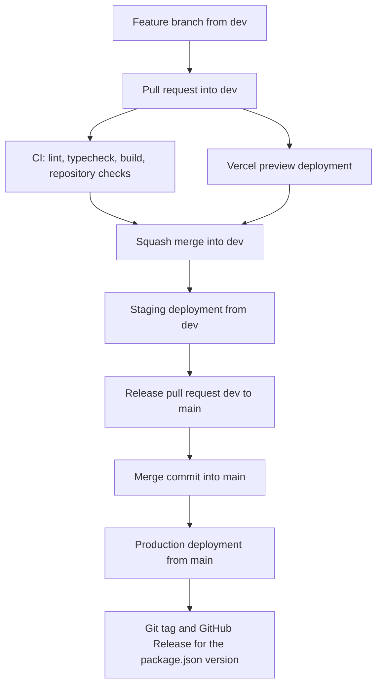

# Deployment

How changes travel from a branch to production on Vercel, which settings
matter, and how to roll back.

## Environments

| Environment | Git branch | URL | Deploys when | Purpose |
| --- | --- | --- | --- | --- |
| Production | `main` | <https://blog-informatica-mu.vercel.app> | A release pull request merges into `main` | The site readers use |
| Staging | `dev` | `<project>-git-dev-<scope>.vercel.app` | A pull request is squash-merged into `dev` | All merged work, before a release |
| Preview | Pull request branch | One deployment per pull request, linked from the pull request | Every push to the pull request | Review of a single change |

Vercel points the branch URL `<project>-git-<branch>-<scope>.vercel.app` at
the latest deployment of each branch. For `dev`, that URL is the stable
staging address.

## Delivery pipeline

The diagram shows the path of a change from a feature branch to a tagged
production release.



| Step | What happens |
| --- | --- |
| 1. Branch | Create a feature branch from `dev`. |
| 2. Pull request | Open a pull request into `dev`. Add an entry under `[Unreleased]` in [`CHANGELOG.md`](../../CHANGELOG.md) that ends with the pull request number and the author's GitHub handle. |
| 3. Checks | CI runs lint (`pnpm lint`, Biome), typecheck (`pnpm typecheck`), build (`pnpm build`) and the repository checks. In parallel, Vercel builds a preview deployment and links it from the pull request. |
| 4. Squash merge | The pull request lands on `dev` as one commit, and Vercel redeploys staging. |
| 5. Release preparation | A `release/vX.Y.Z` branch from `dev` bumps `version` in `package.json` and turns `[Unreleased]` into a section such as `## [0.2.0] - 2026-11-26`; its pull request (label `release`) is squash-merged into `dev`. Then a pull request from `dev` to `main` promotes it. |
| 6. Merge commit | The release pull request merges with a merge commit, so `main` holds the same commits as `dev` plus the merge, and the branches never diverge. |
| 7. Production | Vercel builds `main` and serves it at <https://blog-informatica-mu.vercel.app>. |
| 8. Tag and release | The Release workflow reads `version` from `package.json`. When that version has no tag yet, it creates the tag `vX.Y.Z` and a GitHub Release whose notes are that version's section of `CHANGELOG.md`. |

The same checks run locally:

```bash
pnpm install
pnpm lint
pnpm typecheck
pnpm build
```

Every build prerenders the home page, which calls the UNLP notice board API.
If the API cannot be reached at that moment, the build fails; an HTTP error
status only hides the latest notices on the home page. See
[Failure modes](rendering-and-caching.md#failure-modes).

## Vercel settings that matter

| Setting | Value | Why it matters |
| --- | --- | --- |
| Production branch | `main` | Only `main` reaches production. `dev` and pull request branches deploy as previews. |
| Framework preset | Next.js | Vercel serves the `next build` output with its CDN, ISR, functions and image optimization |
| Install and build commands | Defaults | Vercel detects pnpm from `pnpm-lock.yaml` and the `packageManager` field (`pnpm@10.28.0`), and the `build` script runs `next build` |
| Node.js version | Project setting | [`package.json`](../../package.json) has no `engines` field |
| Environment variables | `NEXT_PUBLIC_SITE_URL` per environment | See the next section |
| Deployment Protection | Project setting | Decides who can open preview and staging URLs |
| Plan | Hobby | See [Hobby plan and a public repository](#hobby-plan-and-a-public-repository) |

## Environment variables per environment

| Variable | Production | Staging (`dev`) | Preview |
| --- | --- | --- | --- |
| `NEXT_PUBLIC_SITE_URL` | `https://blog-informatica-mu.vercel.app` | The stable branch URL, optional | Unset |
| `KV_*`, `ADMIN_*` | Unset | Unset | Unset |

- [`site.ts`](../../src/lib/site.ts) resolves the site URL from
  `NEXT_PUBLIC_SITE_URL` (trailing slash removed), then
  `https://${VERCEL_URL}`, then the hardcoded
  `https://blog-informatica.vercel.app`.
- `VERCEL_URL` is the unique URL of each deployment, not the production
  domain. Without `NEXT_PUBLIC_SITE_URL` in Production, the canonical URLs,
  `og:url`, the sitemap, robots and the host printed on the Open Graph image
  all point at a deployment URL.
- The value is read when the build prerenders those outputs, so a change only
  takes effect after a redeploy.
- In Vercel, staging values belong to the Preview environment scoped to the
  `dev` branch.
- The `KV_*` and `ADMIN_*` variables are unused placeholders. Leave them
  unset: [`next.config.ts`](../../next.config.ts) validates them, so a
  malformed value fails the build. See
  [Environment variables](content-and-data.md#environment-variables).

## Rollback

| Option | When | How |
| --- | --- | --- |
| Instant Rollback | Production is broken and the previous production deployment was good | In the Vercel dashboard, roll production back to the previous production deployment. Nothing rebuilds. On Hobby, only the previous production deployment is eligible. While the rollback is active, new production deployments are not assigned to the domain until you undo the rollback or promote a deployment. |
| Revert pull request | The faulty change has to leave the code | Revert it on `dev` through a pull request and ship a release. If production cannot wait, open a revert pull request into `main` and then merge `main` back into `dev`. |

A rollback does not delete the git tag or the GitHub Release of the faulty
version; the next release supersedes them.

## Hobby plan and a public repository

The Vercel project runs on the Hobby plan, which has no team seats. On Hobby,
Vercel blocks deployments of commits by other authors when the repository is
private, so collaboration requires the GitHub repository to stay public. While
it is public, contributors' pull requests get preview deployments and their
merged work reaches staging and production.
