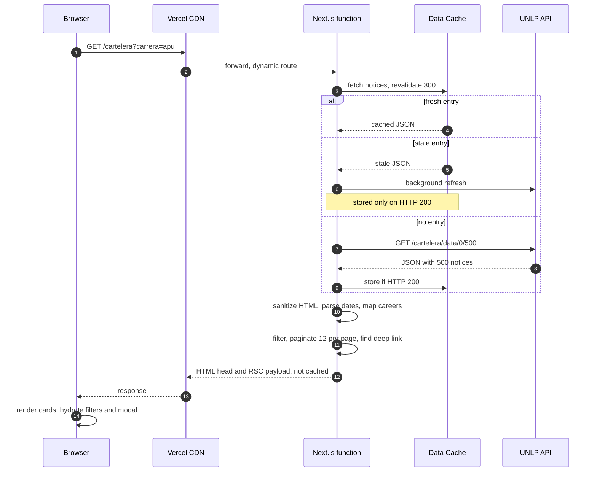
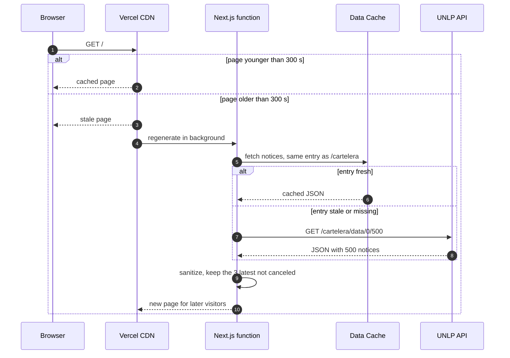

# Rendering and caching

How each route is rendered, how the notice board data flows from the UNLP API
to the browser, and what happens when that API misbehaves. The modes below
match the output of `next build`.

## Rendering strategy per route

| Route | Mode | Revalidation | Data | Notes |
| --- | --- | --- | --- | --- |
| `/` | ISR | 300 s | `carreras`, notices through the Data Cache | Relative times such as "hace 2 horas" (2 hours ago) are computed at render time |
| `/carreras` | Static | - | `carreras` | |
| `/carreras/[carrera]` | Static, 4 paths | - | `carreras` | Other values render on demand and return 404 |
| `/materia/[slug]` | Static, 25 paths | - | `carreras` | Other values render on demand and return 404 |
| `/cartelera` | Dynamic, per request | Page never cached, fetch cached 300 s | Notices through the Data Cache | Reading `searchParams` makes the page dynamic. Its `revalidate = 300` only sets the default for fetches. |
| `/calendario` | Static | - | `calendario`, bundled for the browser | "Today" is computed in the browser and refreshed every minute |
| `/bibliografia`, `/links` | Static | - | Page constants | |
| `/sobre-mi` | Static | - | Page constants and `public/sobre-mi` | Photo existence is checked with `node:fs` at build time |
| `/sitemap.xml`, `/robots.txt`, `/manifest.webmanifest`, `/icon.png`, `/apple-icon.png` | Static | - | `SITE`, `carreras` | `SITE.url` and the sitemap `lastModified` are fixed at build time |
| `/opengraph-image` | Static | - | `SITE` | See [Open Graph image](#open-graph-image) |
| 404 | Static | - | - | |

"Static" means prerendered at build time and served from the CDN until the
next deployment. Unknown values of the dynamic segments are not prerendered:
the page renders on request, calls `notFound()` and returns the 404 page.

## How HTML reaches the browser

Server Components render on the server into the RSC payload, and Next.js then
renders HTML from that payload. In this app the HTML render stops at the top
of the tree for every page:

1. The root [`layout.tsx`](../../src/app/layout.tsx) wraps all pages in
   `<Suspense fallback={null}>` around
   [`NavigationLoadingProvider`](../../src/components/NavigationLoadingProvider.tsx),
   which calls `useSearchParams()`. On a statically rendered route, that hook
   makes everything up to the nearest Suspense boundary render on the client.
2. The [`(public)` layout](../../src/app/(public)/layout.tsx) wraps the shell
   in
   [`ClientOnlyMobileSidebarProvider`](../../src/components/ClientOnlyMobileSidebarProvider.tsx),
   a `next/dynamic` component with `ssr: false`. It never renders on the
   server, so this also applies to the dynamic `/cartelera`.

In a production build, the HTML of every page holds the full `<head>` (title,
description, canonical URL, Open Graph tags, icons, preloaded fonts) and the
JSON-LD script, but its `<body>` contains only an empty, client-rendered
Suspense boundary. The page content travels in the RSC payload inlined in the
same response, so no extra request is needed, but it appears only after the
JavaScript loads and React renders it. Link previews still work because they
read the head; readers and crawlers without JavaScript get an empty body.

## Cache layers

| Layer | What it holds | Lifetime | Notes |
| --- | --- | --- | --- |
| Vercel CDN | Prerendered HTML and RSC payloads, the ISR copy of `/`, the Open Graph PNG, assets under `/_next/static` | Static output until the next deployment. `/` for 300 s, then served stale while it regenerates. | Hashed assets under `/_next/static` are immutable, including the self-hosted Poppins files |
| Data Cache | The raw response of `GET /cartelera/data/0/500` | 300 s. After that, request-time renders (`/cartelera`) get the stale copy while a background refresh runs; prerenders (the build and the regeneration of `/`) wait for fresh data instead. | Only HTTP 200 responses are stored. `/` and `/cartelera` share the entry because the URL and options match. |
| Image Optimization | WebP versions of `public/` images at the requested sizes | At least 4 hours (`minimumCacheTTL` 14400 s) | Covers the logo and the about photos |
| Client router cache | Prefetched segments of static pages | 300 s (`x-nextjs-stale-time`) | Next.js default |
| Browser storage | `theme` and `sidebar-collapsed` in `localStorage` | Until cleared | Preferences only |

The Data Cache stores the HTTP response, not the transformed notices. Parsing,
sanitizing and career mapping run again on every render that reads it.

## Notice board pipeline

[`fetchCartelera()`](../../src/lib/cartelera.ts) requests
`https://gestiondocente.info.unlp.edu.ar/cartelera/data/0/500` with
`next: { revalidate: 300 }` and `Accept: application/json`. The upstream
answers with `cache-control: no-cache, private`; Next.js caches it anyway
because the fetch sets an explicit revalidation.

The diagram shows a request to `/cartelera`, including the three Data Cache
cases.

The diagram shows how the home page keeps its "Últimos anuncios" (Latest
notices) list fresh with ISR.

Notes:

- `next build` prerenders `/`, so a build normally calls the API once.
- The regeneration of `/` never reuses a stale Data Cache entry: Next.js
  waits for fresh data so that it does not store stale notices in the page.
- [`AutoOpenAnuncioModal`](../../src/components/cartelera/AutoOpenAnuncioModal.tsx)
  opens the notice of `?a=` and removes the parameter with `router.replace`
  when the modal closes. [`CarteleraFilters`](../../src/components/cartelera/CarteleraFilters.tsx)
  writes filters to the query string, which triggers a new server render.
- Dates are parsed in the server's time zone. Vercel runs builds and
  functions in UTC while the source times are Argentina time (UTC-3), so each
  notice's instant ends up 3 hours early: relative times read 3 hours older
  and the cards show times 3 hours earlier than the official notice board.

## Open Graph image

[`opengraph-image.tsx`](../../src/app/opengraph-image.tsx) returns a
`next/og` `ImageResponse` on the default Node.js runtime, and Next.js
prerenders it at build time into a 1200x630 PNG. It shows the "BI" mark, the
site name, a one-line description, the main sections and the host of
`SITE.url`, which is fixed at build time.

- Every page points `og:image` and `twitter:image` at `/opengraph-image`,
  through the root metadata and `pageMetadata()`. There are no per-page
  images.
- The response carries `cache-control: public, max-age=0, must-revalidate`,
  the `next/og` default, so browsers revalidate it while the CDN serves the
  prerendered file.
- The markup asks for `Poppins` with weights up to 800, but `ImageResponse`
  only bundles Geist Regular and the file loads no other font. All text
  renders in Geist Regular.

## Failure modes

`fetchCartelera()` handles one failure: a non-2xx status, which it logs and
turns into an empty list. Everything else throws to the page. The `fetch` call
has no timeout and no `AbortSignal`.

| Failure | `/cartelera` | `/` | `next build` |
| --- | --- | --- | --- |
| API slow or hanging | With a cached entry, nothing changes: the refresh runs in the background. Without one, the request waits on the API, and since the code sets no time limit, only platform limits end the wait. | Visitors get the cached page while the regeneration waits. | Prerendering `/` waits. After 60 seconds Next.js retries, up to 3 attempts, and then the build fails. |
| API returns non-2xx | With a cached entry, stale notices keep showing. Without one, the list is empty and the page shows "Sin resultados" (No results), as if the filters matched nothing, and every request calls the API again. | Unless the Data Cache entry is still fresh, the regeneration gets an empty list: the "Últimos anuncios" section disappears and that version stays cached for 300 s. | The build succeeds without the section. |
| Network error, invalid JSON or a changed response shape | With a cached entry, stale notices and a logged refresh error. Without one, the error reaches [`error.tsx`](../../src/app/error.tsx): "Algo salió mal" (Something went wrong) with "Reintentar" (Retry). | The regeneration fails and the last good page keeps being served. | The build fails and Vercel keeps the current deployment. |
| A notice with a malformed date | Parsing yields an invalid `Date`. Date formatting and `mensajeId()` are not guarded, so the render can fail and show the error page. | If the notice is among the 3 latest, `mensajeId()` throws, the regeneration fails and the last good page stays. | The build fails in the same case. |

The Data Cache entry is about 0.95 MB today (500 notices, about 0.7 MB of
JSON). The default Next.js cache handler refuses entries larger than 2 MB, so
a much larger response would reach the API on every request.

## Performance notes

- Every `/cartelera` request parses about 0.7 MB of JSON and sanitizes 500
  HTML bodies, because the page is dynamic and only the raw response is
  cached.
- [`CorrelativasGraphTrigger`](../../src/components/correlativas/CorrelativasGraphTrigger.tsx)
  imports the graph statically, so the @xyflow/react chunk (about 190 KB
  before compression) loads with every career page, although the graph only
  mounts when its dialog opens.
- [`Breadcrumb`](../../src/components/Breadcrumb.tsx) imports `carreras` for
  its labels, so the study plan data (a chunk of about 45 KB) ships to every
  page.
- `sanitize-html` stays on the server: client components import helpers from
  `cartelera.ts`, but the bundler drops the sanitizer from browser chunks.
- The about photos weigh about 10 MB in [`public/sobre-mi`](../../public/sobre-mi/);
  readers receive resized WebP versions through `next/image`.
