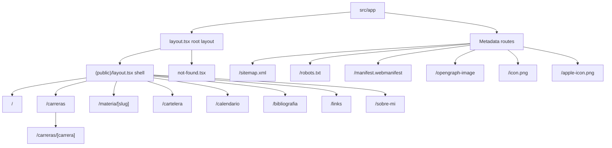
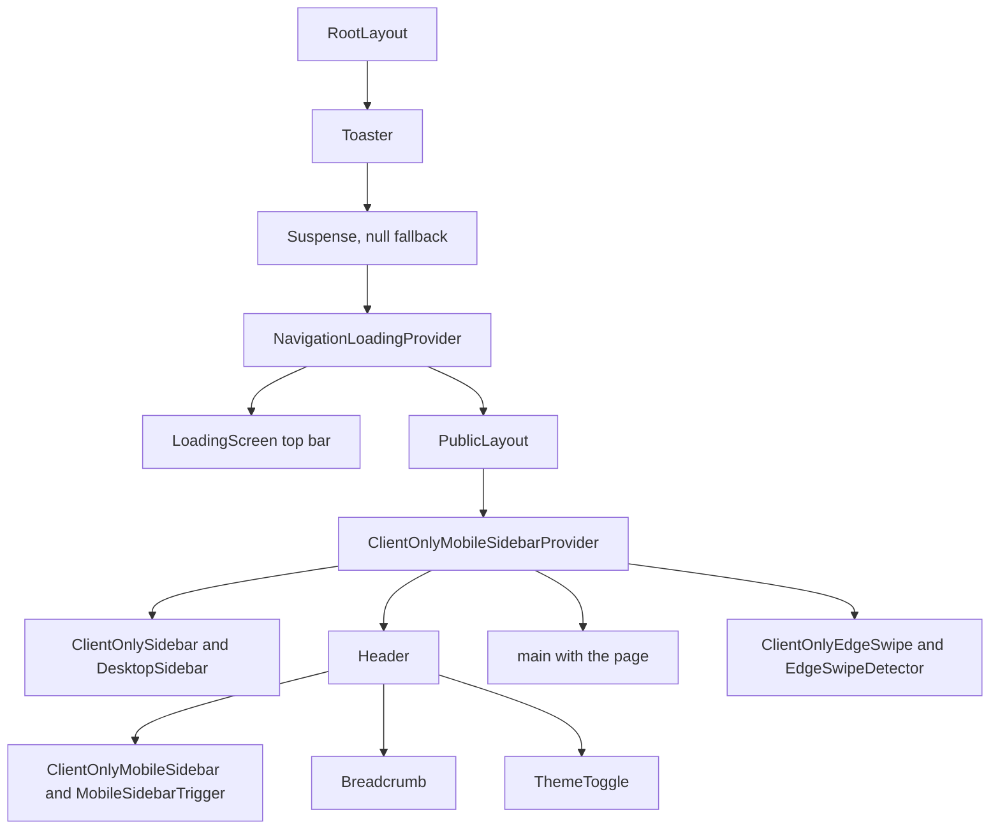

# Routing and layouts

How URLs map to files in [`src/app`](../../src/app/), how the `(public)`
route group builds the site shell, and which components run in the browser.

## Route tree

The diagram shows every route in `src/app`: the pages under the root and
`(public)` layouts, and the metadata routes, which do not use layouts.

### Pages

| URL | File | Parameters | Notes |
| --- | --- | --- | --- |
| `/` | [`(public)/page.tsx`](../../src/app/(public)/page.tsx) | - | Exports `revalidate = 300`, no own metadata |
| `/carreras` | [`(public)/carreras/page.tsx`](../../src/app/(public)/carreras/page.tsx) | - | |
| `/carreras/[carrera]` | [`(public)/carreras/[carrera]/page.tsx`](../../src/app/(public)/carreras/[carrera]/page.tsx) | `carrera`: `apu`, `atic`, `ls`, `li` from `generateStaticParams` | Unknown values call `notFound()` |
| `/materia/[slug]` | [`(public)/materia/[slug]/page.tsx`](../../src/app/(public)/materia/[slug]/page.tsx) | `slug`: the 25 values of `getAllMateriaSlugs()` | Unknown slugs call `notFound()`. Lookup is case-sensitive, so `/materia/EPA` is a 404. |
| `/cartelera` | [`(public)/cartelera/page.tsx`](../../src/app/(public)/cartelera/page.tsx) | Query: `q`, `materia`, `carrera`, `rango`, `adjuntos`, `anulados`, `page`, `a` | Exports `revalidate = 300` |
| `/calendario` | [`(public)/calendario/page.tsx`](../../src/app/(public)/calendario/page.tsx) | - | |
| `/bibliografia` | [`(public)/bibliografia/page.tsx`](../../src/app/(public)/bibliografia/page.tsx) | - | |
| `/links` | [`(public)/links/page.tsx`](../../src/app/(public)/links/page.tsx) | - | |
| `/sobre-mi` | [`(public)/sobre-mi/page.tsx`](../../src/app/(public)/sobre-mi/page.tsx) | - | Checks with `node:fs` at render time whether each photo exists in `public/` |

There is no `/materia` index page. Every page except the home builds its
metadata with `pageMetadata()` from [`site.ts`](../../src/lib/site.ts).

### Metadata routes

| URL | Source | Output |
| --- | --- | --- |
| `/sitemap.xml` | [`sitemap.ts`](../../src/app/sitemap.ts) | 36 URLs: 7 sections, 4 careers and 25 subjects, with `lastModified` set to the build time |
| `/robots.txt` | [`robots.ts`](../../src/app/robots.ts) | Allows every crawler, links the sitemap and sets `Host` from `SITE.url` |
| `/manifest.webmanifest` | [`manifest.ts`](../../src/app/manifest.ts) | Name, short name, `standalone` display, theme color `#0076D2` and the icons in `public/` |
| `/opengraph-image` | [`opengraph-image.tsx`](../../src/app/opengraph-image.tsx) | 1200x630 PNG, see [Rendering and caching](rendering-and-caching.md#open-graph-image) |
| `/icon.png` | [`icon.png`](../../src/app/icon.png) | 512x512 favicon |
| `/apple-icon.png` | [`apple-icon.png`](../../src/app/apple-icon.png) | 180x180 touch icon |

### Special files

| File | Role |
| --- | --- |
| [`layout.tsx`](../../src/app/layout.tsx) | Root layout: `<html lang="es">`, Poppins through `next/font/google`, root metadata and viewport, the JSON-LD graph, `Toaster`, and `NavigationLoadingProvider` inside a `Suspense` boundary |
| [`loading.tsx`](../../src/app/loading.tsx) | Suspense fallback for the root segment: three pulsing dots with `role="status"` and the label "Cargando" (Loading) |
| [`error.tsx`](../../src/app/error.tsx) | Error boundary: "Algo salió mal" (Something went wrong) with "Reintentar" (Retry), "Ir al inicio" (Go home) and the error digest |
| [`global-error.tsx`](../../src/app/global-error.tsx) | Replaces the root layout when the layout itself fails, with its own `<html>` |
| [`not-found.tsx`](../../src/app/not-found.tsx) | 404 page: "Página no encontrada" (Page not found) |
| [`globals.css`](../../src/app/globals.css) | Tailwind v4 entry, theme tokens, the dark variant and the notice body styles |

The 404 and error boundaries sit at the root, above the `(public)` layout, so
those pages render without the sidebar and header.

## The (public) route group

A folder in parentheses groups routes without adding a URL segment. All nine
pages live in [`(public)`](../../src/app/(public)/) so they share
[`(public)/layout.tsx`](../../src/app/(public)/layout.tsx), the shell with the
sidebar, header and main area. The metadata routes and the special files stay
outside the group.

## Navigation shell

The diagram shows how the root layout and the `(public)` layout nest the shell
components around each page.

The three `ClientOnly*` wrappers load their component with `next/dynamic` and
`ssr: false`, to avoid hydration mismatches from Base UI ids. Because
`ClientOnlyMobileSidebarProvider` wraps the whole shell, nothing inside the
`(public)` layout is server-rendered to HTML. See
[How HTML reaches the browser](rendering-and-caching.md#how-html-reaches-the-browser).

### Desktop sidebar

[`DesktopSidebar.tsx`](../../src/components/DesktopSidebar.tsx) is visible
from the `sm` breakpoint up. It shows the logo and name, the links "Inicio"
(Home), "Carreras" (Careers), "Cartelera" (Notice board) and "Sobre mí" (About
me), then a "Recursos" (Resources) group with "Calendario" (Calendar),
"Bibliografía" (Bibliography), "Links útiles" (Useful links) and an external
link to a student-maintained directory of chat groups. The footer links to the
project repository. The sidebar collapses to icons, and the choice persists in
`localStorage` under `sidebar-collapsed`. The active item comes from
`usePathname()`. While the component loads,
[`ClientOnlySidebar.tsx`](../../src/components/ClientOnlySidebar.tsx) shows a
skeleton with the collapsed width.

Both sidebars also define an "Admin" group that links to `/admin`. It only
renders when an `isAdmin` prop is `true`, no caller passes it, and the route
does not exist.

### Mobile drawer

[`MobileSidebarTrigger.tsx`](../../src/components/MobileSidebarTrigger.tsx)
renders the menu button (below `sm`) and a Base UI `Sheet` that slides in from
the left with the same items. Its open state lives in
[`MobileSidebarContext.tsx`](../../src/components/MobileSidebarContext.tsx).
The drawer closes on link click or on a left swipe.
[`EdgeSwipeDetector.tsx`](../../src/components/EdgeSwipeDetector.tsx) opens it
on a right swipe that starts within 20 px of the left edge.

### Header

[`Header.tsx`](../../src/components/Header.tsx) is a sticky Server Component
with the mobile menu button, a mobile-only home link with the logo, the
desktop breadcrumbs and the theme toggle.

### Breadcrumbs

[`Breadcrumb.tsx`](../../src/components/Breadcrumb.tsx) derives the trail from
`usePathname()` and hides itself on the home page. Known segments map to
Spanish labels, career slugs map to their short names (`apu` becomes "APU"),
and subject slugs are uppercased (`epa` becomes "EPA"). The `materia` segment
renders as plain text because `/materia` has no page.

### Loading feedback

[`NavigationLoadingProvider.tsx`](../../src/components/NavigationLoadingProvider.tsx)
listens to clicks on internal links at the document level and shows
[`LoadingScreen.tsx`](../../src/components/LoadingScreen.tsx), a 2 px progress
bar at the top, until the pathname or the search parameters change. It skips
external links, `target="_blank"`, modifier keys and same-page links.

### Theme

[`ThemeToggle.tsx`](../../src/components/ThemeToggle.tsx) stores `light` or
`dark` in `localStorage` under `theme` and sets `data-theme` on `<html>`.
First-time visitors get the light theme. In
[`globals.css`](../../src/app/globals.css), `[data-theme="dark"]` redefines
the color tokens and a `@custom-variant` maps Tailwind's `dark:` to the same
attribute.

## Client components

These files start with `"use client"` and are reachable from a route.

| Component | Used by | Why it runs in the browser |
| --- | --- | --- |
| [`NavigationLoadingProvider`](../../src/components/NavigationLoadingProvider.tsx) | Root layout | `usePathname`, `useSearchParams` and a document click listener |
| [`LoadingScreen`](../../src/components/LoadingScreen.tsx) | NavigationLoadingProvider | framer-motion animation |
| [`Toaster`](../../src/components/ui/toast.tsx) | Root layout | Base UI toast provider and viewport. No code calls `toast` yet. |
| [`ClientOnlyMobileSidebarProvider`](../../src/components/ClientOnlyMobileSidebarProvider.tsx) | `(public)` layout | `next/dynamic` with `ssr: false` |
| [`MobileSidebarContext`](../../src/components/MobileSidebarContext.tsx) | ClientOnlyMobileSidebarProvider | Drawer state in React context |
| [`ClientOnlySidebar`](../../src/components/ClientOnlySidebar.tsx) | `(public)` layout | `next/dynamic` with `ssr: false` and a skeleton |
| [`DesktopSidebar`](../../src/components/DesktopSidebar.tsx) | ClientOnlySidebar | Active item and collapse state in `localStorage` |
| [`ClientOnlyMobileSidebar`](../../src/components/ClientOnlyMobileSidebar.tsx) | Header | `next/dynamic` with `ssr: false` |
| [`MobileSidebarTrigger`](../../src/components/MobileSidebarTrigger.tsx) | ClientOnlyMobileSidebar | Sheet state and touch handlers |
| [`ClientOnlyEdgeSwipe`](../../src/components/ClientOnlyEdgeSwipe.tsx) | `(public)` layout | `next/dynamic` with `ssr: false` |
| [`EdgeSwipeDetector`](../../src/components/EdgeSwipeDetector.tsx) | ClientOnlyEdgeSwipe | Document touch listeners |
| [`Breadcrumb`](../../src/components/Breadcrumb.tsx) | Header | `usePathname` |
| [`ThemeToggle`](../../src/components/ThemeToggle.tsx) | Header | `localStorage` and the `data-theme` attribute |
| [`Reveal`](../../src/components/motion/Reveal.tsx), [`StaggerList`](../../src/components/motion/StaggerList.tsx) | Most pages | framer-motion enter and scroll animations |
| [`CalendarioView`](../../src/components/calendario/CalendarioView.tsx) | `/calendario` | Month navigation, selected day, category filters and a clock that refreshes "today" every minute |
| [`AnuncioCard`](../../src/components/cartelera/AnuncioCard.tsx) | `/cartelera` | Modal state and a `ResizeObserver` for the body fade |
| [`AutoOpenAnuncioModal`](../../src/components/cartelera/AutoOpenAnuncioModal.tsx) | `/cartelera` | Opens the modal for `?a=` and removes the parameter with `router.replace` |
| [`CarteleraFilters`](../../src/components/cartelera/CarteleraFilters.tsx) | `/cartelera` | Debounced search (300 ms) that writes the filters to the query string |
| [`CorrelativasGraphTrigger`](../../src/components/correlativas/CorrelativasGraphTrigger.tsx) | `/carreras/[carrera]` | Dialog state |
| [`CorrelativasGraph`](../../src/components/correlativas/CorrelativasGraph.tsx) | CorrelativasGraphTrigger | @xyflow/react canvas, hover state and `router.push` on node click |
| [`button`](../../src/components/ui/button.tsx), [`dialog`](../../src/components/ui/dialog.tsx), [`sheet`](../../src/components/ui/sheet.tsx) | Shared | Base UI primitives |
| [`error.tsx`](../../src/app/error.tsx), [`global-error.tsx`](../../src/app/global-error.tsx) | Root | Error boundaries must be client components |

Everything else in `src/app` and `src/components` is a Server Component,
including [`Header`](../../src/components/Header.tsx) and
[`CarteleraPagination`](../../src/components/cartelera/CarteleraPagination.tsx).

### Unused components

No route imports these client components:
[`AnimatedBackground`](../../src/components/AnimatedBackground.tsx),
[`BreadcrumbContext`](../../src/components/BreadcrumbContext.tsx),
[`Dropdown`](../../src/components/Dropdown.tsx),
[`ErrorModal`](../../src/components/ErrorModal.tsx), the two
[skeletons](../../src/components/skeletons/), and the `accordion`,
`collapsible`, `combobox`, `command`, `native-select`, `popover`,
`scroll-area`, `select`, `switch` and `tabs` primitives in
[`src/components/ui`](../../src/components/ui/). The `badge`, `card` and
`input` primitives are only re-exported by
[`ui/index.tsx`](../../src/components/ui/index.tsx).

### Navigation lists

Adding a page means updating several hand-written lists:

| List | File |
| --- | --- |
| Desktop sidebar items | [`DesktopSidebar.tsx`](../../src/components/DesktopSidebar.tsx) |
| Mobile drawer items (same list) | [`MobileSidebarTrigger.tsx`](../../src/components/MobileSidebarTrigger.tsx) |
| Home section grid | [`(public)/page.tsx`](../../src/app/(public)/page.tsx) |
| Breadcrumb labels | [`Breadcrumb.tsx`](../../src/components/Breadcrumb.tsx) |
| Sitemap sections | [`sitemap.ts`](../../src/app/sitemap.ts) |

## Configuration that affects routing

[`next.config.ts`](../../next.config.ts) sets:

| Setting | Effect |
| --- | --- |
| `import "./src/env"` | Validates the environment schema when `next dev` or `next build` starts |
| `skipTrailingSlashRedirect: true` | Disables the automatic redirect between URLs with and without a trailing slash |
| `transpilePackages` | Transpiles `@t3-oss/env-nextjs` and `@t3-oss/env-core` |
| `experimental.optimizePackageImports` | Optimizes imports from `lucide-react`, `@base-ui/react`, `framer-motion` and `cmdk` |
| `devIndicators` | Places the dev indicator at the bottom right, in development only |
