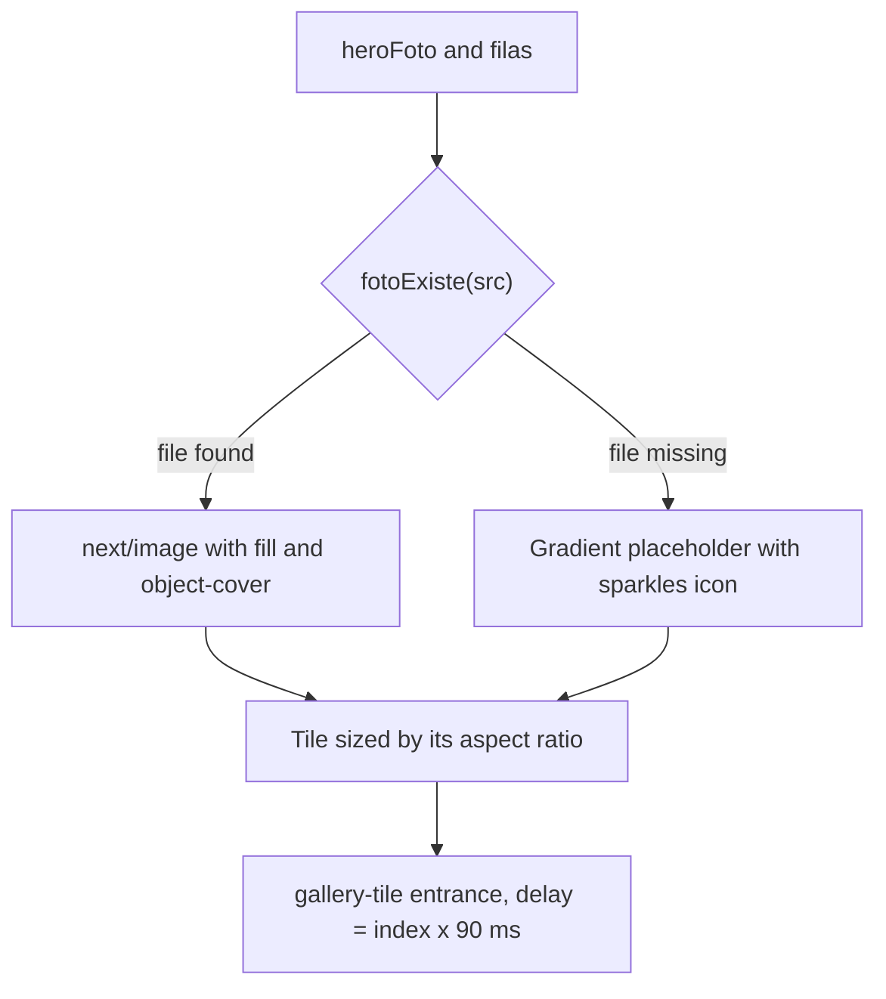

# About

> Introduces the student who builds the site, with a short academic bio, a photo gallery and links to public profiles.

| | |
|---|---|
| **Routes** | `/sobre-mi` |
| **Status** | Live since v0.1.0 |
| **Key files** | [page.tsx](../../../src/app/(public)/sobre-mi/page.tsx), [public/sobre-mi/](../../../public/sobre-mi/), [globals.css](../../../src/app/globals.css) (`.gallery-tile`) |

## Why it exists

The site is a personal project, not an official faculty publication. "Sobre mí" (about me) tells students who writes it and which careers the author has studied at the faculty, so readers can weigh the notes and recommendations in context. It also lists public profiles where students can follow or contact the author.

## User stories

| ID | As a | I want to | So that |
|---|---|---|---|
| US-ABOUT-01 | student | know who writes the site and their path through the faculty | I can judge the context of its notes and recommendations |
| US-ABOUT-02 | visitor | see photos of the author | the site feels like the work of a real student |
| US-ABOUT-03 | student | open the author's public profiles | I can follow or contact the author |
| US-ABOUT-04 | site maintainer | replace or add gallery photos by dropping files in `public/sobre-mi/` and editing one array | the gallery stays current without layout work |

## Acceptance criteria

### US-ABOUT-01 - Know who is behind the site

```gherkin
Feature: Author introduction

  Scenario: Header
    Given I open "/sobre-mi"
    When the page renders
    Then I see the eyebrow "Quién está detrás" (who is behind it) and the heading "Hola, soy Matías" (hi, I'm Matías)
    And a line under the heading states that the author graduated from APU and is studying Licenciatura en Sistemas at the Facultad de Informática - UNLP

  Scenario: Bio
    Given I open "/sobre-mi"
    When I scroll to the "Quién soy" (who I am) section
    Then three paragraphs cover the author's studies, current job title and teaching assistant roles, and the reason the site exists
    And the link in the second paragraph opens the author's private tutoring site in a new tab

  Scenario: Unpublished sections stay hidden
    Given I open "/sobre-mi"
    When I scroll to the end of the page
    Then there is no "Por qué este blog" (why this blog) section and no "Más sobre mí" (more about me) section
    And the last section is "Encontrame en redes" (find me online)
```

### US-ABOUT-02 - Photo gallery

```gherkin
Feature: Photo gallery

  Scenario: Wide layout
    Given the screen is at least 640px wide
    When the gallery renders
    Then the group photo spans the full width first
    And two rows of three photos follow, the photos of each row sharing one height

  Scenario: Narrow layout
    Given the screen is narrower than 640px
    When the gallery renders
    Then every photo stacks at full width with its own aspect ratio

  Scenario: Cascade entrance
    Given the system allows motion
    When the gallery renders
    Then the tiles fade, rise and scale in one after another, 90 ms apart, from the top left to the bottom right

  Scenario: Reduced motion
    Given the system requests reduced motion
    When the gallery renders
    Then the tiles appear in place without the entrance animation
```

### US-ABOUT-03 - Public profiles

```gherkin
Feature: Profile links

  Scenario: Three profile cards
    Given I open "/sobre-mi"
    When I reach "Encontrame en redes"
    Then I see cards for "GitHub", "LinkedIn" and "Instagram", each with its handle
    And each card opens the profile in a new tab without sending a Referer header

  Scenario: Wide layout
    Given the screen is at least 640px wide
    When the cards render
    Then they sit side by side in three columns

  Scenario: Long handle
    Given a handle is wider than its card
    When the card renders
    Then the handle is cut with an ellipsis instead of wrapping
```

### US-ABOUT-04 - Maintain the gallery

```gherkin
Feature: Gallery maintenance

  Scenario: Replacing a photo with a new file
    Given "public/sobre-mi/foto-8.jpeg" is added and the first entry of the first row changes its "src" from "/sobre-mi/foto-3.jpeg" to "/sobre-mi/foto-8.jpeg"
    When the site is rebuilt and deployed
    Then the first tile of the first row shows the new image

  Scenario: A listed file is missing
    Given an entry in "filas" points to a file that does not exist under "public/"
    When the page renders
    Then that tile shows a pastel gradient with a sparkles icon
    And the build does not fail and no broken image icon appears

  Scenario: The declared aspect ratio differs from the file
    Given an entry declares "aspect" 2.2 for a photo whose real ratio is about 2
    When the page renders
    Then the tile keeps the declared 2.2 ratio and the photo is cropped, not stretched

  Scenario: Adding a photo to a row
    Given a fourth entry is appended to the first row's "fotos" array
    When the page renders
    Then the first row shows four tiles that still share one height
    And the new tile enters right after the third one in the cascade
```

## Use cases

### UC-ABOUT-01 - Replace or add a gallery photo

| | |
|---|---|
| **Primary actor** | Site maintainer |
| **Preconditions** | The maintainer has the new image and can deploy the site. |
| **Trigger** | A gallery photo needs to change, or a new photo should join the gallery. |
| **Postconditions** | The deployed `/sobre-mi` shows the photo at its declared aspect ratio. |

**Main success scenario**

1. The maintainer copies the image into `public/sobre-mi/`, for example as `foto-8.jpeg`.
2. The maintainer reads the image's pixel size and computes `aspect` as width divided by height, rounded to two decimals.
3. In [page.tsx](../../../src/app/(public)/sobre-mi/page.tsx), the maintainer appends `{ src: "/sobre-mi/foto-8.jpeg", alt: "<description>", aspect: <value> }` to one of the rows in `filas`.
4. With `pnpm dev` running, the photo shows up on the next page load and the maintainer checks the row.
5. The maintainer commits and deploys, and the build prerenders the page with the new photo.

**Extensions**

- **1a.** The new image overwrites an existing file under the same name: no code change is needed unless the aspect ratio or the description changes, but the image optimizer can keep serving the previous version until its cache entry expires.
- **3a.** The photo should lead the gallery: the maintainer edits `heroFoto` instead. The hero spans the full width and always loads with `priority`.
- **3b.** The photo needs a row of its own: the maintainer appends a `FilaFotos` object to `filas`. Its `height` field is required by the type but does not affect the layout.
- **4a.** The tile shows the gradient placeholder: `src` does not match a file under `public/`. The maintainer checks the `/sobre-mi/` prefix and the extension.
- **4b.** The photo looks cropped: `aspect` does not match the file, and the maintainer corrects it.
- **5a.** A file is deleted while its entry stays in `filas`: the deployed tile shows the placeholder until the entry is removed too.

## How it works

### Page structure

[page.tsx](../../../src/app/(public)/sobre-mi/page.tsx) is a Server Component. It has to run on the server because it checks the photo files with `node:fs`. All copy is hardcoded JSX in the same file.

| Section | Content | Entrance |
|---|---|---|
| Header | Eyebrow "Quién está detrás", heading "Hola, soy Matías" with the name in a primary gradient, and a line about the author's studies next to a graduation cap icon | `Reveal` on mount |
| Gallery | `<section aria-label="Galería de fotos">` (photo gallery) with one hero photo and two rows of three | CSS `.gallery-tile`, 90 ms apart |
| "Quién soy" | Three bio paragraphs. From 768px, the heading sits in a 200px column next to the text | `Reveal` when scrolled into view |
| "Encontrame en redes" | Three profile cards built from the `redes` array | `Reveal` when scrolled into view |

The page does not read `SITE.author` from [site.ts](../../../src/lib/site.ts). That object feeds the root metadata and the JSON-LD `Person` node described in [SEO](../seo/README.md).

### Gallery

Two constants describe the gallery:

| Constant | Type | Fields |
|---|---|---|
| `heroFoto` | `Foto` | `src` (path under `public/`), `alt`, `aspect` (width divided by height) |
| `filas` | `FilaFotos[]` | `height` (required, unused) and `fotos: Foto[]` |

Rendering rules:

- **Existence check.** `fotoExiste(src)` calls `existsSync(join(process.cwd(), "public", src))`. When the file exists, the tile renders `next/image` with `fill` and `object-cover`. When it does not, the tile renders a pastel gradient with a sparkles icon hidden from assistive technology. In development the check runs on every render. In production it runs once, at build time, because the page is static.
- **Hero.** A full-width box whose CSS `aspect-ratio` equals `heroFoto.aspect`. It always loads with `priority` and uses `sizes="(max-width: 640px) 100vw, (max-width: 1280px) 90vw, 1280px"`.
- **Rows.** Below 640px a row is a vertical stack, and each tile takes the full width at its own aspect ratio. From 640px a row is a flex row where each tile gets `flex: <aspect> 1 0` and `aspect-ratio: <aspect>`. Because every tile grows in proportion to its ratio, all tiles in a row end up with the same height, and the row shrinks with its container instead of overflowing when the sidebar opens. More tiles make a row shorter. Row tiles use `sizes="(max-width: 640px) 100vw, (max-width: 1024px) 50vw, 33vw"`.
- **Priority.** Tiles get `priority` when their global index is below 2. The hero is index 0, so only the first tile of the first row qualifies. The other five tiles load lazily.
- **Animation.** `.gallery-tile` in [globals.css](../../../src/app/globals.css) plays a 700 ms fade, 16px rise and scale from 0.96 to 1. Each tile's `animation-delay` is its global index times 90 ms. A `prefers-reduced-motion: reduce` rule turns the animation off.
- **Hover.** The image scales to 1.02 in the hero and 1.03 in the row tiles.

The diagram shows how each gallery entry becomes a tile.



### Current photos

| Position | File | `aspect` | File size in pixels | `alt` |
|---|---|---|---|---|
| Hero | `foto-5.jpeg` | 2.2 | 2819 x 1417 (about 1.99) | "Con toda mi gente querida" (with all my dear people) |
| Row 1, left | `foto-3.jpeg` | 1.0 | 1778 x 1768 | "Foto 3" (photo 3) |
| Row 1, center | `foto-6.jpeg` | 1.33 | 4032 x 3024 | "Foto 6" |
| Row 1, right | `foto-4.jpeg` | 0.78 | 665 x 849 | "Foto 4" |
| Row 2, left | `foto-1.jpeg` | 1.48 | 4284 x 2879 | "Foto 1" |
| Row 2, center | `foto-2.jpeg` | 1.58 | 3569 x 2246 | "Foto 2" |
| Row 2, right | `foto-7.png` | 1.6 | 809 x 505 | "Foto 7" |

### Photo rules

- Files live in [public/sobre-mi/](../../../public/sobre-mi/) and are referenced by absolute path, for example `/sobre-mi/foto-3.jpeg`. Any file name works; the existing ones follow `foto-N`. JPEG and PNG are both in use.
- `aspect` must be the file's width divided by its height. A wrong value crops the photo through `object-cover` instead of distorting it.
- `alt` should describe the photo. Screen readers announce it.
- The original files are served through the image optimizer (`/_next/image`), which resizes them according to `sizes` and serves WebP at quality 75. The originals weigh between 241 KB and 3.2 MB; their size affects the repository and the first optimization of each variant, not what visitors download.
- Prefer a new file name over overwriting a file. The optimizer caches each resized copy by URL for at least 4 hours (the default `minimumCacheTTL`), so an overwritten file can keep showing the replaced image for a while.
- Removing a photo means deleting its entry. Deleting only the file leaves a placeholder tile.

### Profile links

`redes` holds three entries with `label`, `username`, `href` and an inline SVG icon component (`GithubIcon`, `LinkedinIcon`, `InstagramIcon`, all hidden from assistive technology). Each card shows the icon in a tinted tile, the label and the handle, and opens with `target="_blank"` and `rel="noreferrer"`. The same three profile URLs also appear in `SITE.author.sameAs` in [site.ts](../../../src/lib/site.ts).

## States and variants

**Loading.** Nothing is fetched. While a photo loads, its tile keeps its final size because `aspect-ratio` reserves the space, so the layout does not shift. On a first visit the page stays blank until the client bundle renders it, because the static HTML has no visible body content (see [Non-functional notes](#non-functional-notes)).

**Empty.** A missing photo file renders the gradient placeholder. There is no other empty state.

**Error.** Rendering errors fall back to the root [error.tsx](../../../src/app/error.tsx).

**Responsive.**

| Width | Behavior |
|---|---|
| Below 640px | Gallery photos stack at full width. Profile cards stack in one column. |
| 640px and up | Gallery rows lay out side by side with equal heights. Profile cards use three columns. The heading grows. |
| 768px and up | "Quién soy" uses two columns: the heading on the left, the text on the right. |

**Dark mode.** The page uses theme tokens only. The placeholder gradient and the icon tiles use the pastel blue token, which turns darker under `[data-theme="dark"]`, and every tile keeps a `ring-border` outline. The photos themselves do not change.

## Non-functional notes

- **Performance.** The route is static and prerendered at build time, with no ISR. The gallery entrance is pure CSS, so besides `next/image` only the `Reveal` wrappers run on the client. The image optimizer serves resized WebP variants, and the reserved aspect ratios avoid layout shift.
- **Rendering.** The root layout wraps every page in a `Suspense` boundary around a provider that calls `useSearchParams()`, so the static HTML carries the metadata but no visible content. As a result the static HTML has no image preload for the hero, despite `priority`, and the photo requests start only after the client renders the page.
- **Accessibility.** The gallery is a labeled region, the placeholders and icons are hidden from assistive technology, and the profile cards have visible text labels. The gallery animation honors `prefers-reduced-motion`, but the `Reveal` fade-ups do not. Six of the seven photos have placeholder `alt` text, and profile links do not announce that they open a new tab.
- **SEO.** The title is "Sobre mí · Blog Informática UNLP", where the suffix is the site name, the description summarizes the author's studies and roles, and the canonical path is `/sobre-mi`. The sitemap lists the route with a `yearly` change frequency and priority 0.5. The JSON-LD `Person` node in the root layout describes the author on every page. See [SEO](../seo/README.md).

## Known gaps

- Six of the seven photos have placeholder `alt` text ("Foto 1", "Foto 2", "Foto 3", "Foto 4", "Foto 6" and "Foto 7"). Only the hero has a descriptive one.
- The hero declares `aspect` 2.2, but `foto-5.jpeg` is 2819 x 1417 (about 1.99), so roughly 10% of its height is cropped.
- `FilaFotos.height` (280 and 240 in the current rows) is required by the type but never read.
- Two sections exist only as TODO comments, "Por qué este blog" and "Más sobre mí", and neither renders. The second comment mentions a `facetas` array that does not exist in the file.
- The profile URLs are duplicated between `redes` in [page.tsx](../../../src/app/(public)/sobre-mi/page.tsx) and `SITE.author.sameAs` in [site.ts](../../../src/lib/site.ts), and must be kept in sync by hand.
- The bio and header are hardcoded JSX, so any text change needs a code edit and a deploy.
- Photos cannot be opened at full size: there is no lightbox or zoom.
- The static HTML has no visible body content, so crawlers that do not run JavaScript see only the metadata.
