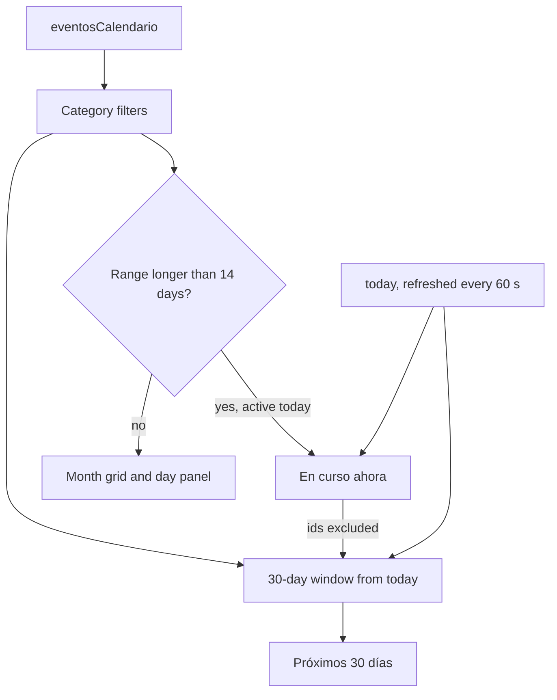

# Academic calendar

> Shows the faculty's 2026 academic calendar as an interactive month grid with category filters, the periods in progress and a 30-day lookahead, so students can find enrollment windows, exam weeks and holidays without reading the whole official calendar.

| | |
|---|---|
| **Routes** | `/calendario` |
| **Status** | Live since v0.1.0 |
| **Key files** | [page.tsx](../../../src/app/(public)/calendario/page.tsx), [CalendarioView.tsx](../../../src/components/calendario/CalendarioView.tsx), [calendario.ts](../../../src/lib/calendario.ts) |

## Why it exists

The faculty publishes its academic calendar as a single page that covers the whole year. This page links to it as "Calendario académico 2026 oficial" (official 2026 academic calendar). Students rarely need the whole year at once. They need narrower answers: what is going on this week, when the next final exam enrollment opens, or whether a given day is a holiday. The page turns the official dates into typed events and shows them by month, by category and by how close they are to today.

## User stories

| ID | As a | I want to | So that |
|---|---|---|---|
| US-CAL-01 | student | browse a month grid where each day shows its most important event category | I can spot exam weeks, enrollment windows and holidays at a glance |
| US-CAL-02 | student | select a day and read its events with dates and notes | I know exactly what happens on that day |
| US-CAL-03 | student | turn event categories on and off | I can focus on the kinds of dates I care about, such as exams |
| US-CAL-04 | student | see the long periods in progress today, with their progress and days left | I know how much of the semester remains |
| US-CAL-05 | student | see the events of the next 30 days with a countdown | I can plan enrollments and exams ahead |
| US-CAL-06 | student | tell national holidays apart from religious observances | I know which days everyone has off |

## Acceptance criteria

Scenarios use the 2026 data in [calendario.ts](../../../src/lib/calendario.ts). Every category is active unless a scenario says otherwise.

### US-CAL-01 - Browse the month grid

```gherkin
Feature: Month grid

  Scenario: The grid opens on the current month
    Given today is 26 November 2026
    When I open "/calendario"
    Then the grid heading reads "Noviembre 2026" (November 2026)
    And the subtitle reads "8 eventos en este mes" (8 events this month)
    And the number 26 sits in the filled circle that marks today

  Scenario: Moving to the next month across a year boundary
    Given the grid shows "Diciembre 2026"
    When I press the "Mes siguiente" (next month) button
    Then the grid heading reads "Enero 2027"

  Scenario: A day with several events shows the highest-priority category
    Given the screen is at least 1024px wide
    And 27 May 2026 has "Mesas de final - Mayo" (May final exams) and "Id Al-Adha (Fiesta del Sacrificio)" (Eid al-Adha)
    When I view "Mayo 2026"
    Then the cell for day 27 shows an "Exámenes" (exams) chip

  Scenario: A month after the loaded data ends
    Given the last loaded event ends on 26 February 2027
    When I navigate to "Abril 2027"
    Then the subtitle reads "0 eventos en este mes"
    And no day cell shows a category marker
```

### US-CAL-02 - Read a day's events

```gherkin
Feature: Day panel

  Scenario: Selecting a day with several events
    Given I am viewing "Febrero 2026"
    When I click the cell for day 16
    Then the panel counter reads "3 eventos" (3 events)
    And the panel lists "Actividades Complementarias para Aprobación de Cursadas (AComAC)" (complementary activities to pass coursework), "Carnaval" (Carnival) and "Inscripción finales - Febrero 2° llamado" (final exam enrollment, second February call), in that order
    And the "Carnaval" line shows "Del 16 al 17 de febrero de 2026" (from 16 to 17 February 2026) and the note "Feriado trasladable" (movable holiday)

  Scenario: Selecting a day covered only by a long period
    Given I am viewing "Noviembre 2026"
    When I click the cell for day 17
    Then the panel counter reads "Sin eventos" (no events)
    And the panel text reads "Día sin eventos académicos cargados." (day with no academic events loaded)
    And "Segundo semestre" (second semester) is not listed even though it spans that day

  Scenario: Selecting a day of the adjacent month
    Given I am viewing "Noviembre 2026"
    When I click the dimmed cell for 1 December
    Then the panel lists the 3 events of 1 December 2026
    And the grid heading still reads "Noviembre 2026"

  Scenario: Jumping back to today
    Given I am viewing "Marzo 2026" with 9 March selected
    When I press "Hoy" (today)
    Then the grid shows the current month
    And the panel shows today's date and events
```

### US-CAL-03 - Filter by category

```gherkin
Feature: Category filters

  Scenario: Every category starts active
    When I open "/calendario"
    Then six buttons follow the "Filtros" (filters) label, in this order: "Clases" (classes), "Exámenes", "Inscripciones" (enrollments), "Feriados" (holidays), "Receso" (break) and "Otros" (other)
    And every filter button reports aria-pressed "true"

  Scenario: Hiding one category
    Given every category is active
    When I press "Exámenes"
    Then the "Exámenes" button reports aria-pressed "false" and turns grey
    And exam events disappear from the grid markers, the day panel, the month count and "Próximos 30 días" (next 30 days)

  Scenario: Hiding every category
    Given every category is active
    When I turn off all six categories
    Then the month subtitle reads "0 eventos en este mes"
    And the "En curso ahora" (happening now) section is not shown
    And "Próximos 30 días" reads "Sin eventos en los próximos 30 días con los filtros actuales." (no events in the next 30 days with the current filters)

  Scenario: Filters reset on reload
    Given I turned off "Feriados"
    When I reload the page
    Then all six categories are active again
```

### US-CAL-04 - Track the periods in progress

```gherkin
Feature: Periods in progress

  Scenario: The current semester appears with its progress
    Given today is 26 November 2026
    When I open "/calendario"
    Then "En curso ahora" shows one card, "Segundo semestre"
    And the card reads "Del 18 de agosto de 2026 al 6 de febrero de 2027 · 173 días totales" (173 total days)
    And the card shows "72 días restantes" (72 days left) and a progress bar at "58%"

  Scenario: The last day of a period
    Given today is 6 February 2027
    When I open "/calendario"
    Then the "Segundo semestre" card reads "termina hoy" (ends today)
    And its progress bar shows "100%"

  Scenario: No long period in progress
    Given today is 12 August 2026, after "Primer semestre" (first semester) and before "Segundo semestre"
    When I open "/calendario"
    Then the "En curso ahora" section is not rendered

  Scenario: A 14-day range is not a long period
    Given today is 27 July 2026, inside the 14-day "Receso invernal" (winter break)
    When I open "/calendario"
    Then "En curso ahora" lists "Primer semestre" but not "Receso invernal"
    And the cell for 27 July carries the "Receso" marker
```

### US-CAL-05 - See the next 30 days

```gherkin
Feature: Next 30 days

  Scenario: Events inside the window
    Given today is 26 November 2026
    When I open "/calendario"
    Then the "Próximos 30 días" header shows "10 eventos"
    And the list starts with "Inscripción finales - Diciembre 1° llamado" (final exam enrollment, first December call) and ends with "Navidad" (Christmas)
    And "Segundo semestre" is not in the list because it is shown in "En curso ahora"

  Scenario: Countdown pills
    Given today is 26 November 2026
    When I read the pills in "Próximos 30 días"
    Then "Día del Trabajador No Docente" (non-teaching staff day), which starts today, shows "en curso" (in progress)
    And "Mesas de final - Diciembre 1° llamado" (first December call final exams), which starts on 30 November, shows "en 4 días" (in 4 days)

  Scenario: An event that starts tomorrow
    Given an event in the list starts the day after today
    When I read its pill
    Then the pill reads "mañana" (tomorrow) and uses the highlighted style

  Scenario: Nothing inside the window
    Given the active filters leave no event in the next 30 days
    When the list renders
    Then it reads "Sin eventos en los próximos 30 días con los filtros actuales."
```

### US-CAL-06 - Spot national holidays

```gherkin
Feature: National holidays

  Scenario: A national holiday is painted
    Given 25 May 2026 is "Día de la Revolución de Mayo" (May Revolution Day), flagged as national
    When I view "Mayo 2026"
    Then the cell for day 25 has a rose background and a rose day number
    And its accessible name is "25, feriado nacional: Día de la Revolución de Mayo" (25, national holiday: May Revolution Day)

  Scenario: A religious observance is not painted
    Given 21 September 2026 has "Iom Kipur (Día del Perdón)" (Yom Kippur), which is not flagged as national, and "Día del Estudiante" (Student Day)
    When I view "Septiembre 2026"
    Then the cell for day 21 keeps the default background
    And its marker uses the "Feriados" category

  Scenario: A national holiday that shares the day with a higher-priority event
    Given the screen is at least 1024px wide
    And 16 February 2026 has "Carnaval" and "Inscripción finales - Febrero 2° llamado"
    When I view "Febrero 2026"
    Then the cell for day 16 has a rose background
    And its chip reads "Inscripciones"

  Scenario: A day without classes that is not a holiday
    Given 12 August 2026 has "Aniversario de la UNLP" (UNLP anniversary) in the "Otros" category
    When I view "Agosto 2026"
    Then the cell for day 12 keeps the default background
```

## Use cases

### UC-CAL-01 - Plan a final exam

| | |
|---|---|
| **Primary actor** | Student |
| **Preconditions** | The exam period and its enrollment window are loaded in `eventosCalendario`. |
| **Trigger** | The student wants the enrollment window and the dates of the next final exam period. |
| **Postconditions** | The student knows when enrollment opens and closes and which week the exams run. The page stores nothing. |

**Main success scenario**

1. The student opens "Calendario" (calendar) from the sidebar, or the "Calendario académico" (academic calendar) card on the [home page](../home/README.md).
2. The page opens on the current month with every category active.
3. The student turns off every category except "Exámenes" and "Inscripciones".
4. "Próximos 30 días" lists the matching "Inscripción finales" (final exam enrollment) and "Mesas de final" (final exams) entries, each with a countdown pill.
5. The student clicks the first enrollment day in the grid and reads the note with the exam week, for example "Semana de exámenes: 30/11 al 05/12" (exam week: 30/11 to 05/12).

**Extensions**

- **3a.** The student keeps every category active: the list also shows holidays, ceremonies and other events.
- **4a.** The exam period starts more than 30 days ahead: it is not listed, so the student presses "Mes siguiente" until the grid shows it.
- **4b.** The filters leave nothing in the window: the list shows its empty message and the student turns a category back on.
- **5a.** The date is after the loaded data: the grid shows "0 eventos en este mes" and the student follows "Calendario académico 2026 oficial" to the faculty site.

### UC-CAL-02 - Check whether a day has classes

| | |
|---|---|
| **Primary actor** | Student |
| **Preconditions** | The day falls inside the loaded data, between 10 November 2025 and 26 February 2027. |
| **Trigger** | The student wants to know whether a date is a holiday or a day without academic activity. |
| **Postconditions** | The student knows how the calendar classifies the day. |

**Main success scenario**

1. The student opens `/calendario`.
2. The student moves to the right month with "Mes anterior" (previous month) or "Mes siguiente".
3. The student looks for rose cells, which mark national holidays.
4. The student clicks the day, and the panel lists its events with notes such as "Feriado inamovible" (fixed holiday).

**Extensions**

- **3a.** The day is a religious observance, such as "Iom Kipur (Día del Perdón)": the cell is not rose and the panel note reads "Solo para quienes profesen religión judía" (only for those who practice Judaism).
- **3b.** The day has no academic activity but is not a holiday, such as "Día sin actividad académica (turismo)" (day without academic activity, tourism): it belongs to "Otros", so the cell is not rose and the student has to open the day panel to see it.
- **4a.** Only a long period such as "Segundo semestre" covers the day: the panel reads "Sin eventos", which does not mean there are no classes.

## How it works

### Components

| File | Kind | Role |
|---|---|---|
| [page.tsx](../../../src/app/(public)/calendario/page.tsx) | Server Component | Exports the metadata through `pageMetadata`, renders the header with the official link, and mounts `CalendarioView` inside a `Reveal` fade-up. |
| [CalendarioView.tsx](../../../src/components/calendario/CalendarioView.tsx) | Client Component | Owns all state and renders the filters, "En curso ahora", the month grid, the day panel and "Próximos 30 días". |
| [calendario.ts](../../../src/lib/calendario.ts) | Data module | Exports the `eventosCalendario` array, the date helpers, and the category order, labels and Tailwind classes. |
| [Reveal.tsx](../../../src/components/motion/Reveal.tsx) | Client Component | Fade-up entrance for the header and the view. |

### Data model

Each event is an `EventoCalendario`:

| Field | Type | Meaning |
|---|---|---|
| `id` | `string` | Stable key. |
| `categoria` | `"clases" \| "inscripciones" \| "examenes" \| "receso" \| "feriado" \| "otro"` | Drives color, filtering and cell priority. |
| `nombre` | `string` | Name shown in the UI. |
| `tipo` | `"fecha" \| "rango"` | Single date or range. |
| `inicio`, `fin` | `string` (`YYYY-MM-DD`) | Start and inclusive end, read as local dates. Both are equal for a single date. |
| `nota` | `string`, optional | Extra line shown in italics. |
| `nacional` | `boolean`, optional | Only for `feriado`: `true` marks a national holiday. |

The dataset holds 73 events (42 ranges and 31 single dates) between 10 November 2025 and 26 February 2027:

| Key | Label | Events | Cell priority | Color |
|---|---|---|---|---|
| `examenes` | "Exámenes" | 13 | 5 (highest) | Amber |
| `inscripciones` | "Inscripciones" | 19 | 4 | Emerald |
| `feriado` | "Feriados" | 22, of which 15 are national | 3 | Rose |
| `clases` | "Clases" | 6 | 2 | Primary blue |
| `receso` | "Receso" | 1 | 1 | Stone |
| `otro` | "Otros" | 12 | 0 | Violet |

The filter buttons follow `CATEGORIAS_ORDEN`: "Clases", "Exámenes", "Inscripciones", "Feriados", "Receso", "Otros".

### Display rules

- Dates go through `parseLocalDate`, which builds a local midnight `Date`. `new Date("YYYY-MM-DD")` would parse the string as UTC and shift the day.
- A **long event** is a range of more than 14 days. Five events qualify: "Inscripción a las carreras 2026" (2026 career enrollment), "Curso inicial" (introductory course), "Cursos de Verano" (summer courses), "Primer semestre" and "Segundo semestre". Long events never appear in grid cells, in the day panel or in the month count. They show up in "En curso ahora" while today falls inside them, and in "Próximos 30 días" when they start within the next 30 days. Ranges of exactly 14 days, such as "Receso invernal", count as short.
- Each cell shows one marker for its highest-priority short event: a colored dot below 1024px, or a chip with the category label from 1024px. The cell's `title` tooltip lists every short event as "Label: name".
- A cell turns rose when one of its short events has `categoria: "feriado"` and `nacional: true`, unless the cell is selected or belongs to the adjacent month.
- "Próximos 30 días" takes every filtered event whose range overlaps the window from today's midnight to 30 days later, drops the events shown in "En curso ahora" and sorts the rest by start date. A long event that starts inside the window does appear.
- The progress bar is `(today - inicio) / (fin - inicio)`, so it reads 0% on the first day and 100% on the last day.
- `today` refreshes every 60 seconds, so the today marker, "En curso ahora" and "Próximos 30 días" stay correct when the tab stays open past midnight. The visible month and the selected day do not move on their own.
- The grid always has 42 cells: six weeks starting on Monday ("Lun"), including dimmed days of the adjacent months.

The diagram shows how the single event array feeds the three views.



### Updating the data

The events are hardcoded. A new academic year means editing these places and deploying:

| File | Year-specific content |
|---|---|
| [calendario.ts](../../../src/lib/calendario.ts) | The `eventosCalendario` array and the source URL in the header comment. |
| [page.tsx](../../../src/app/(public)/calendario/page.tsx) | The eyebrow "Calendario académico 2026" (2026 academic calendar), the official link text and URL, and the meta description. |
| [links/page.tsx](../../../src/app/(public)/links/page.tsx) | The "Calendario académico 2026" card in the [links directory](../links/README.md). |

Keep `inicio` and `fin` as `YYYY-MM-DD`, set `fin` equal to `inicio` for single dates, and add `nacional: true` only to holidays that apply to everyone.

### Delivery and caching

The route is static: Next.js prerenders it at build time with no revalidation period, and nothing is fetched at runtime. The events ship inside the client chunk of `CalendarioView`, which weighs about 28 KB raw and 7 KB gzipped with the data included. Because the view reads the visitor's clock, every date-dependent value is computed in the browser.

## States and variants

**Initial render.** The header and the view fade up on mount, the view with a 0.1 s delay. The grid opens on the visitor's current month, with today selected and every category active.

**Loading.** The route has no `loading.tsx` of its own. During client-side navigation the global top progress bar runs, and the root [loading.tsx](../../../src/app/loading.tsx) (three pulsing dots announced as "Cargando" (loading)) can show while the segment loads. On a first visit the page stays blank until the client bundle renders it, because the static HTML has no visible body content (see [Non-functional notes](#non-functional-notes)).

**Empty.** Each section has its own empty case:

| Section | Empty case |
|---|---|
| "En curso ahora" | Not rendered when no long event is active today. |
| Month subtitle | "0 eventos en este mes" for months without short events, such as every month after February 2027. |
| Day panel | "Sin eventos" and "Día sin eventos académicos cargados." |
| "Próximos 30 días" | "Sin eventos en los próximos 30 días con los filtros actuales." |

**Error.** Nothing is fetched, so there is no data error state. A rendering error falls back to the root [error.tsx](../../../src/app/error.tsx): "Algo salió mal" (something went wrong), with "Reintentar" (retry) and "Ir al inicio" (go to home).

**Responsive.**

| Width | Behavior |
|---|---|
| Below 768px | "En curso ahora" cards stack in one column. |
| 768px and up | "En curso ahora" cards use two columns. |
| Below 1024px | Cell markers are colored dots, which avoids truncated labels in narrow cells. |
| 1024px and up | Cell markers are chips with the category label. |
| Any width | The grid keeps seven columns with cells at least 72px tall, the filter buttons wrap, and weekend headers and numbers are muted. |

**Dark mode.** Category chips set explicit dark text colors, the pastel surface tokens switch to darker values under `[data-theme="dark"]`, and national holiday cells switch from `bg-rose-50` to `dark:bg-rose-950/30`, with `dark:text-rose-400` day numbers.

## Non-functional notes

- **Performance.** The route is static, with no data fetching and no ISR. The only page-specific client code is `CalendarioView`, plus the shared motion wrappers. The filtered list and the month count are memoized with `useMemo`. Each render checks the 42 visible cells against at most 73 events, which is negligible, and the 60-second interval re-renders the view once per minute.
- **Rendering.** The root layout wraps every page in a `Suspense` boundary around `NavigationLoadingProvider`, which calls `useSearchParams()`. During prerendering this makes Next.js render everything inside the boundary on the client, so the static HTML of `/calendario` carries the `<head>` metadata and the JSON-LD script but no visible text. For this page it also means no build-date output reaches the screen: the first paint already uses the visitor's date.
- **Accessibility.** Filter buttons expose their state with `aria-pressed`. The month arrows are labeled "Mes anterior" and "Mes siguiente". Every day is a native `<button>` whose `aria-label` gives the day, month and year plus the number of events, or "<day>, feriado nacional: <name>" for national holidays. Missing pieces are listed in [Known gaps](#known-gaps).
- **SEO.** Metadata comes from `pageMetadata`: the title "Calendario académico · Blog Informática UNLP", where the suffix is the site name, a description that mentions the 2026 calendar, and the canonical path `/calendario`. The sitemap lists the route with a `weekly` change frequency and priority 0.8. See [SEO](../seo/README.md).

## Known gaps

- The events are hardcoded for the 2026 academic year. Nothing imports the official calendar, and there is no `.ics` export or calendar subscription.
- The header, the official link and the meta description name 2026, while the grid opens on the visitor's current month in any year. Every month after February 2027 is empty.
- Events have no career field, so there is no per-career view: every event applies to the whole faculty.
- The filters, the visible month and the selected day live in component state only. They reset on reload and cannot be shared as a URL.
- A day covered only by a long period, such as a regular class day, reads "Sin eventos" in the day panel. Long periods never show in the grid: they appear only in "En curso ahora" while in progress, or in "Próximos 30 días" shortly before they start.
- The countdown pill has a "hoy" (today) label that never shows: an event that starts today already counts as "en curso".
- Plurals slip in two places: "1 día restantes" (1 day left, with the adjective in plural) on the day before a period ends, and "1 eventos" (1 events) in the accessible name of a day with a single event.
- The day panel heading uses CSS `capitalize`, which capitalizes every word, for example "Lunes, 16 De Febrero De 2026" (Monday, 16 February 2026).
- Day buttons expose no `aria-current` or selected state, no live region announces the day panel or month changes, the grid is 42 separate tab stops without arrow-key navigation, and the `Reveal` fade-up ignores `prefers-reduced-motion`.
- The static HTML has no visible body content, so crawlers that do not run JavaScript see only the metadata.
- The 14-day threshold is written twice in [CalendarioView.tsx](../../../src/components/calendario/CalendarioView.tsx) (`LONG_RANGE_THRESHOLD_DAYS` and a literal `14`), and [calendario.ts](../../../src/lib/calendario.ts) exports code the UI does not use: `eventosLargos`, `formatFechaCorta` and the `chipBorder` classes.
