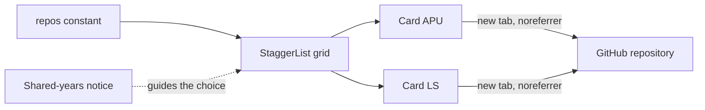

# Bibliography

> Sends students to two public GitHub repositories that collect the official course books as PDFs, one for APU and one for Licenciatura en Sistemas, and explains which one fits each career.

| | |
|---|---|
| **Routes** | `/bibliografia` |
| **Status** | Live since v0.1.0 |
| **Key files** | [page.tsx](../../../src/app/(public)/bibliografia/page.tsx), [GithubIcon.tsx](../../../src/components/icons/GithubIcon.tsx), [StaggerList.tsx](../../../src/components/motion/StaggerList.tsx) |

## Why it exists

Every subject publishes an official bibliography, and finding each book means a separate search. Two public GitHub repositories collect those books as PDFs, organized by career and numbered in the order subjects are taken. This page centralizes the two links and explains which repository matches each career, so students find the material for the current study plan quickly. The site hosts no PDF itself.

The site covers four careers of the faculty: APU (Analista Programador Universitario, a three-year programming degree), ATIC (Analista en Tecnologías de la Información y la Comunicación, a three-year ICT degree), LS (Licenciatura en Sistemas, a five-year degree in information systems) and LI (Licenciatura en Informática, a five-year degree in computer science). There are repositories for APU and LS only.

## User stories

| ID | As a | I want to | So that |
|---|---|---|---|
| US-BIB-01 | student | open the book repository of my career in one click | I can download the official books for my subjects |
| US-BIB-02 | first or second-year student of any career | know that either repository covers my subjects | I do not look for a repository specific to my career |
| US-BIB-03 | student | recognize each repository by career and platform before opening it | I open the right one |

## Acceptance criteria

### US-BIB-01 - Open a career repository

```gherkin
Feature: Repository cards

  Scenario: Opening the APU repository
    Given I am on "/bibliografia"
    When I click the "Bibliografia-APU" card
    Then "https://github.com/MatiasGuaymas/Bibliografia-APU" opens in a new tab
    And the site tab stays on "/bibliografia"

  Scenario: Opening the LS repository
    Given I am on "/bibliografia"
    When I click the "Bibliografia-LS" card
    Then "https://github.com/MatiasGuaymas/Bibliografia-LS" opens in a new tab

  Scenario: No referrer is sent
    Given I am on "/bibliografia"
    When I open either repository
    Then the request to GitHub carries no Referer header

  Scenario: There is no card for ATIC or LI
    Given I study ATIC or LI
    When I look at the repository cards
    Then exactly two cards are shown, one tagged "APU" and one tagged "LS"
```

### US-BIB-02 - Know which repository applies

```gherkin
Feature: Shared years notice

  Scenario: The notice explains the shared first years
    Given I am on "/bibliografia"
    When the page renders
    Then a notice starting with "Importante:" (important) states that the first 2 years are identical in the 4 careers (APU, ATIC, LS and LI)
    And it states that either repository serves those subjects

  Scenario: The notice explains where the careers diverge
    Given I am on "/bibliografia"
    When I read the second paragraph of the notice
    Then it states that APU and ATIC end in the 3rd year with their own path
    And it states that LS and LI continue to the 5th year sharing most subjects

  Scenario: The notice comes first on a narrow screen
    Given the screen is narrower than 768px
    When the page renders
    Then the notice appears above the cards
    And the two cards stack in one column
```

### US-BIB-03 - Recognize each repository

```gherkin
Feature: Card content

  Scenario: What a card shows
    Given I am on "/bibliografia"
    When the cards render
    Then each card shows the career acronym, a GitHub mark next to the repository name, the full career name and an arrow icon
    And each card reads "Libros en PDF de la bibliografía oficial de cada materia, organizados en carpetas numeradas por orden de cursada." (PDF books of each subject's official bibliography, in folders numbered by the order of study)

  Scenario: Hover feedback
    Given I use a pointer device
    When I hover a card
    Then the card lifts, its border turns to the primary color and the arrow moves up and to the right

  Scenario: Screen reader output
    Given I use a screen reader
    When I move to a card
    Then the link is announced with the acronym, the repository name, the career and the description
    And the GitHub mark, the arrow and the decorative glow are not announced
```

## How it works

[page.tsx](../../../src/app/(public)/bibliografia/page.tsx) is a Server Component with no data fetching. The two repositories live in a `repos` constant typed as `RepoBibliografia`:

| Field | APU entry | LS entry |
|---|---|---|
| `carreraSlug` | `apu` | `ls` |
| `sigla` | `APU` | `LS` |
| `carrera` | "Analista Programador Universitario" | "Licenciatura en Sistemas" |
| `href` | `https://github.com/MatiasGuaymas/Bibliografia-APU` | `https://github.com/MatiasGuaymas/Bibliografia-LS` |
| `description` | Same sentence for both entries | Same sentence for both entries |

The page renders three blocks, top to bottom:

1. A header with the eyebrow "Repositorios por carrera" (repositories by career), the heading "Bibliografía" (bibliography) and a one-paragraph introduction, inside `Reveal` on mount.
2. The shared-years notice, with an info icon, inside `Reveal` on mount with a 0.05 s delay.
3. The cards, rendered by [StaggerList.tsx](../../../src/components/motion/StaggerList.tsx) as a `<ul>` grid. Each card fades up 90 ms after the previous one, starting 0.15 s after mount. A card is a single `<a>` with `target="_blank"` and `rel="noreferrer"`, whose heading combines the [GithubIcon.tsx](../../../src/components/icons/GithubIcon.tsx) mark with `Bibliografia-{sigla}`.

The diagram shows how the constant becomes the page.



To add a repository, append an entry to `repos` with a unique `carreraSlug` (it is the React key) and redeploy. The grid places cards two per row from 768px.

## States and variants

**Loading, empty and error.** The content is static, so there is no loading, empty or error state of its own. Rendering errors fall back to the root [error.tsx](../../../src/app/error.tsx). On a first visit the page stays blank until the client bundle renders it, because the static HTML has no visible body content (see [Non-functional notes](#non-functional-notes)).

**Responsive.** Below 768px the notice and the cards stack in one column. From 768px the cards sit side by side with equal heights. The header text grows from 640px.

**Dark mode.** The page uses theme tokens only. The notice uses `bg-pastel-blue/40` with a `border-primary/20` border, and the hover glow uses the pastel blue token, all of which switch to darker values under `[data-theme="dark"]`.

## Non-functional notes

- **Performance.** The route is static and prerendered at build time, with no ISR. The page is a Server Component, so the repository data travels in the RSC payload and no page-specific code ships to the browser beyond the shared motion wrappers.
- **Rendering.** The root layout wraps every page in a `Suspense` boundary around a provider that calls `useSearchParams()`, so the static HTML carries the metadata but no visible text. The content appears once the client renders the RSC payload.
- **Accessibility.** Each card is one link whose accessible name is its text. The GitHub mark and the arrow are hidden from assistive technology, and so is the decorative glow. Links open in a new tab without announcing it.
- **SEO.** The title is "Bibliografía · Blog Informática UNLP", where the suffix is the site name, the description names both careers, and the canonical path is `/bibliografia`. The sitemap lists the route with a `monthly` change frequency and priority 0.7. See [SEO](../seo/README.md).

## Known gaps

- There are only two repositories. ATIC's third year and the LI-specific subjects have no repository of their own, and the page does not say where LI students should look beyond the shared subjects.
- The list is hardcoded in [page.tsx](../../../src/app/(public)/bibliografia/page.tsx), so any change needs a deploy. Nothing checks that the repositories are still online.
- The page does not show what each repository contains, which subjects it covers or when it was last updated. [Subject pages](../subject-page/README.md) under `/materia/[slug]` do not link to their folder in the repositories.
- Both entries repeat the same `description` string.
- New-tab behavior is not announced to screen readers.
- The static HTML has no visible body content, so crawlers that do not run JavaScript see only the metadata.
