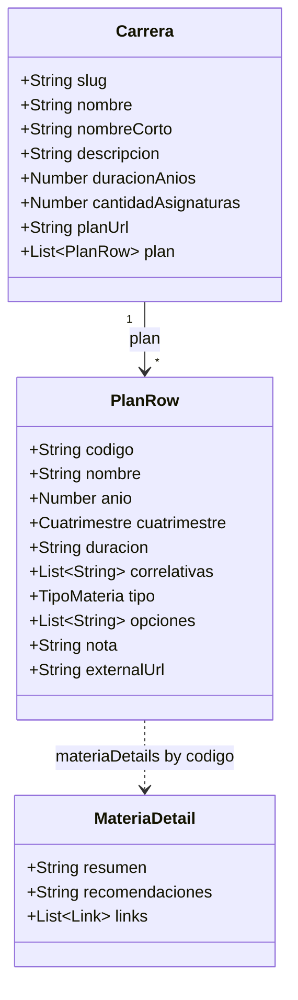
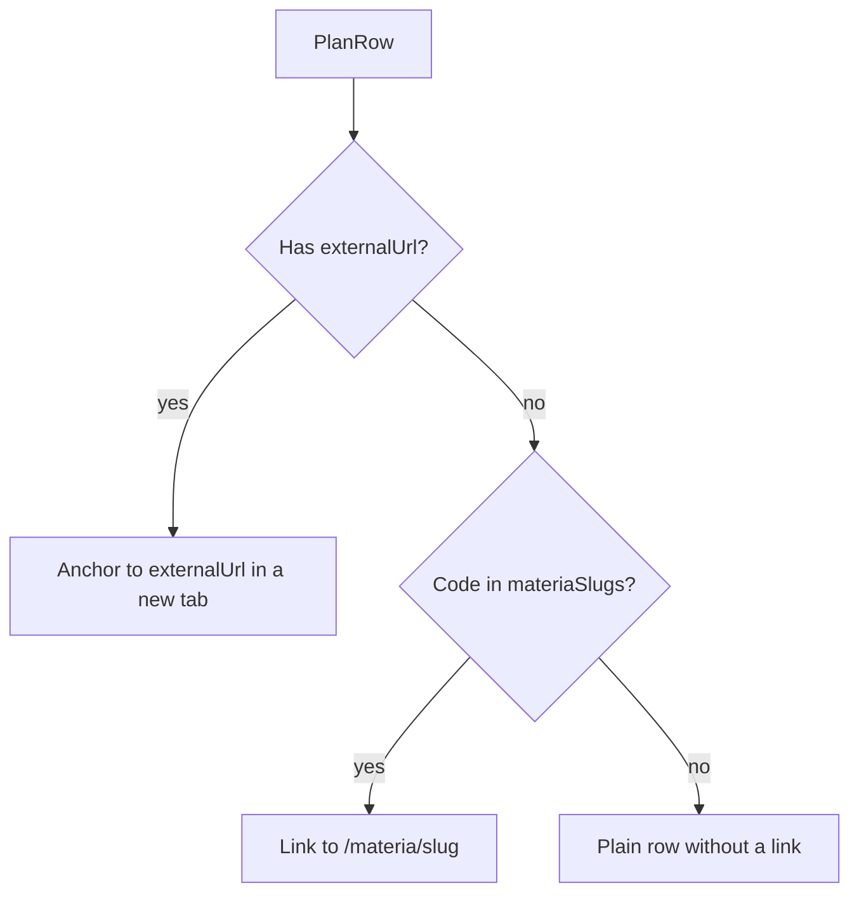

# Careers

> Lists the four undergraduate programs of the faculty and renders each 2021 study plan by year and semester, with prerequisites, options and links to subject pages.

| | |
|---|---|
| **Routes** | `/carreras`, `/carreras/[carrera]` (`apu`, `atic`, `ls`, `li`) |
| **Status** | Live since v0.1.0 |
| **Key files** | [carreras/page.tsx](../../../src/app/(public)/carreras/page.tsx), [carreras/[carrera]/page.tsx](../../../src/app/(public)/carreras/[carrera]/page.tsx), [carreras.ts](../../../src/lib/carreras.ts) |

## Why it exists

The faculty publishes each plan on its own web page, one program per page. Checking which subject requires which, comparing programs, or finding out which subjects have notes on this site means jumping between pages. This section rebuilds the four 2021 plans in one consistent, linkable format: grouped by year and semester, with prerequisite codes, options and notes on every row, and links to subject pages or to the official electives listings.

## User stories

| ID | As a | I want to | So that |
|---|---|---|---|
| US-CAR-01 | prospective or new student | compare the four programs by duration, subject count and description | I can pick the plan that matters to me |
| US-CAR-02 | student | see my career's plan grouped by year and semester | I know what to take each term |
| US-CAR-03 | student | read each subject's code, duration, prerequisites, type, options and notes in the plan | I can tell what I am able to take next |
| US-CAR-04 | student | open a subject's page, or the official electives listing, from its row | I can read more without searching |

## Acceptance criteria

### US-CAR-01 - Compare the programs

```gherkin
Scenario: One card per program
  Given a visitor opens "/carreras"
  When the page renders
  Then four cards show the acronym, full name and description of APU, ATIC, LS and LI
  And each card carries the pills "<years> años" (years), "<subjects> asignaturas" (subjects) and "Plan 2021"

Scenario: Open a plan from its card
  Given the careers index is rendered
  When the visitor clicks the "ATIC" card
  Then the browser navigates to "/carreras/atic"

Scenario: Long-form slug
  Given the career slugs are "apu", "atic", "ls" and "li"
  When a visitor opens "/carreras/licenciatura-en-sistemas"
  Then the "Página no encontrada" (page not found) screen is shown with HTTP status 404
```

### US-CAR-02 - Plan by year and semester

```gherkin
Scenario: Year and semester order
  Given a visitor opens "/carreras/apu"
  When the page renders
  Then sections appear in the order "Curso de ingreso" (intro course), "Año 1" (year 1), "Año 2" and "Año 3"
  And within each year the "Cuatrimestre 1" (semester 1) block comes before the "Cuatrimestre 2" block

Scenario: Final year with one semester
  Given a visitor opens "/carreras/ls"
  When the "Año 5" section renders
  Then it contains only a "Cuatrimestre 1" block

Scenario: Official plan link
  Given a visitor on "/carreras/li"
  When they click "Plan oficial" (official plan)
  Then the faculty's page for the LI plan opens in a new tab
```

### US-CAR-03 - Row details

```gherkin
Scenario: Code, duration and prerequisites
  Given the APU plan
  When the "Proyecto de Software" row renders
  Then it shows "SI305", "Semestral" (one semester) and "Correlativas: SI210, SI202, SI203, SI206, SI207, SI208" (prerequisites)

Scenario: No prerequisites
  Given the row "Taller de lecto-comprensión y Traducción en Inglés" has an empty prerequisite list
  When it renders
  Then no "Correlativas:" line is shown

Scenario: Type chip and note
  Given the APU row "Redes y Comunicaciones" has the type "electiva" (elective)
  When it renders
  Then it shows an "electiva" chip and the italic note "Electiva alternativa de 6° semestre" (alternative elective for semester 6)
  And rows of type "obligatoria" (mandatory) or "introductoria" (intro) show no chip

Scenario: Options
  Given the row "Seminario de Lenguajes"
  When it renders
  Then it shows "Opciones:" (options) followed by "Android + Kotlin · PHP, React y API Rest · .NET · Python · JavaScript · Go · Rust"
```

### US-CAR-04 - Navigate from a row

```gherkin
Scenario: Subject with a page
  Given the code SI106 maps to the slug "cadp"
  When the visitor clicks the "Conceptos de Algoritmos, Datos y Programas" row
  Then the browser navigates to "/materia/cadp"

Scenario: Elective with an official listing
  Given the LS row "Optativa 1" (optional course 1) has an externalUrl
  When the visitor clicks it
  Then the faculty's 2026 electives page for LS opens in a new tab
  And the row's accessible name is "Optativa 1 (abre en info.unlp.edu.ar)" (opens on info.unlp.edu.ar)

Scenario: Subject without a page
  Given the APU row "Sistemas y Organizaciones" (SO410) has no slug and no externalUrl
  When the visitor clicks it
  Then nothing happens and the row has no hover highlight
```

## Use cases

### UC-CAR-01 - Look up a subject in a career plan

| | |
|---|---|
| **Primary actor** | Student |
| **Preconditions** | None; the plans are static |
| **Trigger** | The student wants to know when a subject is taught and what it requires |
| **Postconditions** | The student knows the subject's semester and prerequisite codes and, when available, is on its subject page or on the official electives listing |

**Main success scenario**

1. The student opens "/carreras" from the sidebar or the home.
2. The system shows the four career cards.
3. The student clicks their career.
4. The system renders `/carreras/<slug>` grouped by year and semester.
5. The student finds the subject row and reads its duration, prerequisite codes, type, options and note.
6. The student clicks the row.
7. The system opens `/materia/<slug>`.

**Extensions**

- 1a. The student types an outdated URL such as "/carreras/licenciatura-en-sistemas": the system shows the 404 screen.
- 5a. The student needs the whole dependency picture: they click "Ver grafo de correlativas" (see prerequisites graph) in the header; see [Prerequisites graph](../prerequisites-graph/README.md).
- 6a. The row is an elective with an external URL: the official listing opens in a new tab.
- 6b. The row has neither a slug nor an external URL: nothing happens.

## How it works

All plan data lives in [carreras.ts](../../../src/lib/carreras.ts) as typed constants; no network request or database is involved.

- `PlanRow` is one subject in a plan: `codigo`, `nombre`, `anio`, `cuatrimestre` (`1`, `2` or `"intro"`), `duracion`, `correlativas` (codes), and the optional `tipo`, `opciones`, `nota` and `externalUrl`. The code works as the subject's global id.
- `Carrera` holds `slug`, `nombre`, `nombreCorto`, `descripcion`, `duracionAnios`, `cantidadAsignaturas`, `planUrl` and the `plan` array.
- `PLAN_BASE` (the intro course plus years 1 and 2, 17 rows) is shared by reference by all four careers. Years 3 to 5 live in career-specific blocks (`APU_ANIO_3`, `ATIC_ANIO_3`, `LS_ANIO_3` to `LS_ANIO_5`, `LI_ANIO_3` to `LI_ANIO_5`), which repeat a row when two careers share a subject.
- `materiaSlugs` maps 25 codes to slugs. A row links to `/materia/<slug>` only when its code is in this map.
- `materiaDetails` holds editorial notes for 3 codes; see [Subject page](../subject-page/README.md).
- Helpers: `getCarreraBySlug`, `getCarrerasContaining`, `findPlanRow`, `hasMateriaSlug`, `getMateriaSlug`, `getCodigoBySlug` and `getAllMateriaSlugs`.

The class diagram below shows the data model both routes read.



The four careers as rendered today:

| Slug | Acronym | Name | Years | Subjects shown | Plan rows, incl. 3 intro | Rows linking to a subject page | Rows linking to an official listing | Plain rows |
|---|---|---|---|---|---|---|---|---|
| `apu` | APU | Analista Programador Universitario | 3 | 24 | 27 | 25 | 0 | 2 |
| `atic` | ATIC | Analista en Tecnologías de la Información y la Comunicación | 3 | 24 | 24 | 19 | 0 | 5 |
| `ls` | LS | Licenciatura en Sistemas | 5 | 37 | 37 | 24 | 2 | 11 |
| `li` | LI | Licenciatura en Informática | 5 | 37 | 37 | 23 | 1 | 13 |

Routes:

- `/carreras` (`CarrerasIndexPage`) is a server component. It maps `carreras` to four cards inside a `StaggerList` (90 ms stagger, 0.1 s initial delay) and ends with the source line "Datos extraídos de los planes oficiales en info.unlp.edu.ar" (data taken from the official plans).
- `/carreras/[carrera]` (`CarreraPlanPage`) is a server component. `generateStaticParams` returns the four slugs and `generateMetadata` builds the title and description. The page calls `getCarreraBySlug` and calls `notFound()` when it finds nothing.
- `groupByAnioCuatrimestre` puts intro rows under year 0, sorts years in ascending order and semesters as intro, 1, 2. Each semester renders as a `PlanBloque` card holding a list of `PlanRowItem`s.
- The header shows the acronym, name, description, years, subject count, the "Plan oficial" link and, for slugs in `GRAFO_HABILITADO_PARA` (all four today), the graph trigger.
- Type chips appear for `electiva`, `optativa` and `tesina`; they are hidden for `obligatoria`, `introductoria` and rows without a type.

The flowchart below shows how `PlanRowItem` decides what a row links to.



## States and variants

- Neither route has a loading or error state of its own: both are prerendered from static data. A slug other than the four returns the 404 screen, rendered without the sidebar and header.
- Year 5 of LS and LI has only a first-semester block, because every year 5 row is in semester 1.
- Responsive: index cards stack in one column and sit two per row from 640 px. On plan pages the semester blocks stack and sit side by side from 1024 px. The header stats line wraps on narrow screens.
- Animations: the back link, the header and the first two year sections fade in on mount; later years fade in when scrolled into view.
- Dark mode: card, border and text colors come from theme tokens. The semester header strip uses `--pastel-blue` and the type chips use `--pastel-amber`, both with darker values under `data-theme="dark"`.

## Non-functional notes

Performance:

- Both routes are fully static: the build prerenders `/carreras` and the four plan pages, with no revalidation. The data is bundled, so no request runs at render time.
- Client code on plan pages: the `Reveal` wrappers and `CorrelativasGraphTrigger`, which imports the graph statically. The chunk with React Flow and the graph (190,618 bytes minified, 61,113 bytes gzipped in a local production build) therefore loads with every plan page, even when the dialog is never opened.
- The root layout's client-side rendering bailout applies: the prerendered HTML has no visible text until JavaScript runs; see [Home](../home/README.md#non-functional-notes).

Accessibility:

- Headings: `h1` for the career name on plan pages and `h2` per year. Semester labels are paragraphs, not headings.
- Each semester is a `ul`; linked rows are whole-row links, and their text is the accessible name.
- External rows carry an `aria-label` ending in "(abre en info.unlp.edu.ar)". The "Plan oficial" link also opens a new tab, with only an icon as the cue.

SEO:

- `/carreras`: title "Carreras" (careers), a description naming the four programs, canonical `/carreras`.
- Plan pages: title `<name> · Plan 2021`, rendered for example as "Analista Programador Universitario · Plan 2021 · Blog Informática UNLP"; a description built from the career description, years and subject count; canonical `/carreras/<slug>`.
- Sitemap: `/carreras` monthly at priority 0.9, each plan monthly at 0.8.

## Known gaps

- The subject count on cards and headers is the hand-entered `cantidadAsignaturas`, not a count of the rows, so the two can disagree: ATIC shows 24 while its plan lists 21 subjects plus the 3 intro courses.
- Prerequisites appear as codes ("SI210, SI202"), not as names or links.
- The index text says that subjects with notes and personal opinion appear as links ("Las materias con notas y opinión personal aparecen como links"), but every subject with a slug is linked, and 22 of the 25 only show the "Notas en preparación" (notes in progress) placeholder.
- 24 codes have neither a page nor an external URL, so their rows are plain text: SI304, SO410, OI309, AT310, AT311, PPS-ATIC, the two ATIC electives, and every year 4 and 5 subject of LS and LI except the electives.
- The LS and LI elective links point to the 2026 listings; the year is part of each URL in `carreras.ts`.
- Two code comments are stale: the header of `carreras.ts` says a row links when it has a `materiaDetails` entry, and the plan page says the graph is APU-only. Neither matches the code.
- The graph code downloads with every plan page because of the static import.
