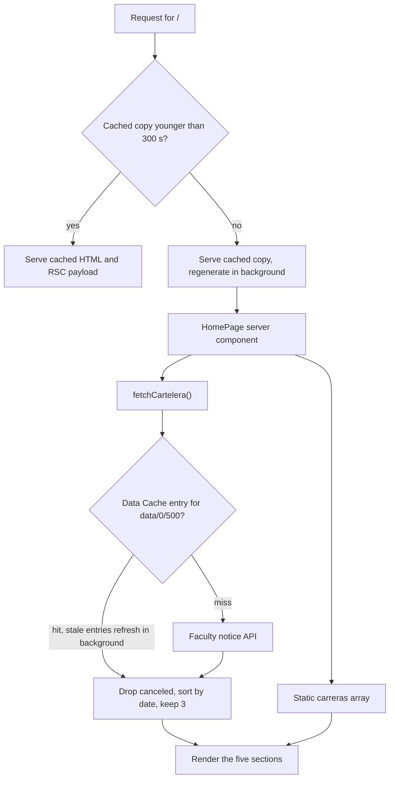

# Home

> A one-page map of the site that introduces the project, links to the four careers and to every public section, and previews the three latest notices from the faculty board.

| | |
|---|---|
| **Routes** | `/` |
| **Status** | Live since v0.1.0 |
| **Key files** | [page.tsx](../../../src/app/(public)/page.tsx), [cartelera.ts](../../../src/lib/cartelera.ts), [carreras.ts](../../../src/lib/carreras.ts), [Reveal.tsx](../../../src/components/motion/Reveal.tsx), [StaggerList.tsx](../../../src/components/motion/StaggerList.tsx) |

## Why it exists

A visitor needs to understand within a few seconds what the site offers. The home works as a site map: every public section appears as a card with a one-sentence description, the four careers are one click away, and the newest notices from the "Cartelera" (notice board) appear inline, so the site feels current without opening the board. A note near the top sets expectations early: the material is personal, not official.

## User stories

| ID | As a | I want to | So that |
|---|---|---|---|
| US-HOME-01 | first-time visitor | see every public section with a short description | I can decide where to go without opening each page |
| US-HOME-02 | student | open my career's plan straight from the home | I reach my subjects in one click |
| US-HOME-03 | student | see the three latest active notices on the home | I notice urgent announcements without opening the board |
| US-HOME-04 | student | open a previewed notice directly in its detail view | I can read it without searching the board |
| US-HOME-05 | reader | be told that the content is personal and unofficial | I do not take it as an official ruling of any course |

## Acceptance criteria

### US-HOME-01 - Site map of public sections

```gherkin
Scenario: Six section cards
  Given a visitor opens "/"
  When the page renders
  Then the "Todo lo que hay acá" (everything here) section shows six cards titled "Carreras", "Calendario académico", "Cartelera", "Bibliografía", "Links útiles" and "Sobre mí"
  And the cards link to "/carreras", "/calendario", "/cartelera", "/bibliografia", "/links" and "/sobre-mi" respectively

Scenario: Card content
  Given the section cards are rendered
  When the visitor reads any card
  Then it shows an icon, the title, an arrow and a one-sentence description

Scenario: Narrow viewport
  Given a viewport narrower than 640 px
  When the section grid renders
  Then the cards stack in a single column
```

### US-HOME-02 - Jump to a career

```gherkin
Scenario: One card per career
  Given a visitor opens "/"
  When the "Las 4 carreras de la facultad" (the faculty's 4 careers) section renders
  Then it shows cards for "APU", "ATIC", "LS" and "LI" with their full names
  And each card reads "<years> años · <subjects> asignaturas" (years, subjects) from the career data

Scenario: Open a plan
  Given the career cards are rendered
  When the visitor clicks the "LI" card
  Then the browser navigates to "/carreras/li"

Scenario: Open the careers index
  Given the careers section header is rendered
  When the visitor clicks "Ver todas" (see all)
  Then the browser navigates to "/carreras"

Scenario: Uneven name lengths
  Given a viewport at least 640 px wide, where the career cards sit two per row
  When the career grid renders
  Then all four cards share the same height, although "Analista en Tecnologías de la Información y la Comunicación" is much longer than the other names
```

### US-HOME-03 - Latest notices

```gherkin
Scenario: Three newest active notices
  Given the notice feed holds at least three notices that are not canceled
  When the home renders
  Then "Últimos anuncios" (latest notices) lists three rows, newest first
  And each row shows the subject, the title and a relative date such as "hace 2 horas" (2 hours ago)

Scenario: Canceled notices are skipped
  Given the newest notice in the feed is canceled
  When the home renders
  Then that notice is not listed and the next active notice takes its place

Scenario: Empty feed hides the section
  Given fetchCartelera returns an empty list
  When the home renders
  Then the "Últimos anuncios" section is absent and the other four sections render normally

Scenario: Subject outside the four plans
  Given a listed notice whose subject name matches no plan row
  When its row renders
  Then the row shows no career chip
```

### US-HOME-04 - Open a notice from the home

```gherkin
Scenario: Deep link to the notice
  Given a row under "Últimos anuncios"
  When the visitor clicks it
  Then the browser opens "/cartelera?a=<mensajeId>" with the id URL-encoded
  And the notice's modal is open over the notice board

Scenario: Link to the full board
  Given the notices section header is rendered
  When the visitor clicks "Ver cartelera completa" (see the full board)
  Then the browser navigates to "/cartelera" with the default filters

Scenario: Two notices share an id
  Given two listed notices with the same title, published in the same minute for different subjects
  When the visitor clicks the second row
  Then the modal shows the notice that comes first in the API response
```

### US-HOME-05 - Personal content notice

```gherkin
Scenario: Note right after the hero
  Given a visitor opens "/"
  When the page renders
  Then a note between the hero and the careers section reads "El material compartido es de carácter personal y no representa contenidos oficiales ni resoluciones aprobadas por ninguna cátedra." (the shared material is personal and does not represent official content or rulings approved by any course)

Scenario: Exposed to assistive technology
  Given a screen reader user on "/"
  When they reach the note
  Then it is announced as a note labeled "Aviso sobre el contenido del blog" (notice about the blog's content)

Scenario: Independent of live data
  Given fetchCartelera returns an empty list
  When the home renders
  Then the note is still shown
```

## Use cases

### UC-HOME-01 - Open a recent notice from the home

| | |
|---|---|
| **Primary actor** | Student |
| **Preconditions** | The notice feed holds at least one notice that is not canceled |
| **Trigger** | The student clicks a row under "Últimos anuncios" |
| **Postconditions** | The student has read the notice; the board stays open at "/cartelera" without the `a` parameter |

**Main success scenario**

1. The student opens "/".
2. The system serves the cached home, which lists the three newest active notices.
3. The student clicks a row.
4. The system opens `/cartelera?a=<mensajeId>`, finds the notice among the newest 500 and opens its modal over the default board.
5. The student reads the notice and closes the modal.
6. The system removes `a` from the URL and keeps the board on screen.

**Extensions**

- 2a. The feed is empty: the notices section is hidden, and the student opens the "Cartelera" card in the sections grid instead.
- 4a. No notice matches the id (it left the newest 500 since the home copy was generated): the board opens without a modal.
- 4b. Another notice has the same title and minute: the modal shows the one that comes first in the API response.

## How it works

`HomePage` in [page.tsx](../../../src/app/(public)/page.tsx) is an async server component. It renders five local section components in a single column capped at `max-w-5xl`:

| Order | Component | Content | Links |
|---|---|---|---|
| 1 | `HeroSection` | Eyebrow "Compañero de estudio · UNLP" (study companion), heading "Blog Informática" with "Informática" in a gradient, one paragraph describing the site | None |
| 2 | `DisclaimerSection` | The personal-content note, with `role="note"` | None |
| 3 | `CarrerasSection` | Eyebrow "Plan 2021", heading "Las 4 carreras de la facultad", one `CarreraCard` per entry in `carreras` | Each card to `/carreras/<slug>`; "Ver todas" to `/carreras` |
| 4 | `CarteleraEnVivoSection` | Eyebrow "En vivo" (live), heading "Últimos anuncios", up to three `AnuncioRow`s; rendered only when there is at least one notice | Rows to `/cartelera?a=<id>`; "Ver cartelera completa" to `/cartelera` |
| 5 | `SeccionesGridSection` | Eyebrow "Secciones" (sections), heading "Todo lo que hay acá", one `NavCard` per entry in the local `navItems` array | The six public routes |

Data and caching:

- Career cards read the static `carreras` array from [carreras.ts](../../../src/lib/carreras.ts): `nombreCorto`, `nombre`, `duracionAnios` and `cantidadAsignaturas`.
- `fetchUltimosAnuncios()` calls `fetchCartelera()` from [cartelera.ts](../../../src/lib/cartelera.ts), drops canceled notices, sorts by date (newest first) and keeps the first `ULTIMOS_ANUNCIOS = 3`.
- Each row shows the career acronyms joined with " · " in one chip (only when the subject maps to a plan), the subject, the title clamped to two lines, and `formatRelative(fecha)`.
- The route exports `revalidate = 300`: the build prerenders it and Next.js regenerates it in the background at most every 300 seconds. The first request after the window still receives the old copy while the new one is built.
- `fetchCartelera()` requests `https://gestiondocente.info.unlp.edu.ar/cartelera/data/0/500` with `next: { revalidate: 300 }`. The Data Cache key (URL plus headers) is the same one `/cartelera` uses, so both pages share one cached response. Only status 200 responses are stored.
- Row links use `mensajeId()`: the notice date as an ISO string cut to the minute, a dash, and a slug of the title (lowercase, accents removed, other characters collapsed to "-", at most 40 characters). The home URL-encodes it with `encodeURIComponent`.

The flowchart below shows how a request for `/` is served and where the notice data comes from.



Animations: `Reveal` fades each section in with a 16 px rise over 0.55 s. The hero and the note animate on mount (the note 0.1 s later); the other sections animate once when they scroll into view, 60 px before entering the viewport. `StaggerList` staggers the career cards by 80 ms and the section cards by 70 ms.

## States and variants

| State | What the visitor sees |
|---|---|
| Feed has active notices | All five sections, with up to three notice rows |
| Feed empty: no active notice, or a non-2xx answer with nothing cached | The notices section is absent; the other four sections render |
| Notice API fails while a cached feed exists | The cached notices keep being shown, because the Data Cache keeps its last good entry |
| Regeneration throws | The previous copy of the home keeps being served |
| Before JavaScript runs | A blank page: the prerendered body has no visible content (see Non-functional notes) and the Suspense fallback is `null` |
| Navigating away | A 2 px progress bar runs along the top edge until the next route renders |

Responsive behavior:

- Side padding comes from the public layout: 16 px on phones, 24 px from 640 px, 40 px from 768 px.
- Career grid: one column, two from 640 px, with equal row heights (`auto-rows-fr`).
- Section grid: one column, two from 640 px, three from 1024 px.
- The hero heading grows from `text-4xl` to `text-6xl` at 640 px.
- On phones the header shows the logo and "Blog Informática" as a link home; on desktop the sidebar carries the branding, and the breadcrumb is not rendered on `/`.

Dark mode:

- All colors come from theme tokens. The pastel tokens behind chips and icon tiles (`--pastel-blue`, `--pastel-amber`) have darker values under `data-theme="dark"`, and the note's icon switches from amber-700 to amber-200.
- The theme comes from the header toggle ("Cambiar tema", change theme), which stores the choice in localStorage and sets `data-theme` on `<html>` after hydration. First visits default to light; the system preference is not read.

## Non-functional notes

Performance:

- ISR with a 300-second window; the build manifest lists `/` with `initialRevalidateSeconds: 300`.
- The notice request shares its Data Cache entry with `/cartelera`. In a local build the entry measured about 0.95 MB, under Next.js's 2 MB per-entry limit for the Data Cache.
- The page is a server component. Its only client code is the motion wrappers (`Reveal` and `StaggerList`, built on framer-motion) and `next/link`.
- Client-side rendering bailout: the root layout wraps `NavigationLoadingProvider`, which calls `useSearchParams()`, in `<Suspense fallback={null}>`. On statically rendered routes Next.js renders that whole subtree in the browser, so the prerendered HTML for `/` carries no visible text. The content travels in the inline RSC payload and appears only after JavaScript runs, which delays the first contentful paint.

Accessibility:

- One `h1`, an `h2` per section and `h3` card titles.
- The note uses `role="note"` with an `aria-label`.
- Cards and rows are plain links whose text is their accessible name; decorative icons are hidden from assistive technology.
- Relative dates are plain text, without a `<time>` element or the absolute date.
- The framer-motion animations do not honor `prefers-reduced-motion` (the project uses neither `MotionConfig` nor `useReducedMotion`), unlike the CSS animations in `globals.css`.

SEO:

- The home exports no page metadata, so it inherits the root defaults: title "Blog Informática UNLP", the site description, canonical "/" and the `/opengraph-image` card.
- The root layout adds JSON-LD (`WebSite`, `Person`, `EducationalOrganization`) outside the Suspense boundary, so it is present in the HTML.
- The sitemap lists `/` with weekly change frequency and priority 1.0.
- Because the HTML body is empty, crawlers that do not run JavaScript see no content.

## Known gaps

- The home renders on the client: the prerendered HTML has no visible content until JavaScript loads, as described above.
- `fetchCartelera()` handles only non-2xx answers. A network error or malformed JSON is not caught: with nothing cached, a background regeneration fails and the previous copy stays, and a build-time prerender fails.
- Relative dates are computed when the copy is generated. On a quiet site the first visitor after a long gap receives the stale copy, with stale "hace ..." labels, while the page regenerates.
- Notice dates depend on the server time zone; see the [notice board known gaps](../notice-board/README.md#known-gaps).
- The preview does not filter by career: it shows the newest active notices of the whole faculty, including subjects outside the four careers, which appear without a chip.
- The six section cards (`navItems` in the page) and the sidebar links in [DesktopSidebar.tsx](../../../src/components/DesktopSidebar.tsx) are separate hard-coded lists, so adding a section means editing both.
- Entrance animations ignore the reduced-motion preference.
