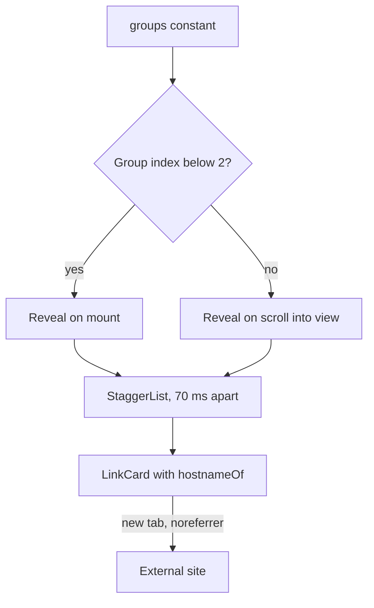

# Links

> Collects 20 official faculty pages and student resources in seven topic groups, each card saying what the link is for and which site it opens.

| | |
|---|---|
| **Routes** | `/links` |
| **Status** | Live since v0.1.0 |
| **Key files** | [page.tsx](../../../src/app/(public)/links/page.tsx), [Reveal.tsx](../../../src/components/motion/Reveal.tsx), [StaggerList.tsx](../../../src/components/motion/StaggerList.tsx) |

## Why it exists

Knowing where to find each thing at the faculty takes time, because it is spread across many sites: SIU Guaraní for enrollment, three course platforms that each course team chooses from, a separate site for class schedules, the official notice board, the institutional website and student-run chat groups. "Links útiles" (useful links) centralizes them, with one short line about what each link does.

## User stories

| ID | As a | I want to | So that |
|---|---|---|---|
| US-LINK-01 | student | open the official page and the 2021 study plan of my career | I can check the official program details |
| US-LINK-02 | student | see the course platforms and what each one is for | I can reach my course materials whichever platform the course uses |
| US-LINK-03 | student | reach enrollment, class schedules, the official notice board, the academic calendar and faculty contacts from one place | I do not have to hunt for the right faculty system |
| US-LINK-04 | student | find the student-run chat groups of my subjects | I can stay in touch with classmates |
| US-LINK-05 | student | see which site a link opens before clicking, and keep this page open afterwards | I can trust the destination and come back to the directory |
| US-LINK-06 | student of a career the site does not cover | find my career's own website | I am not left on a site built for other careers |

## Acceptance criteria

### US-LINK-01 - Career pages and study plans

```gherkin
Feature: Career links

  Scenario: Career pages
    Given I am on "/links"
    When I look at the "Carreras" (careers) group
    Then it shows four cards tagged "APU", "ATIC", "LS" and "LI"
    And every card opens a page on info.unlp.edu.ar

  Scenario: Study plans with duration and subject count
    Given I am on "/links"
    When I look at the "Planes de estudio 2021" (2021 study plans) group
    Then the "Plan APU 2021" and "Plan ATIC 2021" cards mention "3 años · 24 asignaturas" (3 years, 24 subjects)
    And the "Plan LS 2021" and "Plan LI 2021" cards mention "5 años · 37 asignaturas" (5 years, 37 subjects)

  Scenario: Plan cards point to the official site, not to the internal plan pages
    Given I am on "/links"
    When I click "Plan LS 2021"
    Then "https://www.info.unlp.edu.ar/licenciatura-en-sistemas-plan-2021/" opens in a new tab
    And the card does not lead to the site's own "/carreras/ls" page
```

### US-LINK-02 - Course platforms

```gherkin
Feature: Course platforms

  Scenario: The three platforms
    Given I am on "/links"
    When I look at the "Plataformas de cursada" (course platforms) group
    Then it shows "Ideas", "Cátedras (LINTI)" (course sites hosted by LINTI) and "Moodle (Asignaturas)" (Moodle, subjects), each tagged "Plataforma" (platform)
    And the group description ends with "Cada cátedra elige una." (each course team picks one)

  Scenario: Hostnames tell the platforms apart
    Given I am on "/links"
    When I read the bottom line of each platform card
    Then they show "ideas.info.unlp.edu.ar", "catedras.linti.unlp.edu.ar" and "asignaturas.info.unlp.edu.ar"

  Scenario: The page does not map courses to platforms
    Given I want to know which platform a specific course uses
    When I read the "Plataformas de cursada" group
    Then no card names a specific course
```

### US-LINK-03 - Self-service and faculty information

```gherkin
Feature: Self-service and faculty information

  Scenario: Self-service systems
    Given I am on "/links"
    When I look at the "Autogestión y trámites" (self-service and procedures) group
    Then it shows "Autogestión SIU" (SIU self-service) tagged "SIU Guaraní", "Inicio de clases y cursadas" (class start and course schedules) tagged "Cursadas" (courses) and "Cartelera virtual oficial" (official virtual notice board) tagged "Anuncios" (announcements)

  Scenario: Faculty information
    Given I am on "/links"
    When I look at the "Información de la facultad" (faculty information) group
    Then it shows "Web de la Facultad de Informática" (Faculty of Informatics website), "Calendario académico 2026" (2026 academic calendar) and "Contacto institucional" (institutional contact)

  Scenario: The official notice board card mentions the internal board as plain text
    Given I am on "/links"
    When I read the "Cartelera virtual oficial" card
    Then its description mentions "/cartelera" without linking to it
    And clicking anywhere on the card opens the official board on gestiondocente.info.unlp.edu.ar in a new tab
```

### US-LINK-04 - Student chat groups

```gherkin
Feature: Community

  Scenario: Chat groups card
    Given I am on "/links"
    When I look at the "Comunidad" (community) group
    Then it shows one card, "Grupos de WhatsApp por materia" (WhatsApp groups by subject), tagged "WhatsApp"
    And its description says the link page is created and maintained by students

  Scenario: Same destination from the sidebar
    Given I am on any page with the sidebar visible
    When I click "Grupos WhatsApp" (WhatsApp groups) under "Recursos" (resources)
    Then the same external link page opens in a new tab

  Scenario: Individual groups are not listed on the site
    Given I am on "/links"
    When I look for the group of a specific subject
    Then the page offers no per-subject group link, only the external link page
```

### US-LINK-05 - Know the destination

```gherkin
Feature: Card destination

  Scenario: Hostname without "www."
    Given a card links to "https://www.info.unlp.edu.ar/contacto/"
    When the card renders
    Then its bottom line reads "info.unlp.edu.ar"

  Scenario: Opening a card
    Given I am on "/links"
    When I click any card
    Then the destination opens in a new tab and the request carries no Referer header
    And "/links" stays open in the original tab

  Scenario: An href that is not a valid URL
    Given a card's href cannot be parsed as a URL
    When the card renders
    Then its bottom line shows the raw href instead of a hostname
```

### US-LINK-06 - Careers outside the site

```gherkin
Feature: Other careers

  Scenario: Other careers group
    Given I am on "/links"
    When I look at the "Otras carreras de la facultad" (other careers of the faculty) group
    Then it shows "Ingeniería en Computación" (computer engineering) tagged "IC" and "Ciencia de Datos en Organizaciones" (data science in organizations) tagged "CDO"

  Scenario: The group says the site does not cover them
    Given I am on "/links"
    When I read the "Otras carreras de la facultad" description
    Then it states that these careers are not covered by the site but share many subjects with APU, ATIC, LS and LI

  Scenario: Their sites open on their own subdomains
    Given I am on "/links"
    When I click the "IC" card
    Then "https://ic.info.unlp.edu.ar/" opens in a new tab
```

## How it works

[page.tsx](../../../src/app/(public)/links/page.tsx) is a Server Component. All content comes from a `groups` constant, typed as follows:

| Type | Fields |
|---|---|
| `LinkGroup` | `title`, `description`, `icon` (a lucide icon element), `links` |
| `UsefulLink` | `title`, `description`, `href`, optional `tag` (short label above the title) |

The seven groups render in this order:

| Group | Icon | Links | Tags |
|---|---|---|---|
| "Carreras" | `GraduationCap` | 4 | APU, ATIC, LS, LI |
| "Planes de estudio 2021" | `ScrollText` | 4 | APU, ATIC, LS, LI |
| "Plataformas de cursada" | `Laptop` | 3 | "Plataforma" |
| "Autogestión y trámites" | `ClipboardList` | 3 | "SIU Guaraní", "Cursadas", "Anuncios" |
| "Información de la facultad" | `Building2` | 3 | "Portal", "Calendario" (calendar), "Contacto" (contact) |
| "Comunidad" | `MessagesSquare` | 1 | "WhatsApp" |
| "Otras carreras de la facultad" | `Compass` | 2 | IC, CDO |

The page header shows the eyebrow "Directorio de recursos" (resource directory), the heading "Links útiles" and the sentence "Todo abre en otra pestaña." (everything opens in another tab). Each group is a `<section>` with an icon tile, an `h2` title and a one-line description. The first two groups fade up on mount, with 0.1 s and 0.15 s delays. The rest fade up when they scroll into view. Inside each group, [StaggerList.tsx](../../../src/components/motion/StaggerList.tsx) renders the cards as a `<ul>` and reveals them 70 ms apart when the list scrolls into view.

`LinkCard` renders one `<a>` per link with `target="_blank"` and `rel="noreferrer"`. It contains the optional tag, an `h3` title, an arrow icon, the description and, at the bottom, the hostname from `hostnameOf()`. That helper parses the `href` with `new URL()`, strips a leading `www.`, and returns the raw string if parsing fails. Eleven of the 20 links point to `info.unlp.edu.ar`.

The diagram shows how the constant turns into cards.



To add a link, append an object to the right group's `links` array. To add a group, append a `LinkGroup` with a lucide icon. React keys use the group `title` and the link `href`, so both must be unique within their list.

## States and variants

**Loading, empty and error.** The content is static, so there is no loading, empty or error state of its own. Rendering errors fall back to the root [error.tsx](../../../src/app/error.tsx). On a first visit the page stays blank until the client bundle renders it, because the static HTML has no visible body content (see [Non-functional notes](#non-functional-notes)).

**Responsive.** Below 768px the cards stack in one column. From 768px each group shows two columns, and `auto-rows-fr` gives every row of a group the same height. The page heading grows from 640px.

**Dark mode.** Cards, icon tiles and the hover glow use theme tokens (`bg-card`, `bg-pastel-blue`, `border-border`), which switch to darker values under `[data-theme="dark"]`.

## Non-functional notes

- **Performance.** The route is static and prerendered at build time, with no ISR. The page is a Server Component, so the link data travels in the RSC payload and no page-specific code ships to the browser beyond the shared motion wrappers.
- **Rendering.** The root layout wraps every page in a `Suspense` boundary around a provider that calls `useSearchParams()`, so the static HTML carries the metadata but no visible text. The cards appear once the client renders the RSC payload.
- **Accessibility.** Headings follow a clean outline: `h1` for the page, `h2` per group, `h3` per card. Each group's cards form a list. Icons and the hover glow are hidden from assistive technology. A card's accessible name is all of its text, including the hostname, which makes it long. New-tab behavior is stated in the intro text but not announced per link.
- **SEO.** The title is "Links útiles · Blog Informática UNLP", where the suffix is the site name, the description lists the kinds of resources, and the canonical path is `/links`. The sitemap lists the route with a `monthly` change frequency and priority 0.6. Outbound links are followed, with no `nofollow`. See [SEO](../seo/README.md).

## Known gaps

- The links are hardcoded in [page.tsx](../../../src/app/(public)/links/page.tsx), so any change needs a deploy. Nothing checks for broken links.
- The "Calendario académico 2026" card points to a year-specific page.
- The plan durations and subject counts are typed as text instead of being read from [carreras.ts](../../../src/lib/carreras.ts), so the two can drift apart.
- The "Cartelera virtual oficial" description mentions the site's own `/cartelera` ([Notice board](../notice-board/README.md)) as plain text, not as a link.
- The chat groups URL is repeated in three files: this page, [DesktopSidebar.tsx](../../../src/components/DesktopSidebar.tsx) and [MobileSidebarTrigger.tsx](../../../src/components/MobileSidebarTrigger.tsx).
- There is no search or filter. All 20 links render on one page.
- New-tab behavior is not announced to screen readers.
- The static HTML has no visible body content, so crawlers that do not run JavaScript see only the metadata.
