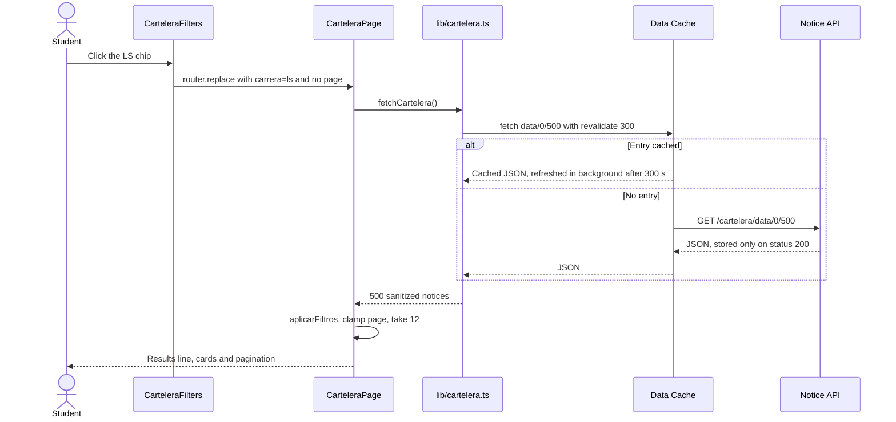
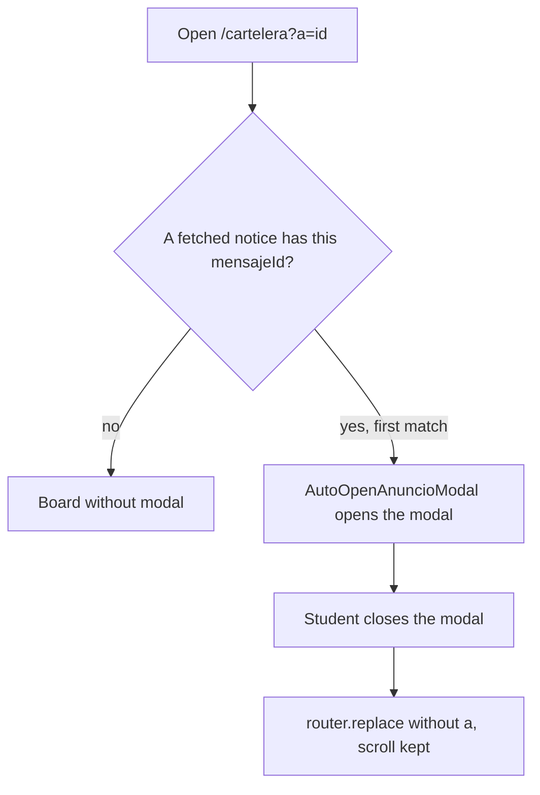

# Notice board

> Mirrors the faculty's official notice board with sanitized content, search, filters, pagination and links that open a single notice.

| | |
|---|---|
| **Routes** | `/cartelera` |
| **Status** | Live since v0.1.0 |
| **Key files** | [cartelera/page.tsx](../../../src/app/(public)/cartelera/page.tsx), [cartelera.ts](../../../src/lib/cartelera.ts), [CarteleraFilters.tsx](../../../src/components/cartelera/CarteleraFilters.tsx), [AnuncioCard.tsx](../../../src/components/cartelera/AnuncioCard.tsx), [AutoOpenAnuncioModal.tsx](../../../src/components/cartelera/AutoOpenAnuncioModal.tsx), [CarteleraPagination.tsx](../../../src/components/cartelera/CarteleraPagination.tsx) |

## Why it exists

Courses and teachers announce date changes, exam sessions, partial exams, links and PDFs on the faculty's official board at gestiondocente.info.unlp.edu.ar/cartelera. That board has no career filter or per-notice links, and its notice bodies are free-form HTML. This page reads the same public API, sanitizes the HTML, tags each notice with the careers whose plan contains its subject, and adds search, filters, pagination and deep links, in both themes.

## User stories

| ID | As a | I want to | So that |
|---|---|---|---|
| US-NB-01 | student | browse recent notices as readable cards | I catch changes to dates, exams and materials |
| US-NB-02 | student | filter notices by career, subject, date range and attachments | I only see what concerns me |
| US-NB-03 | student | search the text of the notices | I can find a notice when I remember a word from it |
| US-NB-04 | student | open a notice in full, with its attachments | I can read everything and download the files |
| US-NB-05 | student | open links to a filtered view or to a single notice | I land on exactly what a classmate or the home page pointed me to |
| US-NB-06 | student | keep canceled notices hidden unless I ask for them | I do not act on withdrawn announcements |

## Acceptance criteria

### US-NB-01 - Browse notices

```gherkin
Scenario: Default view
  Given the feed holds notices from the last 30 days
  When a visitor opens "/cartelera" with no query string
  Then up to 12 non-canceled notices from the last 30 days appear, in the order the API returns them
  And a line reads "Mostrando <n> resultados" (showing n results), followed by "Página 1 de <m>" (page 1 of m) when there is more than one page

Scenario: Card content
  Given a notice for "Taller de Programación" with two attachments
  When its card renders
  Then it shows the chips "APU", "ATIC", "LS" and "LI", a relative date, the title, the subject, a body preview, the author and "2 adjuntos" (2 attachments)

Scenario: Page number past the end
  Given the active filters produce 3 pages
  When a visitor opens "/cartelera?page=99"
  Then page 3 is shown

Scenario: Nothing matches
  Given no notice matches the active filters
  When the page renders
  Then the results line is hidden
  And the empty state reads "Sin resultados" (no results) and "Probá ampliar el rango de fechas o sacar algunos filtros." (try a wider date range or fewer filters)
```

### US-NB-02 - Filter

```gherkin
Scenario: Career chip
  Given no career filter is active
  When the visitor clicks "LS"
  Then the URL becomes "/cartelera?carrera=ls"
  And only notices whose subject is a row of the LS plan remain

Scenario: Back to the default range
  Given the visitor is on "/cartelera?rango=7"
  When they click "30 días" (30 days)
  Then the rango parameter disappears from the URL, because 30 days is the default

Scenario: Subject list wider than the default range
  Given the "Materia" (subject) dropdown lists every subject found in the newest 500 notices
  When the visitor picks a subject whose latest notice is older than 30 days
  Then the empty state appears until they choose a wider range such as "Todo" (all)

Scenario: Only notices with attachments
  Given the board shows notices with and without attachments
  When the visitor turns on "Solo con adjuntos" (only with attachments)
  Then the URL gains "adjuntos=1" and every card shows an attachment count
```

### US-NB-03 - Search

```gherkin
Scenario: Debounced search
  Given the visitor is on "/cartelera"
  When they type "parcial" and stop typing for 300 ms
  Then the URL becomes "/cartelera?q=parcial" and the filter panel dims until the new results arrive

Scenario: Case-insensitive match on four fields
  Given a notice whose body contains "aula 5" while its title, subject and author do not
  When the visitor searches "AULA 5"
  Then the notice matches

Scenario: Accents are not normalized
  Given a notice that contains "Matemática" but never "matematica"
  When the visitor searches "matematica"
  Then the notice does not match

Scenario: Clear everything
  Given a search and a career filter are active
  When the visitor clicks "Limpiar" (clear)
  Then the URL returns to "/cartelera" and the search box is empty
```

### US-NB-04 - Read a notice in full

```gherkin
Scenario: Open from a card
  Given a card in the grid
  When the visitor clicks the card outside any link
  Then a modal shows the title, subject, author, full date (for example "7 may 2026 - 07:41"), the whole body and, when there are attachments, an "Adjuntos (<n>)" (attachments) list

Scenario: Links inside the preview
  Given a card whose preview contains a link
  When the visitor clicks that link
  Then the link opens in a new tab and no modal opens

Scenario: Keyboard
  Given a card has keyboard focus
  When the visitor presses Enter or Space
  Then the modal opens

Scenario: Unsafe markup
  Given a notice body with a script element and an onclick attribute
  When the notice renders
  Then neither the script nor the attribute reaches the page
```

### US-NB-05 - Open shared links

```gherkin
Scenario: Filtered view
  Given the URL "/cartelera?carrera=atic&rango=90&page=2"
  When a visitor opens it
  Then the "ATIC" chip and "90 días" are active and page 2 of those results is shown

Scenario: Single notice
  Given a URL "/cartelera?a=<mensajeId>" for a notice among the newest 500
  When a visitor opens it
  Then the board renders with that notice's modal open, even if the notice is outside the current filters or page

Scenario: Closing keeps the other parameters
  Given the visitor opened "/cartelera?carrera=li&a=<mensajeId>"
  When they close the modal
  Then the URL becomes "/cartelera?carrera=li" and the scroll position stays

Scenario: Unknown id
  Given a URL whose a value matches no fetched notice
  When a visitor opens it
  Then the board renders without a modal and without an error
```

### US-NB-06 - Canceled notices

```gherkin
Scenario: Hidden by default
  Given the feed contains canceled notices
  When a visitor opens "/cartelera"
  Then no canceled notice is listed

Scenario: Shown on request
  Given the feed contains canceled notices
  When the visitor turns on "Mostrar anulados" (show canceled)
  Then the URL gains "anulados=1" and canceled cards appear at 60% opacity under an "Anulado" (canceled) badge

Scenario: Single-notice links ignore the toggle
  Given a canceled notice and its "/cartelera?a=<mensajeId>" link
  When a visitor opens the link with the default filters
  Then the modal opens with the "Anulado" badge, although the grid hides the notice
```

## Use cases

### UC-NB-01 - Find the latest notices of one subject

| | |
|---|---|
| **Primary actor** | Student |
| **Preconditions** | The notice API has answered with status 200 at least once, so the feed is cached |
| **Trigger** | The student wants the recent notices of a subject they take |
| **Postconditions** | The URL encodes the chosen filters and the student has read the notice |

**Main success scenario**

1. The student opens "/cartelera".
2. The system shows the non-canceled notices from the last 30 days, 12 per page.
3. The student clicks their career chip.
4. The system replaces the URL, drops `page` and renders the career's notices.
5. The student picks the subject in the "Materia" dropdown.
6. The system renders the subject's notices.
7. The student clicks a card.
8. The system opens the modal with the full body and the attachments.

**Extensions**

- 2a. The request throws (network error or malformed JSON) and nothing is cached: the error screen "Algo salió mal" (something went wrong) offers "Reintentar" (retry) and "Ir al inicio" (go home).
- 4a. The subject's name on the board differs from the plan, for example by an accent or a "Redictado - " prefix for a re-run course: the career filter hides its notices, so the student removes the career and uses the dropdown or the search instead.
- 6a. The subject has no notice in the last 30 days: the empty state appears, and the student picks "Todo" under "Cuándo" (when).

### UC-NB-02 - Open a single-notice link

| | |
|---|---|
| **Primary actor** | Student |
| **Preconditions** | The student has a link built by the "Últimos anuncios" (latest notices) list on the home page |
| **Trigger** | The student opens `/cartelera?a=<mensajeId>` |
| **Postconditions** | The modal is closed and the URL no longer contains `a` |

**Main success scenario**

1. The student opens the link.
2. The system loads the feed, computes `mensajeId` for every notice and finds the match.
3. The system renders the board with the default filters and mounts the modal open.
4. The student reads the notice and closes the modal.
5. The system replaces the URL without `a`, keeping any other parameter and the scroll position.

**Extensions**

- 2a. No notice matches, because it left the newest 500 or its title changed: the board renders without a modal.
- 2b. Two notices share the id (same title, same minute): the one that comes first in the API response opens.

## How it works

Data source, in [cartelera.ts](../../../src/lib/cartelera.ts):

- `fetchCartelera()` requests `GET https://gestiondocente.info.unlp.edu.ar/cartelera/data/0/500` (public, no authentication) with `Accept: application/json` and `next: { revalidate: 300 }`. The API also reports a `total`, but the site reads only the newest 500 notices (`FETCH_COUNT`); at the time of writing they reach back about 13 months.
- A non-2xx status logs an error and returns `[]`. Network errors and malformed JSON are not caught.
- `transformMensaje` maps each raw notice: `cuerpo` becomes `cuerpoHtml` through `sanitizeCuerpo`; `fecha` ("DD/MM/YYYY HH:mm") becomes a `Date` through `parseFecha`, keeping the raw string as `fechaRaw`; `fecha_anulacion` also goes through `parseFecha` (see Known gaps); `materia` becomes `carreras` through `carrerasDeMateria`, which looks the subject up in an index of every plan row's `nombre`, built once, by exact string.

Caching:

- `/cartelera` reads `searchParams`, so Next.js renders it on every request. It is not prerendered, even though the file exports `revalidate = 300`.
- The API response stays in the Data Cache for 300 seconds and is shared with the home page. After the window, the next request still gets the cached copy while a background request refreshes it. Only status 200 responses are stored.
- The cache holds the raw JSON, so sanitizing and mapping all 500 notices runs on every request. It runs on the server only: sanitize-html is not in any client chunk.

Page flow, in [cartelera/page.tsx](../../../src/app/(public)/cartelera/page.tsx): build `FiltrosCartelera` from the query, fetch, run `aplicarFiltros(todos, filtros)`, list the subjects of all fetched notices for the dropdown with `listarMaterias` (sorted with Spanish collation), look up the `a` parameter among all fetched notices, clamp the page, take 12 notices, and rebuild the query without `page` for the pagination links.

URL parameters:

| Parameter | Values | Default | Effect |
|---|---|---|---|
| `q` | Any text | None | Case-insensitive substring match over title, subject, author and body text with tags stripped |
| `materia` | Exact subject name | None | Keeps notices whose subject equals the value |
| `carrera` | `apu`, `atic`, `ls`, `li` | None | Keeps notices whose subject is a row of that career's plan |
| `rango` | `7`, `30`, `90` or `todo`; any integer works | `30` | Keeps notices up to that many days old; `todo` or a non-numeric value removes the limit |
| `adjuntos` | `1` | Off | Keeps notices with at least one attachment |
| `anulados` | `1` | Off | Includes canceled notices, which are hidden otherwise |
| `page` | Integer | `1` | 12 notices per page; values below 1 or non-numeric become 1, values past the end become the last page |
| `a` | A `mensajeId` | None | Opens that notice's modal when it is among the fetched notices |

Filters, in [CarteleraFilters.tsx](../../../src/components/cartelera/CarteleraFilters.tsx) (client):

- Every change calls `router.replace("/cartelera?...", { scroll: false })` inside `startTransition` and deletes `page`. The panel drops to 70% opacity while the transition is pending.
- The search box, with the placeholder "Buscar título, materia, autor..." (search title, subject, author), keeps local state and updates `q` after 300 ms without typing. It re-syncs from the URL whenever the query string changes.
- "Carrera" (career) chips toggle the career on and off and expose `aria-pressed`.
- "Cuándo" chips offer "7 días", "30 días", "90 días" and "Todo"; picking 30 removes the parameter.
- The "Materia" select starts with "Todas" (all) followed by the subject list.
- Two toggles, "Solo con adjuntos" and "Mostrar anulados", write `adjuntos=1` and `anulados=1`.
- "Limpiar" appears when any filter is active and navigates to `/cartelera`.

Cards and modal, in [AnuncioCard.tsx](../../../src/components/cartelera/AnuncioCard.tsx) (client):

- The card is an `article` with `role="button"`, `tabIndex={0}` and the label `Ver completo: <title>` ("Ver completo" means see full). A click opens the modal unless it started on an `a` or `button`; Enter or Space on the focused card does the same.
- Header: career chips (each with the full career name as tooltip) and a `<time>` element showing the relative date, with the full date as tooltip.
- The body preview is capped at 8.5em. A `ResizeObserver` sets `data-faded` only when the content overflows, which adds a fade mask at the bottom.
- Footer: author, attachment count and a "Ver completo →" hint that appears on hover.
- `AnuncioModal` is a dialog up to min(95vw, 48rem) wide and 85vh tall, with a scrolling body. Attachments render as pill links, with a file icon for PDFs and a link icon otherwise, opening in a new tab.

Deep links:

- `mensajeId(m)` is `m.fecha.toISOString().slice(0, 16)`, a dash, and the title lowercased, without accents, with every other run of characters turned into "-", trimmed and cut to 40 characters.
- Only the home page builds these links. The board searches all fetched notices, ignoring filters and paging.
- On a match, [AutoOpenAnuncioModal.tsx](../../../src/components/cartelera/AutoOpenAnuncioModal.tsx) mounts `AnuncioModal` with `open` initially true; closing it calls `router.replace` with the same query minus `a` and `scroll: false`.

Pagination, in [CarteleraPagination.tsx](../../../src/components/cartelera/CarteleraPagination.tsx) (server component): hidden when there is a single page; previous and next arrows that are disabled at the ends; the first and last page plus one page on each side of the current one, with "…" for gaps. Links keep the other parameters, drop `page` for page 1 and use `scroll={false}`.

Sanitizer allowlist (`sanitizeCuerpo`):

| Aspect | Allowed |
|---|---|
| Tags | `p`, `br`, `strong`, `b`, `em`, `i`, `u`, `s`, `del`, `span`, `a`, `ul`, `ol`, `li`, `h1` to `h6`, `blockquote`, `code`, `pre`, `hr`, `img`, `table`, `thead`, `tbody`, `tr`, `td`, `th`, `div` |
| Attributes | `a`: `href`, `name`, `target`, `rel`; `img`: `src`, `alt`, `width`, `height`; any tag: `style` |
| URL schemes | `http`, `https`, `mailto`; images may also use `data` |
| Inline styles | `color` (hex or `rgb()`), `background-color` (hex or `rgb()`), `font-size` (px, em, rem or %), `font-weight` (number, `bold` or `normal`), `text-decoration`, `text-align` (`left`, `right`, `center`, `justify`) |
| Links | Every `a` is rewritten with `target="_blank"` and `rel="noopener noreferrer"` |

Any other tag (for example `iframe`, or namespaced tags such as `o:p` pasted from word processors) is dropped but its text is kept; `script`, `style`, `textarea`, `option` and `xmp` are removed together with their content. Event handler attributes and unlisted styles are removed as well. The `.cartelera-body` rules in [globals.css](../../../src/app/globals.css) then style the result and neutralize inline font sizes on spans.

Relative dates (`formatRelative`):

| Age | Label |
|---|---|
| Under 60 seconds | "hace instantes" (moments ago) |
| Under 60 minutes | "hace N min" |
| Under 24 hours | "hace 1 hora" or "hace N horas" |
| 1 day | "ayer" (yesterday) |
| 2 to 6 days | "hace N días" |
| 7 to 29 days | "hace N sem" (weeks, rounded down) |
| 30 days or more | "12 mar" in the current year, "12 mar 2025" otherwise |

The sequence below shows a filter change from the click to the new results, including the Data Cache.



The flowchart below shows how a `?a=` link is resolved and cleaned up.



## States and variants

| Case | What renders |
|---|---|
| Results | Results line, a grid of up to 12 cards, and pagination when there is more than one page |
| No results | The "Sin resultados" empty state, without results line or pagination |
| Feed empty: non-2xx answer with nothing cached | The same empty state |
| Request throws with nothing cached | The root error screen "Algo salió mal" with "Reintentar" and "Ir al inicio", without the sidebar and header |
| API down while a cached feed exists | The cached feed keeps being served |
| Deep link matches | The modal open over the board |
| Deep link does not match | The board only |
| Canceled notice shown | Card at 60% opacity, "Anulado" badge on the card and in the modal |
| Filter change pending | Filter panel at 70% opacity; the previous results stay until the new ones arrive |
| Server render in progress on a full page load | The root `loading.tsx` may briefly show three pulsing dots with `role="status"` and the label "Cargando" (loading) |

Responsive behavior:

- The grid has one column, two from 640 px, with equal row heights.
- The career, range, subject and toggle groups wrap; on phones the two toggles wrap onto separate lines, and the subject select is capped at `max-w-xs`.
- The modal is up to 95vw wide (48 rem at most) and 85vh tall, with a scrolling body.
- The breadcrumb reads "Cartelera" and is shown from 640 px.

Dark mode:

- Inline `color` and `background` styles inside notice bodies are reset to theme colors, because the official HTML often hard-codes black text that would be invisible on the dark background. Light mode keeps them.
- The "Anulado" badge switches to a dark rose background with lighter text.
- Chips, toggles and filter buttons use the pastel and primary tokens, which have dark values under `data-theme="dark"`.

## Non-functional notes

Performance:

- Rendered per request on the server. The API JSON comes from the Data Cache; in a local build the entry measured about 0.95 MB, under Next.js's 2 MB per-entry limit, so roughly doubling `FETCH_COUNT` would approach the point where the response stops being cached.
- Filtering 500 notices is a single linear pass, and only 12 cards are sent to the client. Sanitizing all 500 bodies, however, repeats on every request.
- Client components: `CarteleraFilters`, one `AnuncioCard` per visible notice (each with its own dialog), `AutoOpenAnuncioModal` and the `Reveal` wrappers. `CarteleraPagination` is a server component.
- Like the other routes, the notice cards are not in the server HTML today: the `(public)` layout loads its shell provider with `next/dynamic` and `ssr: false`, so the cards render in the browser from the RSC payload. Fixing this is tracked in [#45](https://github.com/MatiasGuaymas/Blog_Informatica/issues/45).

Accessibility:

- Filter chips are buttons with `aria-pressed`; the subject select has a visible `label`; the toggles are visually hidden checkboxes inside their labels.
- The search input has only a placeholder, with no `label` or `aria-label`.
- Cards are focusable elements with `role="button"` and an `aria-label`. ARIA treats the children of a button as presentational, so screen readers may not announce links inside the preview, although they remain clickable.
- The "Ver completo →" hint appears on hover only, not on focus.
- The pagination is a `nav` labeled "Paginación de la cartelera" (board pagination), with labeled arrows and `aria-current="page"` on the current page.
- The modal title is the dialog's accessible name, and the close button is labeled "Cerrar" (close).

SEO:

- Title "Cartelera" (notice board), a description, and canonical `/cartelera`; filtered URLs share that canonical.
- Sitemap: hourly change frequency, priority 0.8.
- Card text, including each full body clipped by CSS, reaches the browser in the RSC payload and is rendered on the client, so crawlers that do not run JavaScript do not see it ([#45](https://github.com/MatiasGuaymas/Blog_Informatica/issues/45)).

## Known gaps

- Canceled notices never show their cancellation date. The API sends `fecha_anulacion` in ISO 8601 (for example `2026-05-07T10:41:00-0300`), but `parseFecha` expects `DD/MM/YYYY HH:mm`; the invalid Date it returns reaches the client as `null`, so the badge only says "Anulado".
- The API's timestamps carry no time zone, and `parseFecha` reads them in the server's zone. The faculty publishes in Argentina time (UTC-3), so on a server running in UTC every notice is placed three hours early: relative ages read three hours older, and full dates shown in an Argentine browser are three hours early.
- Subjects map to careers by exact name, so variants such as "Ingenieria de Software 1" (no accent) or "Redictado - Matemática 1" get no career chip and disappear under a career filter.
- Search is accent-sensitive: "matematica" does not find "Matemática".
- The subject dropdown lists subjects from all 500 notices while the default range is 30 days, so many choices start with an empty result.
- Only the newest 500 notices are fetched; older ones are unreachable, and links to them stop opening the modal.
- `mensajeId` can collide: notices cross-posted to two subjects with the same title in the same minute share an id, and the link always opens the first one.
- Opening a card does not put `?a=` in the URL, so the board itself offers no way to copy a link to a single notice; only the home builds them.
- Network errors and malformed JSON are not caught, so with nothing cached they reach the error screen instead of the empty state.
- The board does not sort notices; it relies on the API's order.
- Page links keep the scroll position, so after changing pages the reader stays next to the pagination and has to scroll up to the first new card.
- Clicking the active page number while the URL has a query string starts the top progress bar, which then stays near 85% because the URL does not change.
- The search box re-syncs from the URL on every change, so characters typed while a previous search is still loading can be overwritten.
- No automated tests cover `aplicarFiltros`, `mensajeId`, `parseFecha` or the sanitizer.
