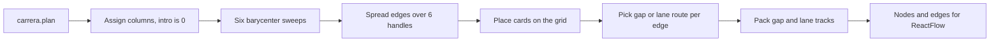
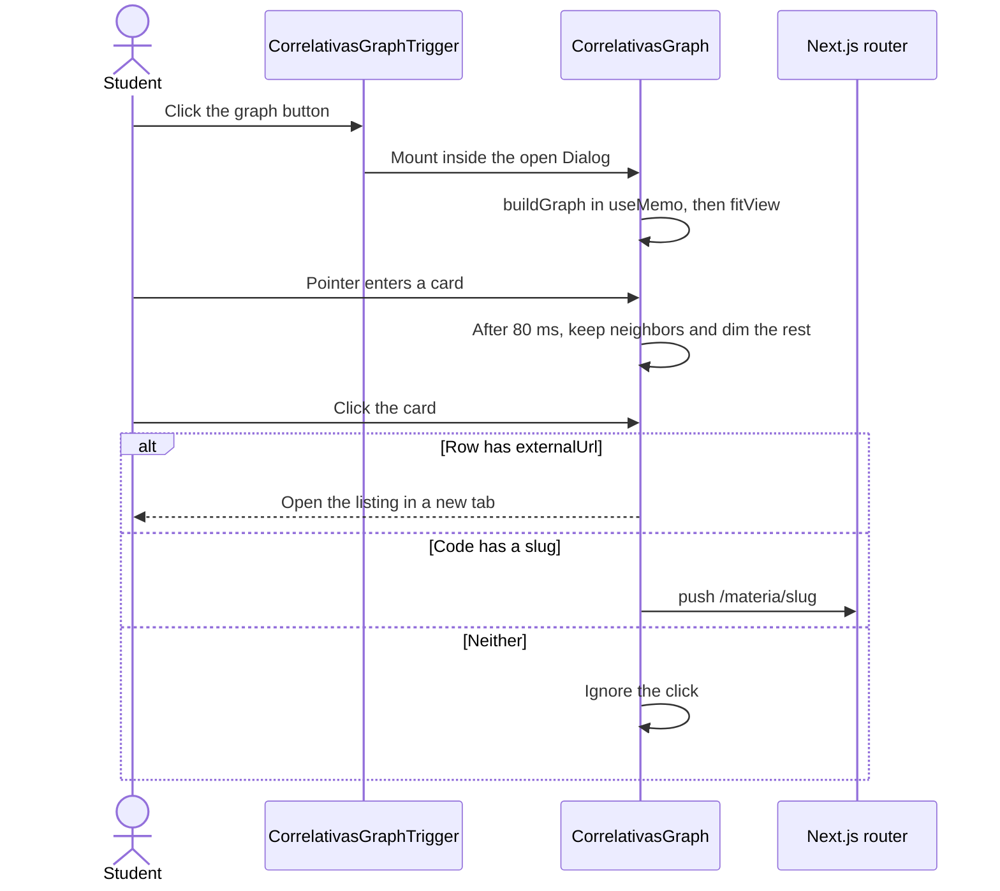

# Prerequisites graph

> Draws a career's prerequisite chains as an interactive graph, one column per semester, inside a near full-screen dialog on the plan page.

| | |
|---|---|
| **Routes** | None of its own; it opens in a dialog on `/carreras/[carrera]` |
| **Status** | Live since v0.1.0 |
| **Key files** | [CorrelativasGraphTrigger.tsx](../../../src/components/correlativas/CorrelativasGraphTrigger.tsx), [CorrelativasGraph.tsx](../../../src/components/correlativas/CorrelativasGraph.tsx), [carreras/[carrera]/page.tsx](../../../src/app/(public)/carreras/[carrera]/page.tsx), [globals.css](../../../src/app/globals.css) |

## Why it exists

The plan lists each subject's prerequisites as codes. That answers "what do I need for this subject?" but not "which chain must I finish before X?" or "which subjects hold up the most others?". A graph makes long chains, bottlenecks and terminal subjects visible at a glance: in APU, for example, "Taller de lecto-comprensión y Traducción en Inglés" is a direct prerequisite of nine subjects.

## User stories

| ID | As a | I want to | So that |
|---|---|---|---|
| US-GRAPH-01 | student | open a graph of my career's prerequisites from its plan page | I see the whole dependency structure at once |
| US-GRAPH-02 | student | see each subject in its exact semester column | I can read the graph as a timeline |
| US-GRAPH-03 | student | highlight a subject's direct prerequisites and dependents | I see what it needs and what it unlocks |
| US-GRAPH-04 | student | click a subject to open its page or the official electives listing | I can dig deeper from the graph |
| US-GRAPH-05 | student | pan, zoom and refit the graph | I can explore even the ten-column plans |

## Acceptance criteria

### US-GRAPH-01 - Open the graph

```gherkin
Scenario Outline: Trigger on every plan
  Given a visitor on "/carreras/<slug>"
  When the plan header renders
  Then it shows a "Ver grafo de correlativas" (see prerequisites graph) button after the "Plan oficial" (official plan) link

  Examples:
    | slug |
    | apu  |
    | atic |
    | ls   |
    | li   |

Scenario: Open the dialog
  Given the LI plan page
  When the visitor clicks "Ver grafo de correlativas"
  Then a dialog titled "Correlativas de Licenciatura en Informática" (prerequisites of Licenciatura en Informática) opens at 95% of the viewport width and 92% of its height

Scenario: Nothing mounts before opening
  Given the visitor has not opened the dialog
  When the plan page finishes loading
  Then the page contains no React Flow canvas

Scenario: Close
  Given the dialog is open
  When the visitor presses Escape
  Then the dialog closes and the graph unmounts
```

### US-GRAPH-02 - Semester columns

```gherkin
Scenario: Three-year plans
  Given the APU plan
  When its graph renders
  Then it shows 7 column headers: "Curso de ingreso" (intro course), then "1° cuat" and "2° cuat" (1st and 2nd semester) under "Año 1", "Año 2" and "Año 3" (year 1 to 3)

Scenario: Five-year plans
  Given the LS plan, whose year 5 has only first-semester subjects
  When its graph renders
  Then it shows 10 column headers, the last one being "1° cuat" under "Año 5"

Scenario: Every plan row becomes a card
  Given the LI plan with 37 rows
  When its graph renders
  Then it shows 37 subject cards with code and name
  And "Optativa 1" carries an "optativa" (optional course) chip and the thesis carries a "tesina" (thesis) chip
```

### US-GRAPH-03 - Highlight neighbors

```gherkin
Scenario: Direct neighbors stay visible
  Given the APU graph is open
  When the pointer rests on the "SI107" card for 80 ms
  Then SI107, its prerequisite SI106 and the six subjects that require SI107 stay fully opaque
  And every other subject card drops to 50% opacity
  And the edges touching SI107 turn to the primary color at 2 px while the other edges fade to 6% opacity

Scenario: Indirect prerequisites stay dimmed
  Given the APU graph is open
  When the pointer rests on the "SI305" card
  Then the "CNE" card stays dimmed, although CNE is an indirect prerequisite of SI305

Scenario: Leaving clears the highlight
  Given a card is highlighted
  When the pointer leaves it and enters no other card within 80 ms
  Then every card and edge returns to its default style
```

### US-GRAPH-04 - Click through

```gherkin
Scenario: Subject with a page
  Given the APU graph is open
  When the visitor clicks the "SI106" card
  Then the browser navigates to "/materia/cadp"

Scenario: Elective with an official listing
  Given the LS graph is open
  When the visitor clicks the "OPT-LS-1" card
  Then the faculty's electives page opens in a new tab and the dialog stays open

Scenario: Subject without a page
  Given the LI graph is open
  When the visitor clicks the "OI404" card
  Then nothing happens and the card shows the default cursor
```

### US-GRAPH-05 - Pan, zoom and fit

```gherkin
Scenario: Initial fit
  Given the visitor opens the LS graph
  When the canvas first renders
  Then the view zooms to fit every card with 15% padding, but never below 0.1x

Scenario: Zoom limits
  Given the graph is open
  When the visitor keeps zooming in or out
  Then the zoom stays between 0.1x and 1.6x

Scenario: Controls
  Given the graph is open
  When the visitor looks at the bottom-left corner of the canvas
  Then zoom in, zoom out and fit view buttons are available, without a lock toggle

Scenario: Cards stay in place
  Given the graph is open
  When the visitor drags a card
  Then the card does not move and the canvas pans instead
```

## Use cases

### UC-GRAPH-01 - Trace what a subject unlocks

| | |
|---|---|
| **Primary actor** | Student using a mouse |
| **Preconditions** | The student is on a career plan page |
| **Trigger** | The student wants to know what a subject requires and what it unlocks |
| **Postconditions** | The student has seen the subject's direct neighbors and may be on its subject page |

**Main success scenario**

1. The student clicks "Ver grafo de correlativas".
2. The system opens the dialog, mounts React Flow and fits the graph.
3. The student zooms and pans to the subject.
4. The student rests the pointer on the subject's card.
5. After 80 ms the system highlights the card, its direct prerequisites, its direct dependents and the edges between them.
6. The student clicks the card.
7. The system navigates to `/materia/<slug>`.

**Extensions**

- 1a. The student uses only the keyboard: Tab moves through cards, column headers and edges, but Enter does nothing; the plan list on the page offers the same links.
- 4a. The student is on a touch device: there is no hover, and a tap acts as a click (step 6).
- 6a. The card is an elective with an external URL: the official listing opens in a new tab and the dialog stays open.
- 6b. The card has no page: nothing happens; hovering it shows a native tooltip with the plan note, when the row has one.

## How it works

Components:

- `CorrelativasGraphTrigger` (client) is a text button with a network icon. The plan page renders it in the header when the slug is in `GRAFO_HABILITADO_PARA` (`apu`, `atic`, `li`, `ls`). It owns the `open` state and renders a `Dialog` (95vw by 92vh, title, helper line, close button "Cerrar" (close)) whose body mounts `CorrelativasGraph` only while open. The helper line reads "Las flechas indican qué materia hay que aprobar antes de cursar la siguiente. Click en una materia para ver su detalle." (arrows show which subject must be passed before taking the next one; click a subject to see its details).
- `CorrelativasGraph` (client) computes the layout with `buildGraph(carrera.plan)` inside `useMemo`, applies hover styling, and renders `ReactFlow` with two node types (`materia` for subject cards, `columnHeader` for column titles) and one edge type (`correlativa`).

Layout steps in `buildGraph`:

1. Column: intro rows go to column 0; any other row goes to `(anio - 1) * 2 + cuatrimestre`, so year 1 semester 1 is column 1. Only columns that contain rows get a header.
2. Row order: start from plan order, then run six barycenter sweeps that alternate forward (average row of the prerequisites in earlier columns) and backward (average row of the dependents in later columns). Ties keep the previous order.
3. Position: `x = 40 + column * 480` and `y = 56 + row * 176` (a 220 px card plus a 260 px gap; a 96 px card plus an 80 px gap).
4. Handles: each card has six invisible target handles on the left and six source handles on the right, at 12, 28, 44, 60, 76 and 92% of its height. Edges are spread over them in row order, so cards with more than six edges share handles (SI208 has nine dependents in APU).
5. Routing: an edge between adjacent columns goes from the source to a vertical segment in the gap and on to the target. An edge spanning two or more columns runs through a horizontal lane above the column headers or below the last row, chosen by whether its average height falls in the top or bottom half of the graph, with one vertical in the source's gap and another in the gap before the target.
6. Tracks: in each gap, greedy interval packing (4 px tolerance) gives overlapping verticals separate X tracks 16 px apart, centered on the gap. Lanes get Y tracks 16 px apart, moving outward from the top of the headers or from below the last row. The gap tracks are then recomputed with the final lane positions.
7. Output: subject nodes (not draggable), header nodes (not selectable) and edges with a closed arrowhead, drawn in the muted foreground color at 35% opacity and 1.4 px.

Edges to codes that are not rows of the same plan are skipped; no plan has such a prerequisite today.

The flowchart below summarizes the layout pipeline in `buildGraph`.



The resulting graphs:

| Career | Columns | Subject cards | Edges | Edges spanning 2 or more columns | Tallest column | Graph width |
|---|---|---|---|---|---|---|
| APU | 7 | 27 | 46 | 29 | 6 cards | 3,100 px |
| ATIC | 7 | 24 | 30 | 10 | 5 cards | 3,100 px |
| LS | 10 | 37 | 52 | 34 | 5 cards | 4,540 px |
| LI | 10 | 37 | 52 | 32 | 5 cards | 4,540 px |

`ReactFlow` settings:

| Setting | Value | Effect |
|---|---|---|
| `fitView`, `fitViewOptions` | padding 0.15 | Fits all cards when the canvas opens |
| `minZoom`, `maxZoom` | 0.1, 1.6 | Zoom range |
| `nodesDraggable`, `nodesConnectable`, `elementsSelectable` | `false` | Read-only graph; dragging over a card pans the canvas |
| `Background` | 20 px dot grid in `--border` | Canvas backdrop |
| `Controls` | `showInteractive={false}` | Zoom in, zoom out and fit view, without the lock toggle |
| `proOptions.hideAttribution` | `true` | Hides the library attribution |

Interaction:

- Hover: `onNodeMouseEnter` sets the hovered card after 80 ms, and `onNodeMouseLeave` clears it after 80 ms; the debounce avoids flicker when the pointer crosses nearby cards. The highlighted set is the hovered card plus its direct neighbors. Other subject cards drop to 50% opacity; edges touching the card switch to `--primary` at 95% opacity and 2 px, and the rest fade to 6%.
- Click: an `externalUrl` wins and opens with `window.open(url, "_blank", "noopener,noreferrer")`. Otherwise a card whose code has a slug calls `router.push("/materia/<slug>")`. Other cards ignore the click and show the default cursor.
- Tooltip: the card's native `title` combines the row's `nota` with a hint, "Click para ver el detalle de la materia" (click to see the subject's details) or "Click para ver el listado oficial de optativas" (click to see the official electives listing).
- Styles: [globals.css](../../../src/app/globals.css) scopes rules under `.correlativas-graph`. The Controls use theme tokens instead of the library's white background, and `.react-flow__node` gets `z-index: 100 !important` so cards always cover edges, including highlighted ones.

The sequence below shows what happens from opening the dialog to clicking a card.



## States and variants

- Closed: only the trigger button exists, and React Flow is not mounted.
- Open: the graph is fitted to the dialog. There is no loading indicator, because the layout is computed synchronously.
- Hover: the highlight described above, available with a mouse only.
- Careers: APU and ATIC have 7 columns; LS and LI have 10.
- Responsive: the dialog is 95vw by 92vh at every width, but the fitted view is small. On a 1,440 px wide window the LS and LI graphs open near 0.26x zoom, so the 12 px card titles render about 3 px tall until the student zooms in. On a 390 px wide phone they reach the 0.1x floor before they fit.
- Touch: dragging pans and pinching zooms; the hover highlight and the native tooltips are unavailable, and tapping a linked card navigates right away.
- Dark mode: cards use `--card` and `--border`; linked cards hover to `--pastel-blue` in light mode and to `--primary` at 15% in dark mode; edges use `--muted-foreground` and `--primary`; the Controls follow theme tokens through `globals.css`.

## Non-functional notes

Performance:

- Runtime cost is deferred: nothing mounts until the dialog opens, and the layout is computed once per opening (memoized on the plan). Hovering only recomputes node and edge styles.
- Download cost is not deferred: the trigger imports the graph statically, so the chunk with React Flow and the graph (190,618 bytes minified, 61,113 bytes gzipped in a local production build) and React Flow's stylesheet ship with every plan page.

Accessibility:

- The dialog has a title (`Correlativas de <name>`), a helper line and a labeled close button ("Cerrar"); Escape closes it.
- With React Flow's defaults, every card, column header and edge is a Tab stop (80 in APU, 99 in LS and LI), but none can be activated from the keyboard: selection is disabled and navigation only runs on pointer clicks.
- The highlight depends on pointer hover and distinguishes neighbors by opacity and color only.
- Native `title` tooltips are not reliably available to keyboard or touch users.
- The plan page carries the same information as lists and links, which remain the accessible path.

SEO:

- The graph has no URL and renders only in the browser after a click, so it adds nothing indexable; the plan page holds the content.

## Known gaps

- Keyboard users can focus cards but cannot open them.
- The highlight covers only direct neighbors, not whole chains of prerequisites or dependents.
- On phones and small windows the fitted graph is unreadable until zoomed in, and there is no simplified mobile view.
- React Flow and its stylesheet load with every plan page, even when the dialog is never opened.
- The plan page still has a comment saying the graph is APU-only, while `GRAFO_HABILITADO_PARA` lists all four careers.
- The graph cannot be exported, for example as an image.
