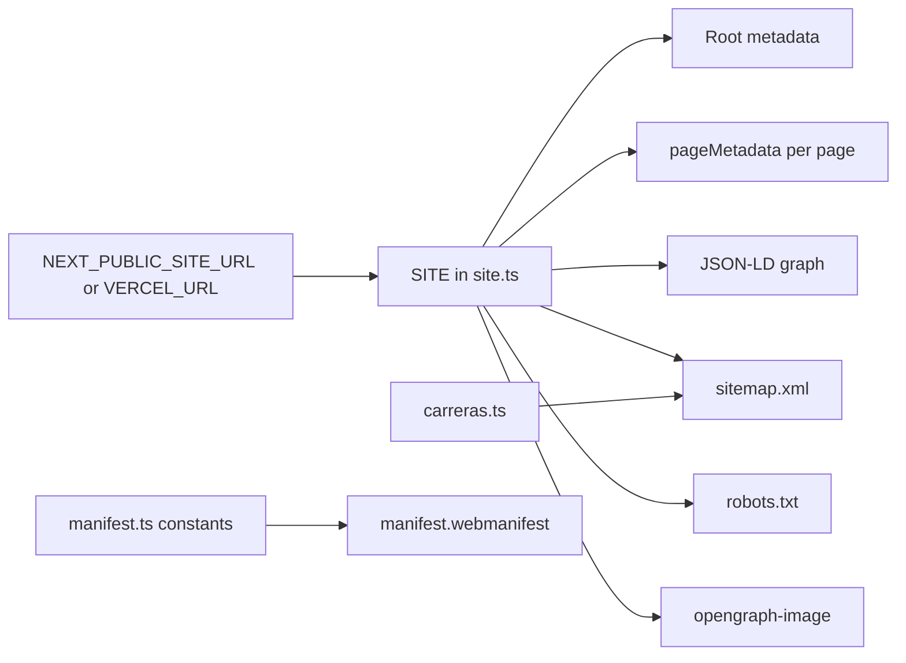
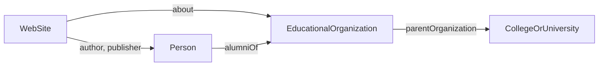

# SEO

> Makes every page findable in search results and presentable when shared in chats, through per-page titles and descriptions, canonical URLs, a preview image, structured data, a sitemap, robots rules, icons and a web app manifest.

| | |
|---|---|
| **Routes** | `/sitemap.xml`, `/robots.txt`, `/manifest.webmanifest`, `/opengraph-image`, `/icon.png`, `/apple-icon.png`, plus the `<head>` of every page |
| **Status** | Live since v0.1.0 |
| **Key files** | [site.ts](../../../src/lib/site.ts), [layout.tsx](../../../src/app/layout.tsx), [sitemap.ts](../../../src/app/sitemap.ts), [robots.ts](../../../src/app/robots.ts), [manifest.ts](../../../src/app/manifest.ts), [opengraph-image.tsx](../../../src/app/opengraph-image.tsx), [icon.png](../../../src/app/icon.png), [apple-icon.png](../../../src/app/apple-icon.png) |

## Why it exists

Students search for things like "plan APU UNLP" or "cartelera informática UNLP" (UNLP informatics notice board) and pass links around in group chats. Without explicit metadata, search results show generic titles and shared links appear as bare URLs. This feature gives every route of "Blog Informática UNLP" (UNLP informatics blog, the site name) a specific title, description and canonical URL, a branded preview image for link cards, structured data that ties the site to the faculty, and the files crawlers use to find every page.

## User stories

| ID | As a | I want to | So that |
|---|---|---|---|
| US-SEO-01 | student searching the web | see a specific title and description for each page in the results | I can pick the right page |
| US-SEO-02 | student sharing a link in a group chat | have the link unfurl with a title, a description and an image | my classmates know what they are opening |
| US-SEO-03 | site maintainer | list every public page in `sitemap.xml` and allow all of them in `robots.txt` | search engines discover the career and subject pages too |
| US-SEO-04 | site maintainer | set the canonical domain in one environment variable | canonical, sharing and sitemap URLs all point to the same host |
| US-SEO-05 | site maintainer | describe the site, its author and the faculty as structured data | search engines can connect the site with the faculty and with the author's public profiles |
| US-SEO-06 | student on a phone | add the site to my home screen with its name and icon | I can open it like an app |

## Acceptance criteria

### US-SEO-01 - Titles and descriptions

```gherkin
Feature: Titles and descriptions

  Scenario: A section page gets the site suffix
    Given "/calendario" passes the title "Calendario académico" (academic calendar) to pageMetadata
    When a crawler loads "/calendario"
    Then the document title is "Calendario académico · Blog Informática UNLP"
    And the meta description equals the description passed to pageMetadata

  Scenario: Dynamic pages build their titles from data
    When a crawler loads "/materia/cadp"
    Then the document title is "Conceptos de Algoritmos, Datos y Programas (SI106) · Blog Informática UNLP" (concepts of algorithms, data and programs)

  Scenario: The home page uses the site defaults
    When a crawler loads "/"
    Then the document title is "Blog Informática UNLP"
    And the meta description is SITE.description

  Scenario: A missing page is not indexed
    When a crawler loads a URL that does not exist, such as "/materia/inexistente"
    Then the response status is 404
    And the head contains a robots meta tag with "noindex"
```

### US-SEO-02 - Link previews

```gherkin
Feature: Link previews

  Scenario: Open Graph tags on a section page
    When a preview bot fetches "/links"
    Then og:title is "Links útiles · Blog Informática UNLP" (useful links) and og:url is the absolute URL of "/links"
    And og:type is "website", og:locale is "es_AR" and og:site_name is "Blog Informática UNLP"
    And og:image is the absolute "/opengraph-image" URL with width 1200 and height 630

  Scenario: Twitter Card tags
    When a preview bot fetches "/links"
    Then twitter:card is "summary_large_image" and twitter:image is the absolute "/opengraph-image" URL

  Scenario: The preview image
    When a client requests "/opengraph-image"
    Then it receives a 1200x630 PNG with the "BI" mark, the title "Blog Informática" (informatics blog), a one-line description and the site host

  Scenario: A page that replaces the root openGraph object keeps the image
    Given a page builds its metadata with pageMetadata
    When a preview bot fetches that page
    Then og:image and twitter:image are present
```

### US-SEO-03 - Sitemap and robots

```gherkin
Feature: Sitemap and robots

  Scenario: The sitemap lists every public page
    When a crawler requests "/sitemap.xml"
    Then it lists 36 URLs: 7 section routes, 4 career plans and 25 subject pages

  Scenario: Per-route hints
    When a crawler reads "/sitemap.xml"
    Then "/" has priority 1 and change frequency "weekly"
    And "/cartelera" has priority 0.8 and change frequency "hourly"
    And every entry carries the build time as lastmod

  Scenario: robots.txt allows everything
    When a crawler requests "/robots.txt"
    Then it reads "User-Agent: *" and "Allow: /"
    And its Sitemap line is the absolute "/sitemap.xml" URL

  Scenario: Subjects without a slug are left out
    Given a subject has no entry in materiaSlugs
    When the sitemap is generated
    Then no "/materia/" URL exists for that subject
```

### US-SEO-04 - One canonical host

```gherkin
Feature: Canonical host

  Scenario: Explicit site URL
    Given NEXT_PUBLIC_SITE_URL is "https://example.org/"
    When the site is built
    Then canonical, og:url, sitemap and robots URLs start with "https://example.org", with no trailing slash

  Scenario: Deployment hostname
    Given NEXT_PUBLIC_SITE_URL is not set and VERCEL_URL is "preview-123.example.app"
    When the site is built
    Then every absolute URL starts with "https://preview-123.example.app"

  Scenario: Hardcoded fallback
    Given neither variable is set
    When the site is built
    Then every absolute URL starts with "https://blog-informatica.vercel.app"

  Scenario: One canonical per page
    When a crawler loads "/bibliografia"
    Then the canonical link is the site URL followed by "/bibliografia"
```

### US-SEO-05 - Structured data

```gherkin
Feature: JSON-LD

  Scenario: One graph on every page
    When a crawler loads any page
    Then the body contains one script of type "application/ld+json"
    And its @graph holds a WebSite node, a Person node and an EducationalOrganization node

  Scenario: Nodes are linked by @id
    When a crawler reads the graph
    Then the WebSite's author and publisher reference the Person id "<SITE.url>#person"
    And the WebSite's about and the Person's alumniOf reference "https://www.info.unlp.edu.ar/#org"

  Scenario: The graph does not depend on JavaScript
    When a crawler that does not run JavaScript fetches "/calendario"
    Then the JSON-LD script is present in the response body

  Scenario: Characters that could close the script are escaped
    Given a value in SITE contains "</script>"
    When the layout serializes the graph
    Then every "<" is written as "\u003c" and the script element stays intact
```

### US-SEO-06 - Icons and manifest

```gherkin
Feature: Icons and manifest

  Scenario: Web app manifest
    When the browser requests "/manifest.webmanifest"
    Then it receives name "Blog Informática UNLP", short_name "Blog Informática", start_url "/" and display "standalone"
    And it lists PNG icons of 192x192 and 512x512

  Scenario: Page icons
    When a browser loads any page
    Then the head links "/icon.png" (512x512) as the icon and "/apple-icon.png" (180x180) as the Apple touch icon

  Scenario: No offline mode
    Given the site was added to the home screen
    When I open it while the device is offline
    Then the browser shows its own offline error, because the site registers no service worker
```

## Use cases

### UC-SEO-01 - Share a page in a group chat

| | |
|---|---|
| **Primary actor** | Student |
| **Preconditions** | The site is deployed and `SITE.url` resolves to a public host. |
| **Trigger** | The student pastes the URL of a page, such as `/calendario`, into a chat. |
| **Postconditions** | The message shows a preview card with the page title, description and the site image. |

**Main success scenario**

1. The student pastes the link.
2. The chat's preview bot fetches the page HTML.
3. The bot reads `og:title`, `og:description` and `og:image` from the head. The image URL is absolute thanks to `metadataBase`.
4. The bot fetches `/opengraph-image`, a static 1200x630 PNG.
5. The chat renders the preview card.

**Extensions**

- **2a.** The bot does not run JavaScript: it still finds every tag, because the head is part of the static HTML. The empty body does not matter for previews.
- **3a.** `NEXT_PUBLIC_SITE_URL` is not set on the deployment: `og:url` and `og:image` point to the per-deployment hostname, and the preview works for as long as that deployment stays online.
- **3b.** The bot only reads Twitter Card tags: it finds `twitter:card` set to `summary_large_image` and the same image.

### UC-SEO-02 - A search engine indexes the site

| | |
|---|---|
| **Primary actor** | Search engine crawler |
| **Preconditions** | The site is public. |
| **Trigger** | The crawler discovers the domain. |
| **Postconditions** | The crawler knows every public URL with its title, description and canonical. |

**Main success scenario**

1. The crawler requests `/robots.txt` and finds `Allow: /` and the sitemap URL.
2. The crawler requests `/sitemap.xml` and receives 36 URLs with priorities and change frequencies.
3. For each page, the crawler reads the title, description, canonical link, the robots tag (`index, follow`) and the extra directives for `googlebot`.
4. The crawler reads the JSON-LD graph at the top of the body.
5. The crawler renders the page with JavaScript to index the visible content.

**Extensions**

- **2a.** A subject has no slug: it is missing from the sitemap and its would-be URL returns 404 with `noindex`.
- **3a.** The crawler reaches a host other than the canonical one, such as another deployment: with `NEXT_PUBLIC_SITE_URL` set, the canonical link points to the configured host; without it, each deployment declares its own hostname as canonical.
- **5a.** The crawler does not run JavaScript: it indexes only the head metadata and the JSON-LD, because the static HTML body has no visible text.

## How it works

### Building blocks

| File | Produces | When |
|---|---|---|
| [site.ts](../../../src/lib/site.ts) | `SITE` config, `absoluteUrl()` and `pageMetadata()` | On import |
| [layout.tsx](../../../src/app/layout.tsx) | Root `metadata`, `viewport` and the JSON-LD script | Every page |
| [sitemap.ts](../../../src/app/sitemap.ts) | `/sitemap.xml` | Build time |
| [robots.ts](../../../src/app/robots.ts) | `/robots.txt` | Build time |
| [manifest.ts](../../../src/app/manifest.ts) | `/manifest.webmanifest` | Build time |
| [opengraph-image.tsx](../../../src/app/opengraph-image.tsx) | `/opengraph-image`, a 1200x630 PNG of about 88 KB | Build time |
| [icon.png](../../../src/app/icon.png), [apple-icon.png](../../../src/app/apple-icon.png) | `/icon.png` (512x512, about 140 KB) and `/apple-icon.png` (180x180), plus their `<link>` tags | Build time |
| [icon-192.png](../../../public/icon-192.png), [icon-512.png](../../../public/icon-512.png) | The manifest icons | Static files |

The diagram shows how the configuration flows into each output.



### Site URL

`SITE.url` has no trailing slash and resolves in this order:

1. `NEXT_PUBLIC_SITE_URL`, with one trailing slash removed.
2. `https://` followed by `VERCEL_URL`, the per-deployment hostname that the hosting platform injects.
3. The hardcoded fallback `https://blog-informatica.vercel.app`.

The value is computed when [site.ts](../../../src/lib/site.ts) loads, which is build time for every prerendered route. The root layout sets `metadataBase` to `new URL(SITE.url)`, so relative paths in metadata, such as canonical paths and `/opengraph-image`, become absolute. `absoluteUrl(path)` builds absolute URLs and returns strings that start with `http` untouched.

### Root metadata

[layout.tsx](../../../src/app/layout.tsx) defines the defaults that every page inherits:

| Field | Value |
|---|---|
| `title` | `default` is `SITE.name` ("Blog Informática UNLP"); `title.template` is `%s · Blog Informática UNLP` |
| `description` | `SITE.description` |
| `applicationName` | `SITE.name` |
| `authors`, `creator`, `publisher` | The author from `SITE.author` |
| `keywords` | The 15 terms in `SITE.keywords` |
| `manifest` | `/manifest.webmanifest` |
| `alternates.canonical` | `/` |
| `openGraph` | Type `website`, locale `es_AR`, site name, title, description and the `/opengraph-image` image at 1200x630 |
| `twitter` | Card `summary_large_image`, title, description and the same image, with no site or creator handle |
| `robots` | `index, follow`, plus `max-image-preview: large`, `max-snippet: -1` and `max-video-preview: -1` for `googleBot` |
| `appleWebApp` | Capable, status bar style `default`, title `SITE.name` |
| `category` | `education` |
| `viewport` | `themeColor` `#ffffff` for light and `#0a0a0a` for dark color schemes, `width=device-width`, `initialScale` 1, `viewportFit: "cover"` |

### Per-page metadata

`pageMetadata({ title, description, path })` returns:

- `title`: the bare section title. The root `title.template` appends " · Blog Informática UNLP".
- `description`.
- `alternates.canonical`: the `path`.
- `openGraph`: type, locale, site name, the full title with the suffix, the description, the absolute URL and the image.
- `twitter`: card, full title, description and image.

Next.js merges metadata shallowly: a page that sets `openGraph` replaces the root object instead of extending it. That is why `pageMetadata` repeats the image in both `openGraph` and `twitter`. Without it, pages would lose their preview image.

| Route | Metadata source | Rendered title |
|---|---|---|
| `/` | Root defaults | "Blog Informática UNLP" |
| `/carreras` | `pageMetadata` | "Carreras · Blog Informática UNLP" (careers) |
| `/carreras/[carrera]` | `generateMetadata` with `pageMetadata` | "<career name> · Plan 2021 · Blog Informática UNLP" (2021 plan) |
| `/materia/[slug]` | `generateMetadata` with `pageMetadata` | "<subject name> (<code>) · Blog Informática UNLP" |
| `/cartelera` | `pageMetadata` | "Cartelera · Blog Informática UNLP" (notice board) |
| `/calendario` | `pageMetadata` | "Calendario académico · Blog Informática UNLP" |
| `/bibliografia` | `pageMetadata` | "Bibliografía · Blog Informática UNLP" (bibliography) |
| `/links` | `pageMetadata` | "Links útiles · Blog Informática UNLP" |
| `/sobre-mi` | `pageMetadata` | "Sobre mí · Blog Informática UNLP" (about me) |

The dynamic routes are documented in [Careers](../careers/README.md) and [Subject page](../subject-page/README.md), and `/cartelera` in [Notice board](../notice-board/README.md). For an unknown career or subject slug, `generateMetadata` returns `{}` and the page calls `notFound()`. The 404 response inherits the root metadata, and Next.js adds `<meta name="robots" content="noindex">`.

### Preview image

[opengraph-image.tsx](../../../src/app/opengraph-image.tsx) returns an `ImageResponse` from `next/og` and exports `alt` (`SITE.name`), `size` (1200x630) and `contentType` (`image/png`). It uses the default Node.js runtime, so Next.js prerenders it at build time into a static PNG. Every page points to this one image.

The image shows a light blue gradient, a "BI" mark, the line "Facultad de Informática · UNLP" (Faculty of Informatics, UNLP), the title "Blog Informática", the sentence "Compañero de estudio para las carreras de la Facultad de Informática UNLP: APU, ATIC, LS y LI." (study companion for the careers of the UNLP Faculty of Informatics: APU, ATIC, LS and LI), the footer "Plan 2021 · Calendario · Cartelera · Bibliografía" (2021 plan, calendar, notice board, bibliography) and the host of `SITE.url`. Styles are inline React style objects, not Tailwind classes. They ask for Poppins, but no font file is loaded, so the text renders in the default font bundled with `next/og` (Geist Regular).

### Structured data

The root layout renders one `<script type="application/ld+json">` at the top of `<body>`. It sits outside the `Suspense` boundary that wraps every page, so it is part of the static HTML of every route. The JSON is serialized with every `<` replaced by `\u003c`, so a value containing `</script>` cannot close the element early.

| Node | `@id` | Main fields |
|---|---|---|
| `WebSite` | `<SITE.url>#website` | `url`, `name`, `alternateName` ("Blog Informática"), `description`, `inLanguage: "es-AR"`, `author` and `publisher` (both the Person), `about` (the faculty) |
| `Person` | `<SITE.url>#person` | `name`, `url`, `jobTitle`, `alumniOf` (the faculty), `sameAs` (three profile URLs), `knowsAbout` (seven topics) |
| `EducationalOrganization` | `https://www.info.unlp.edu.ar/#org` | `name` ("Facultad de Informática - UNLP"), `url`, `parentOrganization` (a `CollegeOrUniversity` for Universidad Nacional de La Plata) |

The diagram shows how the nodes reference each other.



The Person fields come from `SITE.author` and the organization fields from `SITE.publisher`, both in [site.ts](../../../src/lib/site.ts).

### Sitemap and robots

[sitemap.ts](../../../src/app/sitemap.ts) returns 36 entries:

| Entries | Source | `changeFrequency` | `priority` |
|---|---|---|---|
| `/` | Static list | `weekly` | 1.0 |
| `/carreras` | Static list | `monthly` | 0.9 |
| `/calendario` | Static list | `weekly` | 0.8 |
| `/cartelera` | Static list | `hourly` | 0.8 |
| `/bibliografia` | Static list | `monthly` | 0.7 |
| `/links` | Static list | `monthly` | 0.6 |
| `/sobre-mi` | Static list | `yearly` | 0.5 |
| `/carreras/<slug>`, 4 entries | `carreras` in [carreras.ts](../../../src/lib/carreras.ts) | `monthly` | 0.8 |
| `/materia/<slug>`, 25 entries | `getAllMateriaSlugs()` in [carreras.ts](../../../src/lib/carreras.ts) | `monthly` | 0.6 |

Every entry shares one `lastModified` value: the `new Date()` taken when the sitemap is generated at build time.

[robots.ts](../../../src/app/robots.ts) produces:

```text
User-Agent: *
Allow: /

Host: <SITE.url>
Sitemap: <SITE.url>/sitemap.xml
```

### Icons and manifest

`icon.png` and `apple-icon.png` in `src/app/` use the file-based metadata convention, so Next.js adds `<link rel="icon">` (512x512) and `<link rel="apple-touch-icon">` (180x180) to every page. [manifest.ts](../../../src/app/manifest.ts) returns name "Blog Informática UNLP", short name "Blog Informática", a one-line description, `start_url: "/"`, `display: "standalone"`, `background_color: "#0a0a0a"`, `theme_color: "#0076D2"` and the two icons from `public/`. Its name and description are constants in the file, not values read from `SITE`.

## States and variants

**By route.** The home page uses the root defaults. Section pages call `pageMetadata`. Career and subject pages call it from `generateMetadata`. A 404 response keeps the root metadata, adds `noindex`, and also carries the root `index, follow` tag and the home canonical.

**By environment.**

| Environment | `SITE.url` |
|---|---|
| `NEXT_PUBLIC_SITE_URL` set | That URL, without a trailing slash |
| Deployment without `NEXT_PUBLIC_SITE_URL` | `https://` plus the per-deployment hostname from `VERCEL_URL` |
| Local build with neither variable | `https://blog-informatica.vercel.app` |

**Loading and error.** The SEO files (sitemap, robots, manifest, icons and preview image) are generated at build time, so they have no loading states. An exception in [sitemap.ts](../../../src/app/sitemap.ts), [robots.ts](../../../src/app/robots.ts), [manifest.ts](../../../src/app/manifest.ts) or [opengraph-image.tsx](../../../src/app/opengraph-image.tsx) fails the build instead of producing a runtime error.

**Theme.** The `theme-color` meta tags follow the system color scheme (white for light, near-black for dark) and do not react to the in-page theme toggle. The preview image has a single light design.

**Responsive.** The viewport meta tag sets `width=device-width, initial-scale=1, viewport-fit=cover`.

## Non-functional notes

- **Performance.** Every SEO route is static: the sitemap, robots file, manifest, icons and preview image are prerendered at build time and cost nothing at request time. Poppins is self-hosted through `next/font/google` with `display: "swap"` and a preloaded WOFF2 file.
- **Rendering.** The `<head>` metadata and the JSON-LD script are part of the static HTML. The visible body is not: the root layout wraps every page in a `Suspense` boundary around `NavigationLoadingProvider`, which calls `useSearchParams()`, so Next.js renders that subtree on the client. Crawlers that do not run JavaScript see the metadata and the structured data but no page text.
- **Accessibility.** The document declares `<html lang="es">`, the preview image has `og:image:alt` set to the site name, and home screen installs get `apple-mobile-web-app-title`.
- **SEO.** Each route has one canonical URL, the robots tags allow indexing, and the sitemap gives priorities from 1.0 for the home page to 0.5 for `/sobre-mi`.

## Known gaps

- The static HTML has no visible body text on any route, so crawlers that do not run JavaScript index only the metadata and the JSON-LD.
- When `NEXT_PUBLIC_SITE_URL` is not set, canonical, Open Graph, sitemap and robots URLs use `VERCEL_URL`, the hostname of each individual deployment, not the production domain. The hardcoded fallback, `https://blog-informatica.vercel.app`, is also not the production URL listed in the [README](../../../README.md). `NEXT_PUBLIC_SITE_URL` is not declared in [env.ts](../../../src/env.ts), so nothing validates it.
- Every page shares one preview image. There are no per-page images for subjects, careers or the calendar.
- The preview image asks for Poppins but loads no font file, so it renders in Geist Regular and the bold weights in its styles have no effect.
- Every sitemap entry uses the build time as `lastmod`, regardless of when its content changed.
- The `WebSite` node names the Person as both `author` and `publisher`, while `SITE.publisher` (the faculty) only feeds the `EducationalOrganization` node. There is no per-page structured data, such as breadcrumbs, courses or events.
- 404 responses carry two robots tags (`noindex` and `index, follow`) and a canonical link to the home page.
- The manifest's `theme_color` (`#0076D2`) differs from the viewport theme colors, its `background_color` is dark while the default theme is light, it has no maskable icon, and its name and description repeat values from `SITE` instead of reading them.
- There is no `favicon.ico`. The icon link points to a 512x512 PNG of about 140 KB.
- The site registers no service worker, so the installed app has no offline support.
