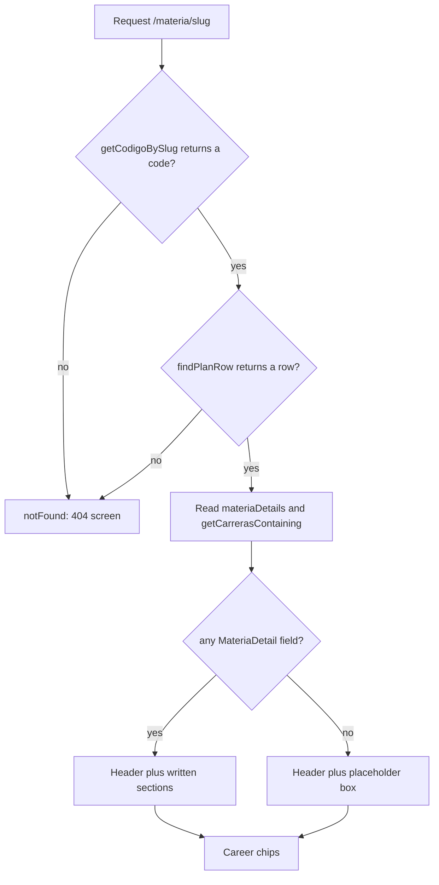

# Subject page

> Gives each registered subject a stable, friendly URL that shows its code, duration, prerequisites by name, the careers that include it and, when written, personal notes.

| | |
|---|---|
| **Routes** | `/materia/[slug]` (25 slugs) |
| **Status** | Live since v0.1.0 |
| **Key files** | [materia/[slug]/page.tsx](../../../src/app/(public)/materia/[slug]/page.tsx), [carreras.ts](../../../src/lib/carreras.ts), [materia-detail.ts](../../../src/lib/materia-detail.ts), [Breadcrumb.tsx](../../../src/components/Breadcrumb.tsx), [sitemap.ts](../../../src/app/sitemap.ts) |

## Why it exists

Institutional codes such as SI106 or O7301 mean little to students, who know subjects by nicknames like CADP or TTPS. A URL such as `/materia/cadp` is easier to remember, share and recognize in search results than one built on the code. Because the URL exists even when no notes are written, adding notes never changes a link.

## User stories

| ID | As a | I want to | So that |
|---|---|---|---|
| US-SUB-01 | student | reach a subject through a short URL based on its nickname | I can remember, share and revisit it |
| US-SUB-02 | student | see a subject's code, duration and prerequisites by name | I know what I need before enrolling |
| US-SUB-03 | student | read the author's summary and recommendations when they exist, and see a clear placeholder when they do not | I can prepare for the course and do not mistake a missing note for an error |
| US-SUB-04 | student | see which careers include the subject and jump to their plans | I can place the subject in context |

## Acceptance criteria

### US-SUB-01 - Friendly URL

```gherkin
Scenario: Registered slug
  Given "cadp" maps to the code "SI106" in materiaSlugs
  When a visitor opens "/materia/cadp"
  Then the page shows "SI106" above the heading "Conceptos de Algoritmos, Datos y Programas"

Scenario: Unregistered slug
  Given no code maps to "redes"
  When a visitor opens "/materia/redes"
  Then the "Página no encontrada" (page not found) screen is shown with HTTP status 404

Scenario: Slugs are case-sensitive
  Given the registered slug is "cadp"
  When a visitor opens "/materia/CADP"
  Then the 404 screen is shown

Scenario: Codes are not slugs
  Given SI106 is a code, not a slug
  When a visitor opens "/materia/si106"
  Then the 404 screen is shown
```

### US-SUB-02 - Code, duration and named prerequisites

```gherkin
Scenario: Several prerequisites
  Given "Proyecto de Software" (slug "ps") has six prerequisites
  When its page renders
  Then the line starts with "Correlativas:" (prerequisites) and lists "Diseño de Bases de Datos, Ingeniería de Software 1, Algoritmos y Estructuras de Datos, Orientación a Objetos 1, Seminario de Lenguajes, Taller de lecto-comprensión y Traducción en Inglés"

Scenario: One prerequisite
  Given "Taller de Programación" (slug "taller") requires only SI106
  When its page renders
  Then the line reads "Correlativa: Conceptos de Algoritmos, Datos y Programas"

Scenario: No prerequisites
  Given "Expresión de Problemas y Algoritmos" (slug "epa") has none
  When its page renders
  Then no prerequisite line is shown
  And the duration chip reads "6 semanas" (6 weeks)
```

### US-SUB-03 - Notes or placeholder

```gherkin
Scenario: Summary and recommendations
  Given SI106 has a resumen and recomendaciones
  When "/materia/cadp" renders
  Then the summary appears under the heading
  And a "Recomendaciones" (recommendations) section shows the advice

Scenario: Summary only
  Given SI107 has only a resumen
  When "/materia/taller" renders
  Then the summary appears and no notes section is shown

Scenario: Nothing written yet
  Given SI203 has no materiaDetails entry
  When "/materia/ayed" renders
  Then a "Notas en preparación" (notes in progress) box takes the place of the notes sections

Scenario: Every filled field gets its section, in order
  Given a subject whose entry fills modalidad, material, miOpinion, recomendaciones, bibliografia, estructuraMaterial and links
  When its page renders
  Then the sections appear in this order: "Modalidad", "Material", "Mi opinión", "Recomendaciones", "Bibliografía", "Estructura del material", "Links útiles"

Scenario: Study material versus other links
  Given a subject whose entry has material links and other links
  When its page renders
  Then "Material" lists the study material and "Links útiles" (useful links) lists the other links, each opening in a new tab
```

### US-SUB-04 - Careers that include the subject

```gherkin
Scenario: Shared subject
  Given SI106 appears in all four plans
  When "/materia/cadp" renders
  Then "Aparece en el plan de" (appears in the plan of) lists APU, ATIC, LS and LI in that order, each with its full name

Scenario: Single-career subject
  Given O7301 appears only in the APU plan
  When "/materia/ttps" renders
  Then only the APU chip is listed

Scenario: Chip navigation
  Given the career chips on "/materia/cadp"
  When the visitor clicks the "LS" chip
  Then the browser navigates to "/carreras/ls"

Scenario: Back link ignores the origin
  Given a visitor reached "/materia/cadp" from "/carreras/li"
  When they click the "Carreras" (careers) back link
  Then the browser opens "/carreras", not "/carreras/li"
```

## Use cases

### UC-SUB-01 - Check a subject before enrolling

| | |
|---|---|
| **Primary actor** | Student |
| **Preconditions** | The subject's code has an entry in `materiaSlugs` |
| **Trigger** | The student clicks a linked row in a plan, a card in the prerequisites graph, or a shared link |
| **Postconditions** | The student knows the prerequisites by name and which careers include the subject |

**Main success scenario**

1. The student clicks a linked row on `/carreras/<slug>`.
2. The system serves the prerendered `/materia/<slug>`.
3. The student reads the code, name, duration and prerequisites.
4. The student reads the summary and the recommendations.
5. The student clicks a career chip under "Aparece en el plan de".
6. The system opens that career's plan.

**Extensions**

- 2a. The slug is unknown or not in lowercase: the system shows the 404 screen.
- 3a. A prerequisite code is missing from every plan: its raw code is shown instead of a name.
- 4a. Nothing is written yet: the system shows "Notas en preparación", whose text points to the career plan and the official notice board, without links.

## How it works

[page.tsx](../../../src/app/(public)/materia/[slug]/page.tsx) is a server component that reads only [carreras.ts](../../../src/lib/carreras.ts):

- `generateStaticParams` returns `getAllMateriaSlugs()`, the 25 values of `materiaSlugs`, so the build prerenders every page. Other slugs render on demand and end in `notFound()`.
- `getCodigoBySlug(slug)` resolves the code with a linear search over `materiaSlugs`. There is no case folding.
- `findPlanRow(code)` returns the first matching row, checking careers in the order APU, ATIC, LS, LI. Prerequisites are identical across careers for every registered subject, so the choice of row does not change the page.
- `getMateriaDetail(code)` reads `materiaDetails`, and `getCarrerasContaining(code)` lists the careers whose plan contains the code.
- `hasContent` is true when any field of [`MateriaDetail`](../../../src/lib/materia-detail.ts) has content: non-empty text or a non-empty list. Without content, the page renders the `ContenidoEnPreparacion` placeholder.
- Prerequisite names come from `findPlanRow(code)?.nombre`, falling back to the code. The label is "Correlativa:" for one prerequisite and "Correlativas:" for more.

Page layout, top to bottom:

1. Back link "Carreras" to `/carreras`.
2. Header: code, name (`h1`), summary when present, duration chip, prerequisite line when there are prerequisites.
3. "Notas en preparación" box, only without content.
4. One section per filled field, in this order: "Modalidad" (format), "Material" (study material links), "Mi opinión" (my take), "Recomendaciones" (recommendations), "Bibliografía" (bibliography), "Estructura del material" (how the material is organized) and "Links útiles" (useful links). `ProseSection` renders text and keeps the line breaks of the source (`whitespace-pre-line`); `LinkListSection` renders link lists that open in a new tab.
5. "Aparece en el plan de" chips, each linking to `/carreras/<slug>`.

The header breadcrumb, shown from 640 px, reads "Materia" (subject) as plain text, because `/materia` has no page, followed by the slug in capitals, for example "CADP".

The flowchart below shows how a request for `/materia/<slug>` resolves.



The 25 registered subjects:

| Slug | Code | Subject | Careers | Written notes |
|---|---|---|---|---|
| `epa` | CNE | Expresión de Problemas y Algoritmos | All four | None |
| `coc` | CNC | Conceptos de Organización de Computadoras | All four | None |
| `mat0` | CNM | Matemática 0 | All four | None |
| `mat1` | SI101 | Matemática 1 | All four | Summary |
| `mat2` | SI102 | Matemática 2 | All four | None |
| `oc` | SI104 | Organización de Computadoras | All four | None |
| `ac` | SI105 | Arquitectura de Computadoras | All four | None |
| `cadp` | SI106 | Conceptos de Algoritmos, Datos y Programas | All four | Summary, recommendations |
| `taller` | SI107 | Taller de Programación | All four | Summary |
| `inge1` | SI202 | Ingeniería de Software 1 | All four | None |
| `ayed` | SI203 | Algoritmos y Estructuras de Datos | All four | None |
| `iso` | SI204 | Introducción a los Sistemas Operativos | All four | None |
| `oo1` | SI206 | Orientación a Objetos 1 | All four | None |
| `seminario` | SI207 | Seminario de Lenguajes | All four | None |
| `ingles` | SI208 | Taller de lecto-comprensión y Traducción en Inglés | All four | None |
| `fod` | SI209 | Fundamentos de Organización de Datos | All four | None |
| `dbd` | SI210 | Diseño de Bases de Datos | All four | None |
| `pc` | SI301 | Programación Concurrente | APU, LS, LI | None |
| `inge2` | SI302 | Ingeniería de Software 2 | All four | None |
| `ps` | SI305 | Proyecto de Software | APU, LS, LI | None |
| `cplp` | SI306 | Conceptos y Paradigmas de Lenguajes de Programación | APU, LS, LI | None |
| `oo2` | SI307 | Orientación a Objetos 2 | All four | None |
| `mat3` | SI308 | Matemática 3 | APU, LS, LI | None |
| `bd1` | SO303 | Bases de Datos 1 | APU, LS | None |
| `ttps` | O7301 | Taller de Tecnologías de Producción de Software | APU | None |

## States and variants

| Case | What renders |
|---|---|
| Registered slug with notes | Header plus the written sections; today `mat1`, `cadp` and `taller` |
| Registered slug without notes | Header plus "Notas en preparación"; 22 of the 25 slugs |
| Unknown slug, uppercase slug or a code | The 404 screen "Página no encontrada", rendered without the sidebar and header |
| Detail with links | "Material" for study material and "Links útiles" for other links; no subject has links today |

- No loading or error state: every page is prerendered from static data. Client navigations show the top progress bar.
- Responsive: a single column capped at `max-w-3xl`; the heading grows from `text-3xl` to `text-4xl` at 640 px; career chips wrap. The breadcrumb is hidden below 640 px, while the back link is always visible.
- Dark mode: colors come from theme tokens. The placeholder uses `--pastel-blue` at 30% behind a primary border at 20%, and the chips use the card and border tokens, all with dark values under `data-theme="dark"`.

## Non-functional notes

Performance:

- Fully static: the build prerenders all 25 pages with no revalidation. Apart from `next/link`, the page ships no client components (it uses no motion wrappers).
- The root layout's client-side rendering bailout applies: the prerendered HTML has no visible text until JavaScript runs; see [Home](../home/README.md#non-functional-notes).

Accessibility:

- An `article` with one `h1` and an `h2` per section.
- Material links open in a new tab, with only an icon as the cue.
- The breadcrumb is a `nav` labeled "Migas de pan" (breadcrumbs); it is hidden on phones.

SEO:

- Title `<name> (<code>)`, rendered for example as "Taller de Programación (SI107) · Blog Informática UNLP".
- Description: the summary when present; otherwise `<name>: <duration in lowercase>, materia del plan 2021 de la Facultad de Informática UNLP.` (a subject of the 2021 plan).
- Canonical `/materia/<slug>`.
- The sitemap lists all 25 slugs, monthly at priority 0.6, including the 22 pages that only show the placeholder.

## Known gaps

- 22 of the 25 pages have no notes and show only the placeholder, and no page has material links.
- The page does not show the subject's year and semester, type, plan note or options, so `/materia/seminario` omits its seven language tracks and `/materia/ttps` its five options, which the plan rows do list.
- Prerequisite names are plain text rather than links, and the page does not list the subjects that this one unlocks.
- The back link always goes to `/carreras`, not to the plan the visitor came from.
- Slugs are case-sensitive and nothing redirects variants: `/materia/CADP` returns 404.
- No sidebar item is highlighted on subject pages, because the sidebar only marks items whose path is a prefix of the current one, and there is no `/materia` item.
- Placeholder pages are indexable and listed in the sitemap.
- Notes live in `carreras.ts`, so editing them requires a code change and a deploy.
