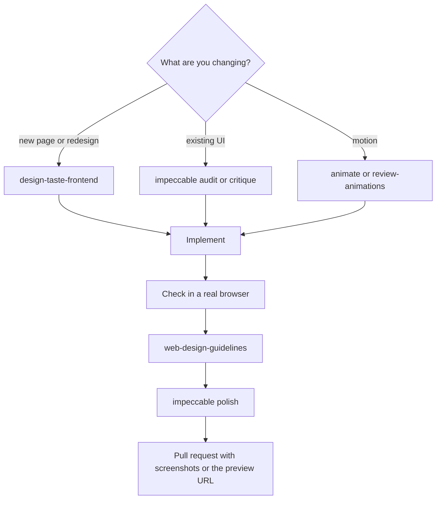

# Design workflow

How to design new pages, refine existing ones, add motion and check
accessibility with the design skills in Claude Code. Each skill holds its own
method; this guide tells you which one to reach for and what the project
expects from the result.

## Product and design context

Two files at the repository root describe the product and its look:

| File | Describes |
|---|---|
| `PRODUCT.md` | Who the site serves, the brand and the design principles |
| `DESIGN.md` | The visual system: colors, typography, spacing, radii and component patterns |

The design skills read both files before they work. Keep them current when the
visual system changes, in the same pull request. If one is missing,
`/impeccable init` writes `PRODUCT.md` through a short interview, and
`/impeccable document` generates `DESIGN.md` from the code.

What the skills find in the code:

- Theme tokens are CSS variables in
  [`src/app/globals.css`](../../src/app/globals.css); the dark theme applies
  under `[data-theme="dark"]`.
- UI primitives are shadcn/ui components on Base UI in
  [`src/components/ui/`](../../src/components/ui/).
- Motion uses framer-motion, with shared wrappers in
  [`src/components/motion/`](../../src/components/motion/).

The site's copy rules win over any skill's copy advice: Spanish, Argentine
voseo, friendly, no heavy slang and no em dashes.

## Which skill when

| Situation | Skill | Start with |
|---|---|---|
| A new page or a redesign | [design-taste-frontend](../../.claude/skills/design-taste-frontend/SKILL.md) | Ask Claude for a visual direction for the page |
| Planning the UX before code | [impeccable](../../.claude/skills/impeccable/SKILL.md) | `/impeccable shape <feature>` |
| A technical quality check of existing UI | impeccable | `/impeccable audit <page or component>` |
| A UX evaluation of existing UI | impeccable | `/impeccable critique <page or component>` |
| The last pass before shipping | impeccable | `/impeccable polish <target>` |
| New motion or a transition | [animate](../../.claude/skills/animate/SKILL.md) | Describe what should move and why |
| Interaction details: press, hover, popovers, tooltips | [emil-design-eng](../../.claude/skills/emil-design-eng/SKILL.md) | Point it at the component |
| A review of existing motion | [review-animations](../../.claude/skills/review-animations/SKILL.md) | `/review-animations` (manual only) |
| A plan to improve all motion | [improve-animations](../../.claude/skills/improve-animations/SKILL.md) | Ask for a motion audit |
| Places that should animate | [find-animation-opportunities](../../.claude/skills/find-animation-opportunities/SKILL.md) | Ask what could be animated |
| Janky or dropped-frame animations | [animation-performance](../../.claude/skills/animation-performance/SKILL.md) | Name the animation that stutters |
| An accessibility and interface review | [web-design-guidelines](../../.claude/skills/web-design-guidelines/SKILL.md) | `/web-design-guidelines <file or pattern>` |

The diagram shows the usual path through the skills for a UI change.

## New pages and redesigns

Use **design-taste-frontend** when a page needs a visual direction: a new
route, or a redesign of an existing one. It decides layout, type, color and a
few deliberate motion moments. In this repository it is guidance only: verify
the result yourself with the `ui-verification` skill.

- The skill targets marketing and product sites. Keep its quality bar, and
  keep this site's identity: Spanish copy, the shell with sidebar and header,
  and `DESIGN.md`. When a redesign changes the visual system, update
  `DESIGN.md` in the same pull request.
- Its browser gate, the Stop hook that ran it and its photo and icon fetchers
  were left out after the security review (see
  [THIRD-PARTY.md](../../.claude/skills/THIRD-PARTY.md)), so it never blocks
  Claude from finishing and never downloads media.
- The skill's 37 MB `assets/` folder is not vendored. If a step needs it,
  restore it with the command in
  [THIRD-PARTY.md](../../.claude/skills/THIRD-PARTY.md).

## Refining existing UI

Use **impeccable** for work on screens that already exist. It reads
`PRODUCT.md` and `DESIGN.md` directly: its engine launcher, which downloads
and runs a native binary, is not vendored, so the engine commands (context,
live, generate, hooks, doctor, screenshots) are unavailable. The design
commands below are written guidance and work without it.

| Command | What you get |
|---|---|
| `/impeccable audit` | Technical checks across accessibility, performance, theming, responsive design and anti-patterns, as a scored report with P0 to P3 severities and a plan |
| `/impeccable critique` | A UX evaluation of hierarchy, information architecture and cognitive load, with scores and persona-based testing |
| `/impeccable polish` | A final pass on alignment, spacing, consistency and small details |
| `/impeccable harden` | Error states, text overflow and edge cases with real data |
| `/impeccable clarify` | Clearer labels, messages and instructions; the copy stays Spanish |
| `/impeccable adapt` | Responsive behavior and touch targets |

It has more commands, such as `typeset`, `layout`, `distill`, `quieter`,
`bolder` and `optimize`; the skill lists them all. A refinement keeps the
current identity and behavior; a redesign replaces the look and belongs with
design-taste-frontend. Save an audit worth keeping in
[`docs/reports/`](../reports/README.md).

## Motion

| Skill | Role |
|---|---|
| animate | Builds an animation from scratch: whether to animate, the purpose, properties, curve, duration, interruption and exit |
| emil-design-eng | The small interaction details that make a component feel right |
| review-animations | A strict review of motion code; runs only as `/review-animations` |
| improve-animations | Surveys all motion in the codebase and writes a prioritized plan, without editing code |
| find-animation-opportunities | Proposes motion with exact values, without implementing it |
| animation-performance | Keeps animations within the frame budget and finds the cause of jank |

New and changed animations must respect reduced motion. Today only the CSS
animations in `globals.css` check `prefers-reduced-motion`; the framer-motion
code does not, so cover it in any motion you touch. The performance skill
prefers properties the browser can composite, such as `transform` and
`opacity`.

## Accessibility

The target is WCAG 2.2 AA: keyboard access, visible focus, 4.5:1 text
contrast, labels on controls and respect for reduced motion.

- **web-design-guidelines** reviews UI code against interface guidelines,
  accessibility included. Pass it a file or a glob pattern.
- `/impeccable audit` covers accessibility as part of its technical checks.
- `pnpm lint` runs Biome's accessibility rules; several of them report
  warnings rather than errors, so read them.
- Check the result with the keyboard, and verify in a real browser before you
  say the change works (`ui-verification` skill).

## Before you open the pull request

- Before and after screenshots, or the Vercel preview URL, in the pull
  request.
- Checked at mobile and desktop widths, in the light and dark themes, with the
  keyboard and with reduced motion.
- Spanish copy follows the site's copy rules.
- `DESIGN.md` or `PRODUCT.md` updated when the system changed.
- The feature page's "States and variants" section updated.
- The `area: design` label and the `design` scope for design-only changes.
