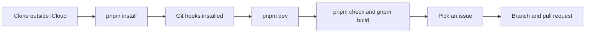

# Getting started

From a fresh machine to a running site, passing checks and your first pull
request.

## Prerequisites

| Tool | Version | Notes |
|---|---|---|
| Node.js | 22 | Pinned in [`.nvmrc`](../../.nvmrc); `nvm use` picks it up |
| pnpm | 10.28.0 | Pinned in the `packageManager` field of [`package.json`](../../package.json); `corepack enable` provides it |
| Git | Any recent version | |
| GitHub CLI (`gh`) | Any recent version | Run `gh auth login` once; the workflow uses it for issues, labels and pull requests |
| Claude Code | Latest | Optional, but both maintainers use it; see [Working with Claude Code](working-with-claude.md) |

Use pnpm only. npm, yarn and npx are not used in this repository; `pnpm dlx`
runs one-off tools and `pnpm exec` runs installed binaries.

In VS Code, accept the recommended extensions from
[`.vscode/extensions.json`](../../.vscode/extensions.json): Biome, Tailwind
CSS, EditorConfig, Mermaid preview for Markdown and Claude Code. The workspace
settings format on save with Biome, except Markdown.

## Choose where to clone

Keep the repository outside folders that iCloud syncs, such as Desktop and
Documents when iCloud Drive syncs them. iCloud evicts files it considers
unused, and evicted files in `node_modules` make `next build` fail with
`ECANCELED`. A folder such as `~/code/` works well.

## Install

```bash
git clone https://github.com/MatiasGuaymas/Blog_Informatica.git
cd Blog_Informatica
corepack enable                          # once per machine
pnpm install                             # dependencies and git hooks
pnpm exec playwright install chromium    # once, for browser checks
```

The clone checks out `dev`, the default branch. `pnpm install` runs the
`prepare` script ([`scripts/install-git-hooks.mjs`](../../scripts/install-git-hooks.mjs)),
which installs the git hooks from [`lefthook.yml`](../../lefthook.yml). It
skips that step in CI and on Vercel.

The diagram shows the path from a fresh clone to your first pull request.



## Run the site

```bash
pnpm dev    # http://localhost:3000
```

No environment variables are needed locally. `NEXT_PUBLIC_SITE_URL` is
optional and only changes the absolute URLs in metadata; see the
[README](../../README.md#environment-variables).

The home page and the notice board read the official UNLP notice board API on
the server, so they need network access. `pnpm build` prerenders the home
page, so a build also fails when the API cannot be reached; see
[Failure modes](../architecture/rendering-and-caching.md#failure-modes).

## Run the checks

| Command | What it checks |
|---|---|
| `pnpm check` | Biome lint and format, TypeScript, the branding guard and the 500-line limit |
| `pnpm build` | The production build |
| `pnpm format` | Formats the codebase with Biome |
| `node --test ".claude/hooks/tests/*.test.mjs"` | The Claude Code hook rules, when you change them |

CI runs the same checks on every pull request.

## The git hooks

| Hook | Runs | Fails when |
|---|---|---|
| pre-commit | Biome with auto-fix on staged files (fixed files are re-staged), the file size check, the branding guard | Biome finds an error it cannot fix, a TypeScript file passes its line limit, or a file contains forbidden branding |
| commit-msg | [`scripts/check-commit-message.mjs`](../../scripts/check-commit-message.mjs) | The message is not a Conventional Commit, the header passes 100 characters, or it looks Spanish |
| pre-push | `pnpm typecheck` | TypeScript reports an error |

Never skip them with `--no-verify`: fix what the hook reports, stage again and
commit again. Run one by hand with `pnpm exec lefthook run pre-commit`.

## Your first Claude Code session

1. Run `claude` in the repository folder and accept the workspace trust
   dialog. The project hooks stay off until you do.
2. Check the first message: the session-start hook reports your branch and
   warns you when you are on `dev` or `main`.
3. Type `/` to list the skills.

[Working with Claude Code](working-with-claude.md) explains the settings, the
hooks and the skills.

## Your first contribution

1. Look for an issue labeled `good first issue` on the Roadmap board.
2. Follow the [Task workflow](task-workflow.md) to pick it up and the
   [Git workflow](git-workflow.md) to branch, commit and open the pull
   request.
3. Read [CONTRIBUTING.md](../../CONTRIBUTING.md) for the conventions and the
   Definition of Done.

## Troubleshooting

| Symptom | Cause and fix |
|---|---|
| `next build` fails with `ECANCELED` | The clone is in a folder iCloud syncs. Move it elsewhere, then run `rm -rf node_modules .next && pnpm install`. |
| The git hooks do not run | They were not installed. Run `pnpm exec lefthook install`. |
| `... does not follow Conventional Commits` | Use `<type>(<scope>): <subject>`, for example `fix(calendar): show events that span two months`. |
| `... looks like Spanish` | Write the commit message or pull request title in English. |
| `File size limit exceeded` | Split the TypeScript file by domain. Allowlisted files may not grow. |
| `Forbidden third-party branding found` | Remove the reported term from the file. |
| The push fails on `typecheck` | Run `pnpm typecheck` and fix the errors. |
| The build fails while fetching notices | The UNLP API is unreachable. Check your network and retry. |
| Claude Code refuses `npm install` or `npx` | Use `pnpm add`, `pnpm dlx` or `pnpm exec`. |
| pnpm reports a different version | Run `corepack enable`, so the pinned pnpm is used. |
