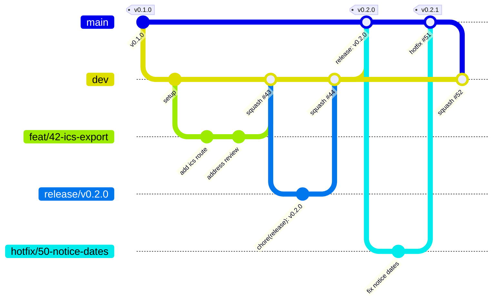
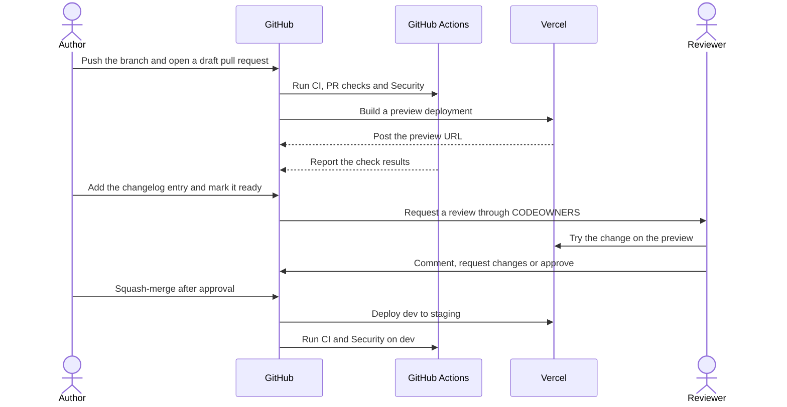

# Git workflow

How a change travels from a branch to staging and production. This guide
explains the model; the commands and checklists live in the
[git-workflow skill](../../.claude/skills/git-workflow/SKILL.md), which Claude
Code loads before any branch, commit or pull request work. The reasons behind
the model are in [ADR 0002](../decisions/0002-branching-and-environments.md).

## Branches and environments

| Branch | Role | Deploys to | Changes only through |
|---|---|---|---|
| `dev` | Integration, default branch | Staging: the Vercel branch URL of `dev` | Squash-merged pull requests with one approval, green checks and resolved threads |
| `main` | Production | <https://blog-informatica-mu.vercel.app> | Release pull requests from `dev` and hotfix pull requests, merged with a merge commit and one approval |
| `<type>/<issue>-<slug>` | One issue | A Vercel preview per pull request | Your own commits |

The diagram shows how work flows between the branches: on `dev` every merge is a squash merge that adds a single commit, `main` receives releases and hotfixes as merge commits, and a hotfix returns to `dev` through its own pull request.



## What protects `dev` and `main`

GitHub rulesets:

| Rule | `dev` | `main` |
|---|---|---|
| Changes only through pull requests | Yes | Yes |
| Merge method | Squash | Merge commit |
| Approvals | 1 | 1 |
| Required checks | Yes | Yes |
| Resolved conversations | Yes | - |

Admins can bypass the rules only when merging a pull request, never by pushing
directly. An admin merge skips the review and the checks: use it only in an
emergency and write the reason in the pull request.

Locally, the Claude Code hooks deny commits on `dev` or `main`, pushes to them
and `git merge` into them unless it is `--ff-only`; `git pull` still works.
The git hooks run on every commit and push. Never skip them with
`--no-verify`.

## Branch names

`<type>/<issue>-<slug>`, with a short kebab-case English slug:
`feat/42-ics-export`, `fix/57-notice-dates`, `docs/61-release-guide`.

Types: `feat`, `fix`, `docs`, `chore`, `refactor`, `test`, `ci`, `perf` and
`hotfix`. Every branch starts from an up-to-date `dev`, except `hotfix`
branches, which start from `main`. Release preparation uses `release/vX.Y.Z`
branches; see the [Release process](release-process.md).

## Commits

- Conventional Commits in English: `<type>(<scope>): <imperative subject>`.
- Keep the header under 72 characters. The commit-msg hook rejects headers
  over 100 characters, unknown types and headers that look Spanish.
- The body explains why. Wrap it at 72 columns.
- Prefer small, focused commits.

Accepted types: `feat`, `fix`, `docs`, `style`, `refactor`, `perf`, `test`,
`build`, `ci`, `chore`, `revert`, `release`. Scopes: `careers`, `subjects`,
`graph`, `notice-board`, `calendar`, `bibliography`, `links`, `about`, `seo`,
`design`, `infra`, `docs`, `deps`, `release`.

| Hook | Runs |
|---|---|
| pre-commit | Biome with auto-fix on staged files, the 500-line limit, the branding guard |
| commit-msg | The Conventional Commits and English check |
| pre-push | `pnpm typecheck` |

## Pull requests

1. Push your branch and open a draft pull request into `dev` early.
2. Write the title as a Conventional Commit. It becomes the squash commit on
   `dev`, so CI checks it with the same rules as a commit message.
3. Fill in the [template](../../.github/pull_request_template.md): Summary,
   `Closes #<issue>`, Changes, How to test, Screenshots or preview, Checklist.
4. Once the pull request has a number, add the changelog entry ending with
   `#<PR> @<your-handle>`
   ([changelog-management skill](../../.claude/skills/changelog-management/SKILL.md)).
5. Copy the `type:` and `area:` labels from the issue.
6. When the checks are green, mark it as ready. CODEOWNERS makes GitHub
   request the other maintainer.

The diagram shows a pull request from the first push to the merge.



## Checks

Required checks:

| Check | Workflow | What it does | Run locally |
|---|---|---|---|
| Lint, typecheck and repository checks | [CI](../../.github/workflows/ci.yml) | Biome, `tsc`, the branding guard, the 500-line limit and the Claude Code hook tests | `pnpm check` and `node --test ".claude/hooks/tests/*.test.mjs"` |
| Build | [CI](../../.github/workflows/ci.yml) | `next build` | `pnpm build` |
| Conventional title | [PR checks](../../.github/workflows/pr-checks.yml) | The title format and language | `node scripts/check-commit-message.mjs --title "<title>"` |
| Docs and changelog | [PR checks](../../.github/workflows/pr-checks.yml) | A changelog entry for this pull request, and docs changes when `src/` changes | - |
| Dependency audit | [Security](../../.github/workflows/security.yml) | High or critical advisories in production dependencies | `pnpm audit --prod --audit-level=high` |
| Secret scan | [Security](../../.github/workflows/security.yml) | gitleaks over the history | - |

Also on every pull request: a dependency review that fails on new high or
critical vulnerabilities, CodeQL code scanning, and a Vercel preview.

The "Docs and changelog" check
([`scripts/check-docs-changelog.mjs`](../../scripts/check-docs-changelog.mjs))
works like this:

- Every added changelog line must end with `#<number> @<handle>`, and at least
  one must reference this pull request.
- A change to `src/**/*.ts`, `.tsx` or `.css` (tests excluded) needs a change
  under `docs/` or to the root `README.md`.
- Pull requests from `dev` into `main` and pull requests opened by bots skip
  both rules.

| Label | Effect | Who decides |
|---|---|---|
| `skip-changelog` | Waives the changelog entry | The reviewer agrees it does not apply |
| `skip-docs` | Waives the docs rule | The reviewer agrees it does not apply |
| `release` | Waives the changelog entry for release preparation | The release process |

## Reviews

The reviewer reads the issue and its acceptance criteria first, runs the
change on the preview or locally, prefixes comments with **blocking:**,
**suggestion:**, **question:** or **nit:**, and approves when the criteria are
met and the checks are green.

The author runs `/code-review` in Claude Code before asking for a review,
answers every comment, pushes fixes as new commits without force-pushing, and
resolves a thread only after addressing it. The
[CONTRIBUTING](../../CONTRIBUTING.md#reviews) page has the full checklist.

## Merge

The author merges after approval:

```bash
gh pr merge <n> --squash --delete-branch    # or --auto to merge when checks pass
```

Merging into `dev` closes the linked issue through `Closes #<issue>` and
updates staging.

## Keep your branch up to date

```bash
git fetch origin && git rebase origin/dev
git push --force-with-lease                 # your own branch only
```

GitHub's "Update branch" button works too. Claude Code asks before any force
push. When two branches add changelog entries in the same place, keep both:
[`.gitattributes`](../../.gitattributes) sets a union merge for
`CHANGELOG.md`, which applies to local merges and rebases.

## Hotfixes

For an urgent production bug:

1. Branch `hotfix/<issue>-<slug>` from `main`.
2. Open a pull request into `main`. To publish the fix as a patch release, the
   same pull request sets the patch version in `package.json` and moves its
   changelog entry under the new version heading; the Release workflow tags
   any version on `main` that has no tag yet.
3. Merge it with a merge commit after approval.
4. Open a pull request from `main` into `dev`, so the fix is not lost, and
   squash-merge it like any pull request into `dev`. The "Docs and changelog"
   check only exempts pull requests from `dev` into `main`, and the changelog
   entry already arrived with the hotfix, so ask the reviewer for the
   `skip-changelog` label (and `skip-docs` when the hotfix had it).
5. Put `Closes #<issue>` in the pull request into `dev`: GitHub closes issues
   only from pull requests merged into the default branch.

The [Release process](release-process.md) covers versions and rollback.

## Deployments

| Event | Result |
|---|---|
| Pull request opened or updated | A Vercel preview deployment |
| Merge into `dev` | Staging updates |
| Release pull request merged into `main` | Production deployment, git tag and GitHub Release |

The Vercel project is on the Hobby plan, which deploys commits from both
maintainers because the repository is public. Details in
[Deployment](../architecture/deployment.md).
