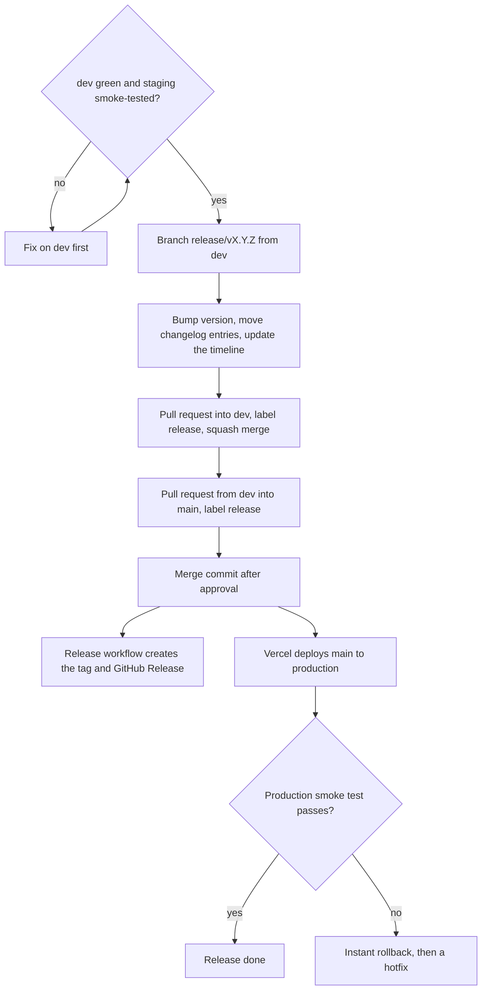

# Release process

Production (`main`) changes only through releases, and a release ships
everything merged into `dev` since the last tag. The step-by-step checklist,
with every command, is the [release skill](../../.claude/skills/release/SKILL.md).
Claude Code runs it only when a maintainer types `/release`; it never starts a
release on its own.

## Versioning

Semantic Versioning, `0.x` while the product is pre-1.0:

| Bump | When |
|---|---|
| Minor (`0.X.0`) | New user-facing capabilities |
| Patch (`0.0.X`) | Fixes, documentation or internal changes only |
| `1.0.0` | When both developers agree, for example at the custom domain launch |

The version lives in `package.json`, and each release has a section in
[CHANGELOG.md](../../CHANGELOG.md). v0.1.0 is the baseline release: the site
as deployed to production when the team started tracking its work in this
repository.

## Before you start

- `dev` is green: `gh run list --branch dev --limit 5`.
- Staging works: smoke-test the `dev` branch URL in a real browser.
- No blocker is open for this release.

## Steps

1. **Prepare on a branch from `dev`**, named `release/vX.Y.Z`:
   - set `version` in `package.json` to `X.Y.Z`;
   - move the `[Unreleased]` entries of `CHANGELOG.md` under a new
     `## [X.Y.Z] - YYYY-MM-DD` heading, keep an empty `[Unreleased]` above
     it, and update the compare links at the bottom;
   - add the user-facing capabilities to the Timeline in
     [`docs/overview.md`](../overview.md);
   - commit `chore(release): vX.Y.Z`.
2. **Merge the preparation into `dev`**: a pull request titled
   `chore(release): vX.Y.Z` with the `release` label, which waives the
   changelog check. Squash-merge it after approval.
3. **Promote `dev` to `main`**: a pull request from `dev` into `main`, titled
   `release: vX.Y.Z`, with the `release` label and the changelog section as
   its body. Merge it with a merge commit after approval.
4. **Verify**: the tag and the GitHub Release exist
   (`gh release view vX.Y.Z`), the Vercel production deployment of `main`
   succeeded, and production passes a smoke test.

The diagram shows the release from the readiness check to the verified
production deployment.



## What the automation does

| Event | Automation |
|---|---|
| Push to `main` | The [Release workflow](../../.github/workflows/release.yml) reads `version` from `package.json`. If the tag `v<version>` does not exist yet, it extracts that version's section from `CHANGELOG.md` with [`scripts/release/extract-notes.mjs`](../../scripts/release/extract-notes.mjs) and creates the tag and a GitHub Release on the merge commit. If the tag exists, it does nothing. |
| Push to `main` | Vercel builds `main` and serves it at <https://blog-informatica-mu.vercel.app>. |
| Pull request from `dev` into `main` | The "Docs and changelog" check passes on its own: every change was checked when it reached `dev`. |

The release notes are the changelog section of the version, followed by a
link to the full changelog. The workflow fails if `CHANGELOG.md` has no
section for the version in `package.json`, so prepare both together.

## Changelog at release time

The [changelog-management skill](../../.claude/skills/changelog-management/SKILL.md)
defines the entries; at release time they only move. The compare links at the
bottom of `CHANGELOG.md` become:

```markdown
[Unreleased]: https://github.com/MatiasGuaymas/Blog_Informatica/compare/vX.Y.Z...dev
[X.Y.Z]: https://github.com/MatiasGuaymas/Blog_Informatica/compare/vPREVIOUS...vX.Y.Z
```

Released sections are never edited afterwards, except to fix a typo.

## When production breaks

1. **Roll back.** In the Vercel dashboard, use Instant Rollback to the
   previous production deployment. Nothing rebuilds. On the Hobby plan only
   the previous production deployment is eligible; see
   [Deployment](../architecture/deployment.md#rollback).
2. **Fix forward with a hotfix.** Branch `hotfix/<issue>-<slug>` from
   `main`, and in the same pull request set the patch version and move the
   fix's changelog entry under the new version heading, so the Release
   workflow tags it. Merge into `main`, then bring `main` back into `dev`
   with a second pull request. The [Git workflow](git-workflow.md#hotfixes)
   has the details.

A rollback does not delete the tag or the GitHub Release of the faulty
version; the next release supersedes them.

## Release history

Every release is a tag `vX.Y.Z`, a GitHub Release with its notes and a
section in [CHANGELOG.md](../../CHANGELOG.md). The user-facing timeline is in
the [overview](../overview.md#timeline).
