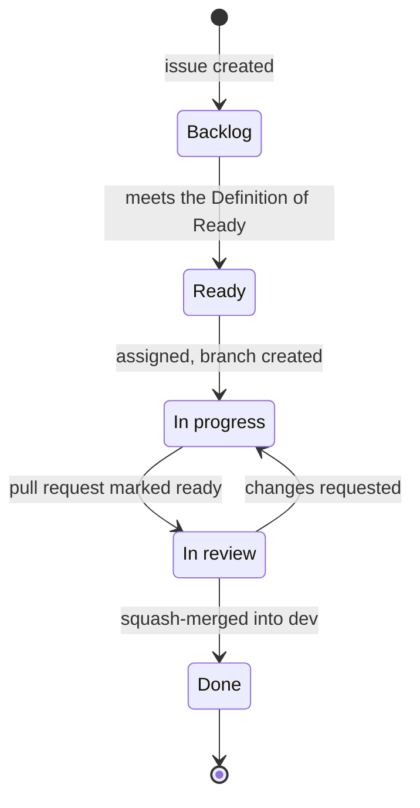

# Task workflow

How work is planned and tracked: epics, features, labels and the Roadmap
board. This guide explains the model; the commands (creating issues, linking
sub-issues through the API, adding items to the board) live in the
[task-management skill](../../.claude/skills/task-management/SKILL.md).

## Epics, features and tasks

| Level | On GitHub | Contains | In the repository |
|---|---|---|---|
| Epic | An issue labeled `type: epic`, titled `Epic: <name>` | Goal, problem, scope, success criteria | `docs/epics/<key>-<slug>/README.md` |
| Feature | A sub-issue of its epic, labeled `type: feature` or `type: bug` | User stories, Gherkin acceptance criteria, use cases, non-functional requirements, Definition of Done | `docs/features/<slug>/README.md` once built |
| Task | A checklist item inside the feature, or a sub-issue when someone else takes it | - | - |

Keys identify the work: epics are `E01`, `E02`..., features `E01-F01`. The key
goes in the issue body and in the docs, not in the title. The
[epic index](../epics/README.md) lists every epic.

## Labels

[`.github/labels.json`](../../.github/labels.json) is the source of truth;
`pnpm labels:sync` applies it to GitHub.

| Group | Labels | Use |
|---|---|---|
| Type | `type: epic`, `type: feature`, `type: bug`, `type: chore`, `type: docs` | What kind of work it is |
| Area | `area: careers`, `area: subjects`, `area: prerequisites-graph`, `area: notice-board`, `area: calendar`, `area: bibliography`, `area: links`, `area: about`, `area: seo`, `area: design`, `area: content`, `area: infra`, `area: docs`, `area: dependencies` | Which part of the product it touches |
| Priority | `priority: high` (do next), `priority: medium` (planned), `priority: low` (nice to have) | Order of work |
| Size | `size: S` (a few hours), `size: M` (one to three days), `size: L` (more than three days, consider splitting) | Effort |
| Flow | `good first issue`, `help wanted`, `blocked` | Who can take it and whether it can move |
| Checks | `release`, `skip-changelog`, `skip-docs` | Waive pull request checks, by reviewer agreement |

## The Roadmap board

The GitHub Project "Roadmap" has three views: a Board by Status, a Table
grouped by parent epic, and a Roadmap timeline.

The diagram shows the statuses an issue moves through on the board.

| Status | Meaning |
|---|---|
| Backlog | Captured, not ready to start |
| Ready | Meets the Definition of Ready |
| In progress | Someone is assigned and working on a branch, usually with a draft pull request |
| In review | The pull request is ready and waiting for the other maintainer |
| Done | Merged into `dev`, so the issue is closed |

The `blocked` label marks an item that waits on a decision or another issue,
whatever its status.

## Plan an epic

1. Draft the brief in `docs/epics/<key>-<slug>/README.md`, following the
   structure in the [epic index](../epics/README.md).
2. Create the issue with the **Epic** form: goal, problem, scope, success
   criteria, risks and a link to the brief.
3. Split it into features.

## Plan a feature

1. Write the spec with the [feature-spec](../../.claude/skills/feature-spec/SKILL.md)
   skill; the [Writing feature specs](writing-feature-specs.md) guide explains
   the standard.
2. Create the issue with the **Feature** form, with `type:`, `area:`,
   `priority:` and `size:` labels and an imperative, specific title.
3. Link it to its epic as a sub-issue. The GitHub CLI has no flag for that, so
   the skill uses the REST API.
4. Add it to the Roadmap board.

Bugs use the **Bug** form, which asks for the environment (production,
staging, pull request preview or local) and the severity. A bug that breaks
production follows the hotfix path in the [Git workflow](git-workflow.md#hotfixes).

## Definition of Ready

A feature can start when:

- Its stories meet INVEST.
- Every story has Gherkin acceptance criteria.
- Its size is S or M. Split L features first.
- Its dependencies are resolved.
- UI work has design notes.

## Pick up work

1. Take the Ready feature with the highest priority. Prefer finishing an epic
   over starting a new one.
2. Assign yourself and move it to In progress.
3. Branch from `dev` and open a draft pull request early with
   `Closes #<issue>`.
4. Keep at most two features in progress at a time.

## Definition of Done

A feature is done when it is verified, documented, has its changelog entry,
is approved by the other developer and is merged into `dev`. The checklist is
in [CONTRIBUTING](../../CONTRIBUTING.md#definition-of-done), in the Feature
form and, as the reference for agents, in the task-management skill.

## Close

Merging the pull request into `dev`, the default branch, closes the feature.
Close an epic when all its sub-issues are done and its success criteria are
met; then update its brief and the epic index.

## Working together

- A weekly 20-minute sync: review the board, choose the next features and
  unblock each other.
- Pair on large or unfamiliar features.
- At the end of each epic, a short retrospective (keep, change, try), recorded
  in the epic brief.
