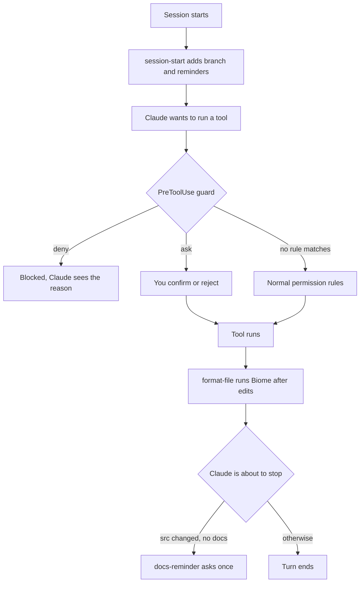
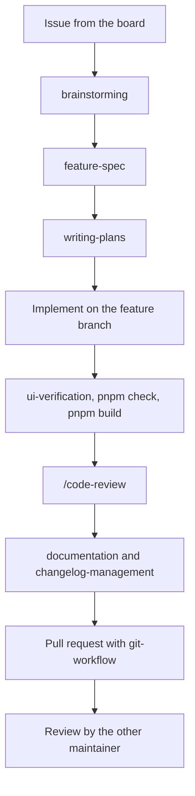

# Working with Claude Code

Both maintainers use Claude Code. The repository ships a shared configuration
in `.claude/`: settings with permissions and hooks, and skills that carry the
detailed procedures. This guide explains each piece, how they fit together and
how to keep them current.

## What Claude reads

| When | What |
|---|---|
| Every session | [`CLAUDE.md`](../../CLAUDE.md), which imports [`AGENTS.md`](../../AGENTS.md): mandatory rules, language, branding, workflow and the skills table |
| Session start | The session-start hook adds the current branch and the first workflow steps |
| On demand | A skill, when the task matches its description or when you type `/<skill>` |
| Editing docs | [`docs/AGENTS.md`](../AGENTS.md), through the documentation skill |

Your personal notes in `CLAUDE.local.md` load too, only on your machine.

## Team and personal settings

| File | Shared | Holds |
|---|---|---|
| [`.claude/settings.json`](../../.claude/settings.json) | Yes, committed | Permissions and hooks for everyone |
| `.claude/settings.local.json` | No, gitignored | Your own permissions and preferences for this repository |
| `CLAUDE.local.md` | No, gitignored | Your personal instructions for this repository |
| `~/.claude/settings.json`, `~/.claude/CLAUDE.md` | No, in your home folder | Preferences for all your projects |
| [`.claude/hooks/`](../../.claude/hooks/) | Yes | Hook scripts and their tests |
| [`.claude/skills/`](../../.claude/skills/) | Yes | Project and vendored skills |
| `.claude/worktrees/` | No, gitignored | Worktrees that Claude Code creates |

Claude Code merges these files. When a setting appears in more than one, your
local project file wins over the shared one, which wins over your user
settings. Permission rules from all files add up, and a deny rule always beats
an allow rule. Hooks from every file run. `/permissions` and `/hooks` show
what is active.

The shared settings let Claude run these commands without asking:

- `pnpm lint`, `pnpm typecheck`, `pnpm check` and `pnpm check:*`,
  `pnpm build`, `pnpm format`, `pnpm exec biome check`
- `git status`, `git diff`, `git log`, `git show`, `git branch`
- `gh issue view` and `list`, `gh pr view`, `list`, `checks` and `diff`,
  `gh run list` and `view`
- `node scripts/check-forbidden-terms.mjs`,
  `node scripts/check-file-lines.mjs` and `node --test`

Everything else follows your permission mode. Claude may never read `.env` or
`.env.*` files. Put personal allowances, such as `pnpm dev`, in
`.claude/settings.local.json` rather than in the shared file.

## The trust dialog

The first time you run Claude Code in a folder, it asks whether you trust the
files in it. Until you accept, the project hooks and settings from
`.claude/settings.json` do not run. Accept it for your clone of this
repository, then run `pnpm install` and
`pnpm exec playwright install chromium` if you have not yet.

Hooks are scripts that run on your machine with your permissions. When a pull
request changes `.claude/`, review the hook scripts like any other code.
Claude Code reads hooks when a session starts, so restart it, or review the
change in `/hooks`, after pulling hook changes.

## Hooks

Hooks are Node.js scripts in [`.claude/hooks/`](../../.claude/hooks/),
configured in [`.claude/settings.json`](../../.claude/settings.json). The rules
are pure functions in [`rules.mjs`](../../.claude/hooks/rules.mjs), covered by
[`tests/rules.test.mjs`](../../.claude/hooks/tests/rules.test.mjs), which CI
runs.

| Event | Matcher | Script | Effect |
|---|---|---|---|
| SessionStart | - | [`session-start.mjs`](../../.claude/hooks/session-start.mjs) | Adds the branch and workflow reminders to Claude's context |
| PreToolUse | `Bash` | [`guard-bash.mjs`](../../.claude/hooks/guard-bash.mjs) | Denies workflow-breaking commands, asks before destructive ones |
| PreToolUse | `Edit`, `Write`, `MultiEdit` | [`guard-write.mjs`](../../.claude/hooks/guard-write.mjs) | Denies writing secrets, generated files and branding |
| PostToolUse | `Edit`, `Write`, `MultiEdit` | [`format-file.mjs`](../../.claude/hooks/format-file.mjs) | Formats the edited file with Biome |
| Stop | - | [`docs-reminder.mjs`](../../.claude/hooks/docs-reminder.mjs) | Asks once for docs when `src/` changed without them |

The diagram shows where each hook acts during a session.



### session-start.mjs

Adds three things to Claude's context: the current branch with the number of
uncommitted changes, a warning with the command to create a feature branch
when the session starts on `dev` or `main`, and a reminder that work starts
from an issue (task-management skill) and follows the git-workflow skill.

### guard-bash.mjs

The hook splits a command line at `&&`, `||`, `;`, `|` and newlines, drops
leading `VAR=value` assignments and checks every segment. If any segment is
denied, the whole command is denied; a deny beats an ask.

It **denies**:

| Command | Instead |
|---|---|
| `npm install`, `i`, `ci`, `add`, `update`, `up`, `uninstall`, `remove`, `rm` | `pnpm install`, `pnpm add`, `pnpm remove`, `pnpm update` |
| Any `yarn` command | The same pnpm commands |
| `npx` | `pnpm dlx` for one-off tools, `pnpm exec` for installed binaries |
| `git commit` or `git push` with `--no-verify` or `-n` (for `git push`, `-n` is a dry run, blocked as well) | Fix what the git hook reports and commit again |
| `git commit` while on `dev` or `main` | A feature branch from `dev` |
| `git merge` while on `dev` or `main`, unless `--ff-only` | A pull request; `git pull` to sync |
| `git push` to `dev` or `main`: an explicit target such as `origin main` or `HEAD:main`, or a bare push while on them | Push your feature branch and open a pull request |

It **asks** before:

| Command | Why |
|---|---|
| `git push --force`, `--force-with-lease` or `-f` | It rewrites the remote branch: fine on your own branch after a rebase, never on someone else's |
| `git reset --hard` | It discards uncommitted work |
| `git clean -f` | It deletes untracked files |
| `rm -rf`, in any flag order | It deletes files permanently; allowed without asking when every target is `node_modules`, `.next`, `test-results`, `playwright-report` or under `/tmp/` |
| `gh pr merge --admin` | It bypasses the review and the required checks |
| `gh repo delete`, `gh repo edit --visibility` | It deletes the repository or changes its visibility; Vercel deploys both maintainers' commits only while the repository is public |
| `gh api` with `POST`, `PUT`, `PATCH` or `DELETE` on rulesets or branch protection | It changes the protection rules |
| `vercel ... --prod` | Production deploys come from `main` through a release pull request |

### guard-write.mjs

It **denies** an `Edit`, `Write` or `MultiEdit` that would:

- write a `.env` or `.env.*` file, except `.env.example`: secrets belong in
  Vercel environment variables;
- edit `pnpm-lock.yaml` by hand: run `pnpm add`, `pnpm remove` or
  `pnpm update`;
- write inside `node_modules/` or `.next/`: change the source instead;
- add text that contains forbidden third-party branding, using the same
  patterns as the branding guard.

### format-file.mjs

After every edit to a `.js`, `.jsx`, `.mjs`, `.cjs`, `.ts`, `.tsx`, `.json`,
`.jsonc` or `.css` file, it runs `pnpm exec biome check --write` on that file,
the same command as the pre-commit hook. When Biome still reports problems, the
hook passes the first 30 lines of its output to Claude to fix. Markdown is not
formatted.

### docs-reminder.mjs

When Claude is about to finish and `git status` lists uncommitted changes to
`.ts`, `.tsx` or `.css` files under `src/` but nothing under `docs/` and no
change to the root `README.md`, the hook stops Claude once. Claude then
updates the matching feature or architecture page, or states in one sentence
why no update is needed. The message also reminds it to add the changelog
entry once the pull request exists. CI runs the same docs rule as part of
"Docs and changelog".

### Hooks inside skills

Skills can declare their own hooks in their frontmatter. None of the vendored
skills does in this repository: the Stop hook of `design-taste-frontend` was
removed during the security review because it could keep Claude from
finishing. Review any skill update for new `hooks:` blocks before committing
it.

### Change a hook

1. Change the rule in [`rules.mjs`](../../.claude/hooks/rules.mjs), which has no
   I/O, or the hook script.
2. Add or update a case in
   [`tests/rules.test.mjs`](../../.claude/hooks/tests/rules.test.mjs) and run
   `node --test ".claude/hooks/tests/*.test.mjs"`.
3. Update this guide and the hooks summary in [`CLAUDE.md`](../../CLAUDE.md).

## Skills

A skill is a folder with a `SKILL.md`. Claude loads it when your request
matches its description, or when you type `/<skill>`. Two skills never load on
their own: `release` runs only as `/release`, and `review-animations` only as
`/review-animations`. Type `/` in Claude Code to list them all.

### Project skills

Written and maintained here:

| Skill | Use when |
|---|---|
| [task-management](../../.claude/skills/task-management/SKILL.md) | Creating or refining epics and features, picking up work, closing finished work |
| [feature-spec](../../.claude/skills/feature-spec/SKILL.md) | Drafting or refining a feature issue, splitting an epic, documenting a built feature |
| [git-workflow](../../.claude/skills/git-workflow/SKILL.md) | Before creating a branch, committing, or opening, reviewing or merging a pull request |
| [changelog-management](../../.claude/skills/changelog-management/SKILL.md) | Writing or reviewing the changelog entry of a pull request |
| [documentation](../../.claude/skills/documentation/SKILL.md) | Any change to behavior, structure, workflow or decisions; holds the code-to-docs map |
| [release](../../.claude/skills/release/SKILL.md) | Promoting `dev` to production, only when a maintainer asks (`/release`) |
| `frontend-development` | Anything in `src/` |
| `ui-verification` | Checking a change in a real browser |
| `debugging` | Project playbooks for diagnosing errors, before `systematic-debugging` |

### Vendored skills

Written by others and copied into the repository with their licenses.
Sources, commits and licenses are in
[THIRD-PARTY.md](../../.claude/skills/THIRD-PARTY.md); content hashes are in
[`skills-lock.json`](../../skills-lock.json).

| Area | Skill | Use when |
|---|---|---|
| Planning | [brainstorming](../../.claude/skills/brainstorming/SKILL.md) | Before building something new or changing behavior: it shapes the idea through questions and agrees on a design. It can offer a visual companion served on `127.0.0.1`. |
| Planning | [writing-plans](../../.claude/skills/writing-plans/SKILL.md) | An agreed spec needs a step-by-step implementation plan before anyone touches code |
| Planning | [user-stories](../../.claude/skills/user-stories/SKILL.md) | Story-writing technique: the 3 C's and INVEST |
| Planning | [test-scenarios](../../.claude/skills/test-scenarios/SKILL.md) | Turning stories into test scenarios with steps and expected outcomes |
| Code | [vercel-react-best-practices](../../.claude/skills/vercel-react-best-practices/SKILL.md) | Writing or reviewing React and Next.js code for performance: data fetching, rendering, bundle size |
| Code | [vercel-composition-patterns](../../.claude/skills/vercel-composition-patterns/SKILL.md) | Designing component APIs: compound components, context providers, fewer boolean props, React 19 changes |
| Quality | [systematic-debugging](../../.claude/skills/systematic-debugging/SKILL.md) | Any bug, failing check or unexpected behavior, before proposing a fix |
| Quality | [verification-before-completion](../../.claude/skills/verification-before-completion/SKILL.md) | Before claiming that work is done, fixed or passing: run the commands and read their output |
| Quality | [requesting-code-review](../../.claude/skills/requesting-code-review/SKILL.md) | After a major change or before merging, to check the work against its requirements |
| Quality | [receiving-code-review](../../.claude/skills/receiving-code-review/SKILL.md) | Acting on review feedback: verify each point before changing code |
| Security | [security-audit](../../.claude/skills/security-audit/SKILL.md) | Security questions and focused reviews; a full audit only on explicit request (see [SECURITY.md](../../SECURITY.md)) |
| Design | [design-taste-frontend](../../.claude/skills/design-taste-frontend/SKILL.md) | Visual direction for new pages and redesigns |
| Design | [impeccable](../../.claude/skills/impeccable/SKILL.md) | Auditing, critiquing and polishing existing UI: `/impeccable audit`, `critique`, `polish`... |
| Design | [emil-design-eng](../../.claude/skills/emil-design-eng/SKILL.md) | Interaction details: press and hover states, popovers, tooltips, transitions |
| Design | [animate](../../.claude/skills/animate/SKILL.md) | Building a new animation or transition |
| Design | [improve-animations](../../.claude/skills/improve-animations/SKILL.md) | Auditing all motion in the codebase and planning fixes, without editing code |
| Design | [review-animations](../../.claude/skills/review-animations/SKILL.md) | A strict review of motion code, only as `/review-animations` |
| Design | [find-animation-opportunities](../../.claude/skills/find-animation-opportunities/SKILL.md) | Finding places that should animate, as proposals only |
| Design | [animation-performance](../../.claude/skills/animation-performance/SKILL.md) | Janky animations, dropped frames, choosing which property to animate |
| Design | [web-design-guidelines](../../.claude/skills/web-design-guidelines/SKILL.md) | Accessibility and interface guideline reviews of UI code |

The [Design workflow](design-workflow.md) explains when to use each design
skill.

### Built-in commands

| Command | Use it |
|---|---|
| `/code-review` | Before asking the other maintainer for a review |
| `/security-review` | For changes that touch external data, HTML or dependencies |
| `/hooks`, `/permissions` | To inspect the active hooks and permission rules |

## Recommended flows

### A new feature

1. Pick the issue and branch from `dev` (task-management, git-workflow).
2. Shape it with **brainstorming** when the change is not trivial.
3. Write the stories and acceptance criteria with **feature-spec** and update
   the issue.
4. Turn the spec into steps with **writing-plans**.
5. Implement the plan task by task on the feature branch with
   `frontend-development`; use the React skills for component and performance
   decisions.
6. Verify in a real browser with `ui-verification`, run `pnpm check` and
   `pnpm build`, and apply **verification-before-completion** before calling
   it done.
7. Run **`/code-review`** and fix what it finds.
8. Update the docs (**documentation**) and add the changelog entry
   (**changelog-management**).
9. Open the pull request (**git-workflow**). Use **requesting-code-review**
   and **receiving-code-review** around the human review.

The diagram shows the same flow from the issue to the human review.



### Other flows

| Situation | Flow |
|---|---|
| A bug | `debugging` playbooks, then **systematic-debugging** to find the root cause, a reproduction, the fix, **verification-before-completion**, `/code-review`, pull request. A broken production site follows the hotfix path in the [Git workflow](git-workflow.md#hotfixes). |
| A UI change | The [Design workflow](design-workflow.md): direction or audit, implementation, browser check, polish |
| External data, HTML or dependencies | `/security-review` before the pull request; **security-audit** for questions |
| Docs only | **documentation** and [`docs/AGENTS.md`](../AGENTS.md); a `docs` branch and commit type |
| A release | `/release`, only when a maintainer asks ([Release process](release-process.md)) |

## Project rules come first

Vendored skills are written for many projects. When one conflicts with
[`AGENTS.md`](../../AGENTS.md), `AGENTS.md` wins:

- Claude commits only after you confirm, even when a skill says to commit.
- pnpm only, even when a skill's example uses npm or npx.
- Git hooks are never skipped.
- brainstorming saves a design file and writing-plans saves a plan, each under
  `docs/` at a default path that is not part of the
  [docs structure](../README.md). Both accept another location if you name
  one. Until the team settles where these working files live, keep them out of
  commits.
- Some vendored skills mention companion skills that are not vendored here;
  ignore those references.

## Update vendored skills

```bash
DO_NOT_TRACK=1 pnpm dlx skills@1.9.0 update -p -y
```

Then, in a `chore` pull request:

1. Re-apply the local changes listed in
   [THIRD-PARTY.md](../../.claude/skills/THIRD-PARTY.md): today, the path
   rewrites in `design-taste-frontend` and `impeccable`.
2. Review the diff like third-party code: new scripts, network access and
   changed instructions.
3. Update the commit column in THIRD-PARTY.md and check that
   [`skills-lock.json`](../../skills-lock.json) changed with it.
4. Run `pnpm check`.
5. If skills were added or removed, update the skills table in
   [`AGENTS.md`](../../AGENTS.md) and this guide.

To add a new skill, use the same CLI in copy mode, never a symlink, and record
it in THIRD-PARTY.md with its license:

```bash
DO_NOT_TRACK=1 pnpm dlx skills@1.9.0 add <owner>/<repo> -s <skill> -a claude-code --copy -y
```

Afterwards, `git status` should show only the new folder and the lock file.
The reasons are in [ADR 0004](../decisions/0004-vendor-agent-skills.md).

`design-taste-frontend` is vendored without its 37 MB `assets/` folder. If a
step needs it, restore it locally with the command in THIRD-PARTY.md; the
folder is gitignored, so it stays on your machine.

## Good to know

- One vendored helper runs on your machine: brainstorming's optional visual
  companion serves pages on `127.0.0.1`. Its tracking image is disabled by
  `SUPERPOWERS_DISABLE_TELEMETRY=1` in the team settings. The impeccable
  engine and the design-taste-frontend gate are not vendored.
- Give commands that can block, such as builds, installs and servers, a
  timeout.
- Claude cannot commit on `dev` or `main`, so start each task on a feature
  branch.
