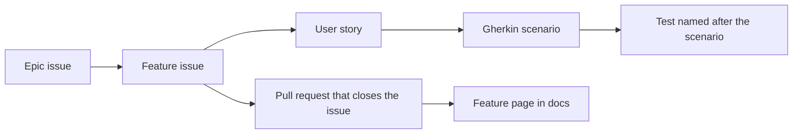

# Writing feature specs

Every feature has a spec: in its GitHub issue while it is planned, and in
`docs/features/<slug>/README.md` once it is built. The spec turns "done" into
something both maintainers, and Claude Code, can check. This guide explains
the standard; the rules and examples Claude follows live in the
[feature-spec skill](../../.claude/skills/feature-spec/SKILL.md), which builds
on the vendored [user-stories](../../.claude/skills/user-stories/SKILL.md) and
[test-scenarios](../../.claude/skills/test-scenarios/SKILL.md) skills.

## Anatomy

The **Feature** issue form asks for these sections, in this order:

1. **Summary**: two or three sentences on what changes for students.
2. **User stories**: a table with IDs.
3. **Acceptance criteria**: Gherkin scenarios per story.
4. **Use cases**: only for flows with meaningful alternatives.
5. **Non-functional requirements.**
6. **Technical notes**: files likely to change, approach, risks.
7. **Definition of Done.**

Once the feature ships, the same content moves to its feature page:

| In the issue | On the feature page |
|---|---|
| Summary | The summary quote and "Why it exists" |
| User stories | User stories |
| Acceptance criteria | Acceptance criteria |
| Use cases | Use cases |
| Non-functional requirements | Non-functional notes |
| Technical notes | How it works, describing what was built |
| Definition of Done | Not copied: it ends with the merge |
| - | States and variants, Known gaps |

The page template is in [docs/AGENTS.md](../AGENTS.md#feature-page-template).

## IDs and traceability

| Item | In issues | On feature pages |
|---|---|---|
| Story | `US-E02F03-01` | `US-<PREFIX>-01` |
| Use case | `UC-E02F03-01` | `UC-<PREFIX>-01` |
| Non-functional requirement | `NFR-E02F03-01` | `NFR-<PREFIX>-01` |

Feature prefixes: `HOME`, `CAR` (careers), `SUB` (subject page), `GRAPH`,
`NB` (notice board), `CAL`, `BIB`, `LINK`, `ABOUT`, `SEO`.

The diagram shows the chain that must stay traceable from planning to the
merged pull request.



## User stories

Write each story as **As a** `<persona>`, **I want to** `<action>`, **so
that** `<outcome>`. The personas are the prospective student, the first-year
student, the advanced student, and the maintainer, a developer editing
content.

Every story meets INVEST: Independent, Negotiable, Valuable, Estimable, Small
(a few days at most) and Testable. Split a large story by workflow step, data
variation, happy path versus edge cases, or device. Never split by technical
layer: "build the API" and "build the UI" are not stories.

## Acceptance criteria

Write two to four Gherkin scenarios per story, one behavior each, with at
least one edge or negative case: empty data, the external API down, a small
screen or keyboard-only use.

- `Given` holds only the context that matters.
- `When` is exactly one action.
- `Then` is something you can observe: visible text, a URL, an element state.
  Use `And` for more.
- Quote Spanish UI text exactly, with an English gloss the first time.
- Leave implementation out: "calls fetchCartelera" is not observable.

```gherkin
Scenario: Nothing matches the filters
  Given the notice board lists notices
  When I search for a term that matches no notice
  Then I see "Sin resultados" (no results)
  And I see "Probá ampliar el rango de fechas o sacar algunos filtros." (try a wider date range or fewer filters)

Scenario: Page number past the end
  Given the active filters produce 3 pages
  When I open "/cartelera?page=99"
  Then I see page 3
```

## Use cases

Add use cases only when a flow has real alternatives or failure paths. Each
one names the primary actor, preconditions, trigger and postconditions, then
lists a numbered **main success scenario** and **extensions** numbered after
the step they branch from (`2a.`, `2a1.`). The skill shows the full layout.

## Non-functional requirements

The skill lists default targets for performance, accessibility (WCAG 2.2 AA),
SEO, security and copy. Start from those defaults and write only the
requirements that matter for this feature, each with an ID and a number
someone can check, such as a load time or a contrast ratio.

## Quality gate

Before a feature moves to Ready, check every requirement against ISO/IEC/IEEE
29148: necessary, unambiguous, verifiable, feasible, singular, consistent and
traceable. The skill turns each characteristic into a question you can answer
in a review. Words such as "fast" or "intuitive" fail the gate.

## From the issue to the feature page

In the pull request that ships the feature:

1. Create or update `docs/features/<slug>/README.md` with the
   [template](../AGENTS.md#feature-page-template).
2. Copy the stories and scenarios, renaming the IDs to the feature prefix.
3. Replace the technical notes with **How it works**, describing what was
   actually built.
4. Fill in **States and variants** and **Known gaps**.

CI fails a pull request that changes `src/` without touching the docs, so the
page ships with the code.

## Getting help from Claude Code

Ask Claude to draft or review a spec, or invoke the skill directly with
`/feature-spec`. Give it the epic, the problem and any constraints; it
proposes stories, scenarios and requirements in this format. Review them as
carefully as code: the acceptance criteria are what the reviewer checks.
